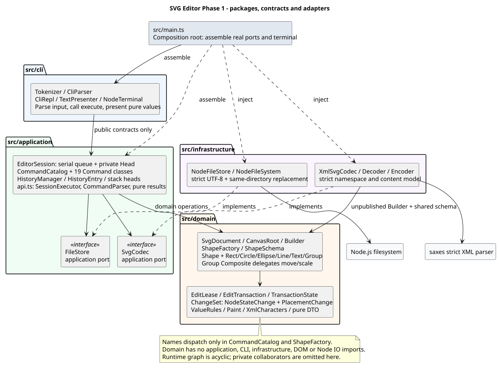
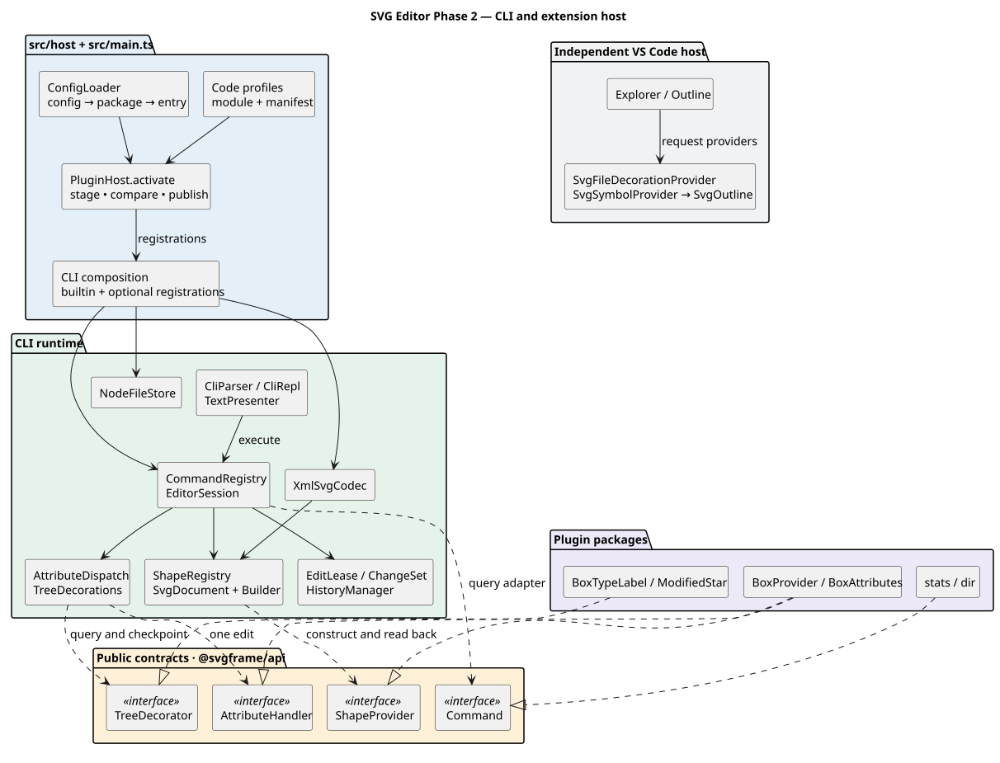
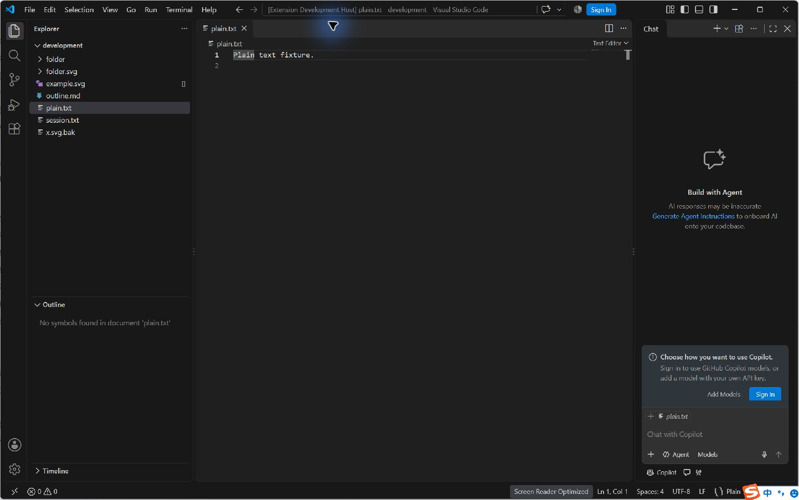
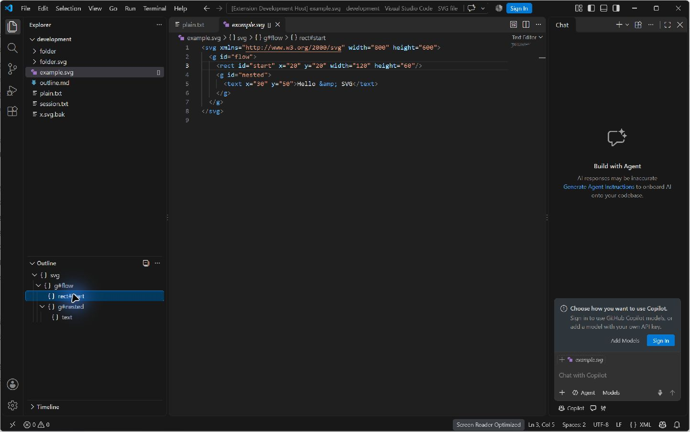

# SVG 编辑器 Phase 2 课程报告

在 Phase 1 中，画一个带标题的框需要分别创建矩形和文字，再把它们编成一组。Phase 2 把这项操作做成了 `box` 插件。输入 `create box n1 120 100 160 60 "开始"` 就能创建整个框，`move n1 0 100` 会让框体和标题一起移动。本阶段还为 VS Code 添加了 SVG 文件标记和大纲导航。

### 扩展点设计

#### CLI 的四个扩展点

创建图形、执行新命令、修改特殊属性和给树行加标签，各有一个扩展点。插件实现公开接口，编辑会话继续统一管理命令顺序、事务和撤销历史。

1. **`ShapeProvider` 管理一种图形的创建和读写。** 六种原图形通过 `NativeShapeProvider` 注册，复合框由 `BoxProvider` 注册。`BuiltinCommands.parseCreate` 按提供者声明的参数解析输入，`SvgDocument.create` 通过 `ShapeRegistry.plan` 和 `create` 建立图形。保存和读取时，`XmlSvgEncoder.node` 和 `XmlSvgDecoder.decode` 也查询这份注册表。未注册的类型会报 `UNKNOWN_SHAPE_TYPE`，重复的类型名或 XML 映射会被拒绝。如果构造器返回了错误的 ID、类型或所属文档，注册表会报 `INVALID_VALUE`。[接口](../src/domain/shapes/ShapeProvider.ts) · [注册表](../src/domain/shapes/ShapeRegistry.ts)
2. **`Command` 增加命令及其帮助信息。** `stats` 按深度优先顺序统计叶子图形和容器。一张只含一个 box 的画布会统计出一个矩形、一个文字节点和一个容器。`dir` 列出启动目录，即使尚未创建画布也可以使用。`CommandRegistry` 负责按名称查找和列出帮助，`PluginCommandBinding.bind` 检查参数，`EditorSession` 在会话队列里调用 `PluginQuery.run`。多给参数会报语法错误，执行结果不符合字符串数组约定时会报 `INVALID_COMMAND_RESULT`。关闭插件后，命令从 `help` 中消失，再调用会得到 `error: unknown command: <name>`。[接口](../src/application/contracts/Command.ts) · [命令绑定](../src/application/commands/PluginCommandBinding.ts) · [队列测试](../test/integration/registered-command.test.ts)
3. **`AttributeHandler` 定义属性应该改到哪里。** 普通矩形的 `fill` 改自身填色。对 box 执行 `set n1 fill red` 时，`BoxAttributes` 把颜色写入内部矩形，而 `set n1 label "处理数据"` 修改内部文字。`SetCommand.run` 调用 `AttributeDispatch.set` 查找处理器。没有匹配者时，沿用原图形允许修改的属性清单。多个处理器同时匹配时，程序在写入前报告 `ATTRIBUTE_CONFLICT`。[接口](../src/application/contracts/AttributeHandler.ts) · [调度实现](../src/application/commands/AttributeDispatch.ts)
4. **`TreeDecorator` 给树的每一行追加标签。** `TreeDecorations.apply` 把只读文档交给装饰器，`TextPresenter` 按登记顺序把结果放在行尾。`BoxTypeLabel` 用 `(box)` 标出复合框，`ModifiedStar` 用 `*` 标出尚未保存的变化。两者可以在同一行显示为 `g#n1 (box) *`。关闭装饰器时，`tree` 保留原有输出。装饰器抛错或返回多行标签时，本次树查询报告 `DECORATOR_FAILED`。[接口](../src/application/contracts/TreeDecorator.ts) · [标签组合](../src/application/session/TreeDecorations.ts)

#### VS Code 的两个扩展接口

VS Code 管理文件、编辑缓冲区、Explorer 和原生 Outline。扩展在 `activate` 中注册两个提供者，再由宿主按需调用。Explorer 请求文件装饰时，`SvgFileDecorationProvider` 同时检查小写 `.svg` 后缀和实际文件类型，因此文件 `example.svg` 会有 `[]` 标记，目录 `folder.svg` 没有。经典 Decorator 模式用同接口对象包装原对象并转发调用。这里的组合发生在 Explorer 绘制文件行时，提供者只交付徽标和提示信息，文件名和内容均由宿主管理。[文件标记实现](../extensions/svg-tools/src/SvgFileDecorationProvider.ts)

大纲使用了 Adapter 模式。`SvgOutline` 读取当前缓冲区，根据 XML 的开始和结束标签记录层级与 UTF-16 字符位置。`SvgSymbolProvider` 再把这些记录转换为宿主需要的 `DocumentSymbol`。符号按 XML 的父子关系排列，每个符号都记录整个元素的范围，点击时定位到它的开标签。这里复用了 Phase 1 的 `saxes` 解析库和栈遍历思路。CLI 读入文档时会给缺少 ID 的元素补名，领域树也不保留源码位置，而大纲必须能原样显示没有 ID 的 `text` 并跟随未保存的编辑，所以直接从当前文本生成符号树。[大纲适配器](../extensions/svg-tools/src/SvgSymbolProvider.ts) · [源码范围测试](../test/unit/svg-outline.test.ts)

### 插件装配方式

**方式 A 通过代码选择插件。** `src/host/code-profile.ts` 列出插件、清单和所属预设。基础模式保留 Phase 1 的 19 条命令和六种图形。`commands` 增加 `stats` 和 `dir`，`box` 启用复合框、它的属性处理器和类型标签，`demo` 启用全部五个插件包。[代码装配入口](../src/host/code-profile.ts)

**方式 B 通过配置文件选择插件。** 加载器按 `plugins` 数组的顺序处理每一项。`module` 可以是包名，也可以是相对于配置文件的目录。使用包名时按 ESM 规则解析，使用目录时从包清单的 `main` 查找入口。`enabled: false` 会在解析模块前跳过该项，`options` 以只读副本传给当前插件。下面的配置启用目录命令和复合框，关闭未保存星号。[完整演示配置](../plugins.config.json) · [配置加载器](../src/host/loader/ConfigLoader.ts)

```json
{
  "plugins": [
    { "module": "@svgframe/plugin-dir", "options": {} },
    { "module": "./plugins/shape-box" },
    { "module": "./plugins/tree-star", "enabled": false }
  ]
}
```

两种入口都调用 `PluginHost.activate`。每个插件在自己的 `package.json` 中用 `contributes` 声明提供的 `shapes`、`commands`、`attributes` 和 `decorators`，未填写的列表按空列表处理。例如 box 包同时声明图形 `box` 与处理器 `box-attributes`，宿主会核对这两项是否都已登记。[box 包清单](../plugins/shape-box/package.json) · [插件宿主](../src/host/loader/PluginHost.ts)

在仓库根目录用 Node 24 执行 `npm ci` 和 `npm run build` 后，可任选一种方式启动 CLI。

```sh
node dist/main.js
node dist/main.js --preset demo
node dist/main.js --config plugins.config.json
```

VS Code 扩展有独立的构建与启动入口。用 VS Code 打开仓库，选择 **Phase 2: SVG Extension** 后按 F5，启动任务会构建扩展并打开临时示例工作区。需要在单独的 VS Code 配置中安装时，可运行 `npm run build:vscode`，再用 **Developer: Install Extension from Location...** 选择 `extensions/svg-tools`。

### 重构前后的架构变化与设计决策

#### 从固定的命令表和图形工厂，到启动时注册

Phase 1 的 `CommandCatalog` 集中定义命令的名称、语法和绑定规则，`ShapeFactory` 集中创建六种图形。Phase 2 保留命令行、应用、领域和基础设施四层，将“这次启动要启用哪些能力”移到 `src/main.ts` 和 `src/host`。原命令的绑定保存在 `BuiltinCommands`，内置图形和插件图形共用一份注册表。插件依赖 `@svgframe/api` 的公开接口，文档、历史和 CLI 显示层可以各自演进。





两张组件图均由 PlantUML 渲染。可用 `npm run doc:diagram` 和 `npm run doc:diagram -- --phase2` 分别重建。[Phase 1 图源](architecture.puml) · [Phase 2 图源](phase2/architecture.puml) · [渲染记录](phase2/architecture.meta.json)

为检查新图形能否独立接入，我们从同一提交 `83028b2` 做了两次 box 实验。代码方式的提交 `1f37244` 只改动一处已有运行代码，即顶层装配文件。配置方式的提交 `bd981ac` 通过修改根配置启用新包。两份 box 包的 Git tree ID 相同，锁文件差异只涉及新增工作区包及其链接。检查脚本对六个插件接入提交逐一核对完整差异，并确认受保护的内核、加载器和已有插件路径确实存在。按同一脚本从 Git 统计，CLI 生产代码从 3,997 行增至 5,302 行，函数圈复杂度之和从 1,005 增至 1,372。插件占 341 行，VS Code 扩展的 107 行单独统计。[Git 差异检查](../scripts/check-plugin-diffs.mjs) · [按文件和类别生成的指标](../docs/metrics/README.md)

#### 四项设计决策

- **ADR-01　一次属性修改对应一次撤销。** 唯一匹配的处理器在当前事务内获得临时写权限，只能访问目标和直接子部件。即使要修改两个部件，成功后也只记一条历史。第二处写入失败时，第一处也回滚。撤销和重做使用已保存的变更，避免再次执行处理器。[事务与历史测试](../test/integration/attribute-handler.test.ts)
- **ADR-02　让普通 SVG 阅读器也能打开 box。** 框保存为 `<g data-kind="box">`，矩形和标题的 ID 分别是 `<id>-rect` 和 `<id>-label`。启用插件时，读入后恢复复合框，拒绝缺件、类型错误和重复 ID。关闭插件时，文件仍能按普通分组读入，孩子与元数据得到保留。允许移动或删除整框，直接拆出必要子部件及对 box 解组会被拒绝。[创建与读回测试](../test/integration/box-roundtrip.test.ts)
- **ADR-03　星号表示内容与保存点有差异。** 每个装饰器实例记录上次成功保存或读入时的属性、文字、父级和孩子顺序。新建节点立即带星，子节点变化会向祖先传播。撤销回到保存内容时星号消失，重做后重新出现。失败或结果不确定的保存不会清星。多个标签按注册顺序显示。[星号状态机](../test/unit/star-plugin.test.ts) · [保存点测试](../test/integration/star-checkpoints.test.ts)
- **ADR-04　每个插件整包生效。** 宿主先暂存登记，激活结束后再将四类名称逐项与清单比较。名称重复、清单不符或激活抛错时，丢弃这个包的全部登记，继续加载后面的包。配置文件自身不合法时，以默认内置能力启动。例如一个坏包已经登记图形、随后登记属性失败，用户也不会看见半个可用的插件。[加载器故障测试](../test/e2e/plugin-loader.test.ts)

`dir` 体现了依赖方向怎样落实到代码。命令面向 `DirectoryReader` 接口，`NodeDirectoryReader` 负责把 Node 的 `readdir` 和 `Dirent` 适配为名称与类别。这样可以单独检查排序和格式，再用真实文件系统检查文件类型。命令列出启动目录的直接子项，包含隐藏项，目录排在文件之前，同组按名称排序，略过符号链接及其他特殊项。读取失败后仍可继续执行下一条命令。[适配器](../plugins/dir/src/NodeDirectoryReader.ts) · [替身与真实目录测试](../test/integration/dir-plugin.test.ts)

#### 与 AI 协作时的检查和修正

开发大纲前，我先让 AI 观察原生大纲。Markdown 标题能在点击后跳转，未保存的改名也会立即反映在大纲中。同一窗口以文本方式打开 SVG 时，原生大纲没有符号。第一版扩展已经能返回正确的符号和源码范围，但实际点击 `rect#start` 时，VS Code 又打开了图像预览。AI 用带选区的 `vscode.open` 调用复现了错误，再修改扩展清单，为 SVG 提供默认文本编辑器关联。重载后重做同一次点击，状态栏才显示第 3 行第 5 列。[原生对照](phase2/native-svg.jpg) · [修正前画面](phase2/navigation-before.jpg) · [宿主回归测试](../extensions/svg-tools/test/host.ts)

双装配的检查也发现了单个插件测试看不到的问题。`stats` 和 `dir` 各自执行正确，两种方式的 `help` 却按相反顺序列出它们。我们把完整输出按字节比较，固定失败用例后统一登记顺序。验证 box 时还出现过一次分支切换与终端执行重叠，程序读到了另一份配置。那次结果作废，改为在两个独立检出中分别安装、构建和运行，同时核对创建反馈、标准错误和退出码。[装配顺序回归](../test/e2e/assembly-order.test.ts) · [过程记录](PROGRESS.md)

#### 测试与验证材料

- **插件与加载器测试。** 五个插件包各有针对自身行为的用例，覆盖统计顺序、目录排序、复合框的创建与属性、类型标签和未保存标记。加载器测试用“正常包、坏包、正常包”的顺序检查模块找不到、缺少默认导出、清单不符和激活抛错，并额外验证重复注册、整包回滚和后续正常命令仍能执行。[stats](../test/unit/stats-plugin.test.ts) · [dir](../test/integration/dir-plugin.test.ts) · [box](../test/unit/box-plugin.test.ts) · [类型标签](../test/unit/box-label.test.ts) · [星号](../test/unit/star-plugin.test.ts) · [宿主注册](../test/unit/plugin-host.test.ts) · [加载器进程测试](../test/e2e/plugin-loader.test.ts)
- **功能兼容性验证。** 运行 `npm run test:p2:assemblies`，脚本会启动 24 次编译后的 CLI 进程。基础会话、旧流程图、帮助和树输出与 Phase 1 的 `final` 作对照。box 流程图和新插件会话在相同工作目录下对照两套装配，逐项检查退出码、标准输出、标准错误及保存的 SVG。独立 XML 检查还核对了流程图的 8 个节点、两个框的标记、填色和撤销后的中文标题。[会话输入与手写期望](transcript/) · [验证脚本](../scripts/test-assemblies.mjs) · [测试报告](TEST_REPORT.md)
- **VS Code 扩展运行截图。** 下列两张图拍自 VS Code 1.147.0 的扩展开发宿主。第一张在选中普通文本时检查 Explorer 的徽标，第二张同时显示大纲中的 `rect#start`、源码和跳转行号。另有同一窗口未保存改名并插行、故意使 XML 残缺、补回结束标签后恢复导航的记录。[未保存编辑](../docs/images/p2-vscode-edited.jpg) · [残缺 XML](../docs/images/p2-vscode-incomplete.jpg) · [同窗恢复](../docs/images/p2-vscode-recovered.jpg) · [截图和构建摘要](phase2/vscode-evidence.json)





代码候选 `dbcb050` 已在干净检出中完成 798 项测试，0 失败、0 跳过，另有 9 项性能检查。真实宿主测试可用 `npm run test:vscode:host` 复验，完整检查使用 `npm run verify`。[需求与测试对照](TEST_TRACEABILITY.md) · [验收摘要](phase2/acceptance.md)

# SVG 编辑器 Phase 1 课程报告

本项目使用 TypeScript 实现命令行 SVG 编辑器，支持 19 个命令、6 类图形和 36 个合法的 `set` 类型与属性组合。设计以课程要求和已确认的需求决策为依据，采用面向对象模型，将命令行交互、编辑协调、图形行为和文件读写分开。

### 架构方案

| #   | 项                 | 要求                                                                                           |
| --- | ------------------ | ---------------------------------------------------------------------------------------------- |
| 1   | **模块划分**       | 打算把代码分成哪几个模块（目录），**每个模块的职责**；附一张图（PlantUML 组件图或包图）        |
| 2   | **设计模式的选择** | 你认为应该采用什么设计模式？代码中是如何落地的？（要求使用 Command 模式）                      |
| 3   | **依赖方向规则**   | 明确写出“哪些模块可以依赖哪些模块”及理由；违反规则的依赖即为待处理项                           |
| 4   | **变化点假设**     | **你认为未来最可能发生变化的是哪几处**？逐条列出，并说明你为它留了什么——或者**为什么决定不留** |

#### 1. 模块划分

工程分为四层，另设一个程序装配入口：

- **`src/cli`：命令行交互。** `Tokenizer` 和 `CliParser` 将输入转换为结构化请求，`CliRepl` 逐行调用应用入口，`TextPresenter` 和 `NodeTerminal` 负责显示结果。这里处理引号、注释、提示符和输出流，不决定图形怎样移动或怎样撤销。
- **`src/application`：编辑协调。** `EditorSession` 是统一执行入口，负责请求排队、事务提交、历史、保存点和当前文件路径。`CommandCatalog` 管理命令定义，具体命令类调用领域行为；`HistoryManager` 管理撤销、重做和历史屏障。文件与 SVG 编解码能力通过本层定义的接口接入。
- **`src/domain`：文档与图形。** `SvgDocument` 维护树结构、活动 ID 索引和整体约束；`CanvasRoot` 表示画布；六个图形类实现各自的几何和属性行为。事务与变更记录也在本层，保证多步操作能够完整撤销或回滚。
- **`src/infrastructure`：具体读写实现。** `XmlSvgCodec` 负责 SVG 解析、校验和序列化；`NodeFileStore` 负责路径、UTF-8 文件读写及替换。解析库和文件系统的细节封装在这里。
- **`src/main.ts`：程序装配。** 创建上述对象，注入真实的编解码器、文件存储和资源限制，再启动命令行。它只连接模块，不承载编辑规则。


图中列出了实际目录和主要协作者，省略了私有辅助类。[PlantUML 源码](architecture.puml) 与[渲染信息](architecture.meta.json)一并保存在仓库中，可通过 `npm run doc:diagram` 重新生成。

一次普通编辑的流程是：命令行解析输入 → `EditorSession.execute` 接收请求 → 命令对象调用文档或图形行为 → 事务收集变化 → 准备好历史和返回结果 → 统一提交 → 命令行显示结果。这样，图形已经修改而历史尚未更新的中间状态不会被其他请求看到。

#### 2. 设计模式的选择

**Command 模式将一条用户命令封装成一个对象。** 创建、移动、分组等命令各有对应的类，`CommandCatalog` 统一提供命令名、语法、帮助信息和绑定规则。解析器不再维护另一套命令分派。所有入口都调用 `EditorSession.execute`，以后增加其他客户端时，可以直接提交结构化请求，不必先拼接 CLI 字符串。

**Composite 模式统一处理叶子图形和容器。** 矩形、圆、椭圆、直线、文本和 Group 都属于 `Shape` 层次。Group 的移动和缩放递归作用于后代，因此移动一个“矩形加文字”的节点，只需操作它们所在的组。Group 的 `set` 只修改自身属性，子节点是否受到颜色等变化的影响，遵循 SVG 的继承规则；已有的显式样式不会被批量覆盖。

**工厂模式集中管理图形创建。** `ShapeFactory` 负责类型名与图形类的对应关系，`ShapeSchema` 提供共享的属性定义。图形行为仍由各个类实现，避免解析、序列化和几何操作各自重复一份类型判断。

**事务和可逆变更记录负责可靠恢复。** `EditTransaction` 是已发布文档的修改入口，控制端 `EditLease` 负责准备、提交和回滚。`ChangeSet` 只组合两类记录：`NodeStateChange` 保存节点自身字段的前后值，`PlacementChange` 保存节点的父容器和位置。撤销重放这些真实变化，不重新执行原命令，也不通过反向计算猜测旧值。例如，缩放后的撤销直接恢复原数值，避免“再乘倒数”带来的浮点误差。

应用层在正式提交前准备好下一份历史、会话状态和返回结果，最后同步发布。dry-run 使用同一条编辑路径，取得只读预览后回滚，不改变已提交状态。如果内部故障使完整恢复无法得到保证，会话进入故障态，禁止继续编辑和保存不可信内容，直到成功的 `init` 或 `read` 建立新文档。

#### 3. 依赖方向规则

依赖方向遵循以下规则，包括只用于类型声明的导入：

1. **Domain 只依赖领域内部的模型、值和契约。** 它不能依赖 Application、CLI、具体基础设施、Node 文件接口或 XML DOM。图形行为因此可以脱离终端和解析库独立使用。
2. **Application 可以依赖 Domain 和自身定义的端口，不能依赖具体基础设施。** `EditorSession` 只知道 `SvgCodec`、`FileStore` 的约定，不知道它们使用什么 XML 库、怎样访问磁盘。
3. **CLI 通过应用公开入口执行操作，只读取返回的数据描述。** 它可以引用必要的纯值类型，但不能取得可修改的 `Shape`、`SvgDocument` 或事务权限。以后更换交互界面时，不会绕过历史和校验规则。
4. **Infrastructure 可以实现应用端口，并使用领域 Builder、共享规则和数据描述。** XML 节点和文件句柄不能穿过这些边界进入业务模型。
5. **main 可以依赖各层来完成装配。** 运行环境和具体依赖在这里确定，再注入所需对象；业务代码不自行读取全局配置来改变编辑语义。

会话状态也有明确归属：文档持有图形内容，Session 持有路径、保存点和历史；未来的选择、鼠标悬停和视图缩放属于交互或视图状态，不混入 SVG 文档。当前内容身份用于判断是否有未保存修改，会话版本用于标记已发布的状态变化，二者不能混用。空编辑不增加撤销条目、不清空 Redo；如果它解除了历史屏障，会话版本仍会增加。

保存需要单独处理外部结果。文件存储先写完同目录临时文件并关闭，再替换目标；应用层区分“已提交”“确认未提交”和“结果不确定”，只在确认成功后更新保存点和路径。成功保存后的终端输出失败不会回滚文件，也不会自动重试保存。

#### 4. 变化点假设

1. **命令和图形种类会增加。** 命令定义集中在 `CommandCatalog`，图形创建与属性定义集中在 `ShapeFactory`、`ShapeSchema`。这两处按名称分派明确标为后续待重构点，可逐步演化为注册机制；当前先保持内置类型的简单实现，不增加动态插件管理器。
2. **交互方式可能从 CLI 扩展到 GUI 或 Agent。** 结构化请求、统一执行入口和只读结果允许复用编辑核心。当前没有引入选择、命中测试或内嵌渲染器，因为课程阶段不需要这些能力，也没有必要提前维护它们的状态。
3. **SVG 兼容范围可能扩大。** 当前只支持六类图形及明确列出的属性，所有图形处在统一坐标空间；未支持的 transform、CSS 和外部资源会被拒绝。以后若支持完整变换，需要统一设计坐标空间和矩阵规则，不能把未知属性直接透传。当前承诺支持子集内的语义往返，不承诺保留原文件的缩进、注释和属性顺序。
4. **文件存储方式可能变化。** `FileStore` 隔离了实际读写方式，但替换实现仍须遵守保存结果三态的契约。没有提前加入云存储、网络协议或历史持久化，以免扩大本阶段范围。
5. **更大的文档可能需要优化。** 当前使用子节点数组和活动 ID 索引，普通叶子编辑只记录相关状态，历史通过共享栈尾更新栈头。结构操作仍可能受兄弟节点数量影响，分组不承诺统一的常数或线性成本；删除子树在可撤销期间也必须保留其内容。更复杂的批量结构和历史容量策略留待真实瓶颈出现后再设计。

### 过程记录

讨论包括[讨论架构设计与测试](chatgpt-conversation://6adccf5d-4ed0-83ec-b706-9e5d5d974489)（需求与初稿）、[分支 · 讨论架构设计与测试](chatgpt-conversation://6adce057-9858-83ec-857a-dd40193650d7)（架构审查）、[分支 · 讨论架构设计与测试](chatgpt-conversation://6adce8f8-73b4-83ee-99b7-d1e1f87c5399)（接口与流程定稿），以及[生成测试方案](chatgpt-conversation://6adcf3f6-60ac-83e8-8138-57626e5f50a8)。这些讨论对最终实现的影响，主要体现在以下几个方面。

#### 先消除需求歧义，再选择架构

讨论最初比较了参考开源设计与让 AI 自行设计的取舍，也提出了“完整测试之外，还能怎样保证质量”的问题。本项目借鉴的是职责和状态边界，没有引入完整的开源编辑器框架。随后，我没有直接要求 AI 生成代码，而是先让它分析课程要求，整理缩放、跨父分组、层序、样式继承、历史屏障、空操作、SVG 范围、补 ID、保存路径和画布修改等十项决策。确认这些决定后，我又要求它从常见办公和绘图软件的使用习惯出发检查操作是否容易理解。

这一步使实现有了稳定的行为依据。例如，分组按原文档顺序排列孩子，而不是按命令参数顺序排列；修改画布尺寸不缩放已有图形；无参数保存使用最近成功读写的路径。对于保存后清空历史、根级 Group 不能解组等课程特有规则，仍然遵守实验要求，并在文档中明确说明，避免为了模仿其他软件而改变题意。

#### 用专项审查修正初版架构的乐观假设

我要求 AI 在给出初步方案后继续检查设计缺陷，并从 CLI 耦合、事务、历史、SVG 兼容、文件 IO、扩展和性能等十五个方面重新审查。审查后的一个关键结论是：有了四层目录和几个模式，并不表示模块之间的契约已经完整。

例如，直接修改图形坐标与保留任意 SVG transform 并不兼容；仅预留一个图形工厂，也不能保证未来的 `box` 插件完全不改内核。前者促使方案明确采用严格 SVG 子集，后者则使插件扩展从“已经具备的能力”调整为“需要继续设计的变化点”。这些修订进入了 v0.2 架构，避免把方向性的建议当作已经解决的问题。

#### 通过具体状态变化补齐接口与提交边界

在 v0.2 基础上，我要求进一步细化 `EditorSession`、`SvgDocument`、`Shape`、`EditTransaction`、`ChangeSet` 和 `HistoryManager`，并分别推演正常编辑、中途失败、dry-run、撤销重做、读取失败和保存结果三态。

最重要的修正是把“领域修改完成”和“会话正式提交”分开。即使图形已经改对，如果随后创建历史或返回结果失败，整个命令仍不能留下半提交状态。因此，最终方案要求先准备完整的发布状态，再用一个短的同步步骤统一提交。

结构操作也用手算反例确认。例如，根节点为 `[A, P, D, Z]`、`P` 的孩子为 `[B, C]`，执行 `group G D B` 后，G 的孩子应为 `[B, D]`。G 最终位于根的索引 2，但创建时插入的是索引 3；历史必须记录当时的位置，不能用最终位置覆盖。这个例子帮助确认了分组算法和撤销日志的含义。

#### 让测试独立于实现，而不是相互证明

进入测试设计后，讨论重点从“要写多少测试”转向“怎样判断预期是正确的”。我们区分了文档语义相等、内部对象身份相等和完整会话不变。例如，Undo 应恢复内容，但会话版本仍增加；缺失 `fill` 与显式 `fill="black"` 也不能合并为同一种状态。

讨论还纠正了两个容易采用的简单假设：group 与 ungroup 不是通用逆操作；编码器和解码器往返成功也不能单独证明正确，因为它们可能同时丢掉同一属性。因此，测试同时使用手写预期、独立 XML 解析、故障注入和另一种实现方式的参考模型。生产代码使用细粒度变更日志，参考模型则用简单节点记录和内容快照，减少共同犯错的可能。

最后，将课程要求、实现规范、测试方案和分阶段执行说明分成四份文档，让 Codex 持续完成“实现一个增量、运行相关测试、修复、审查差异、本地提交”的循环。测试随功能接入，实际失败和随机反例保留用于回归，而不是等代码全部完成后再统一补测试。

#### 用实现中的反例检验设计是否真正落地

实际复核发现，早期创建预览只有 ID 和位置，不能说明将创建什么内容。修正后，变更记录在写入前保存图形的只读摘要；预览回滚和后续编辑都不能改变已经返回的描述。另一个问题是新建文档的候选构建失败曾错误地影响旧会话的故障状态，修正后只有已发布文档的完整性受到破坏时才进入故障态。

参考模型本身也接受校验。模型曾把“注入了保存结果不确定”误当作“保存一定已经进入文件 IO”，但没有保存路径的请求可能更早失败。修复依据是请求的实际执行边界，而不是修改产品预期来迎合模型。

真实符号链接测试还说明，环境限制必须与产品结果分开。测试一度因为系统权限无法创建链接夹具，此时没有用模拟文件类型的通过来替代真实测试。开启 Windows 开发者模式后，原测试在不改断言的情况下通过。它验证的是完整的真实路径，而不是一个被放宽的要求。

### 一致性自查

1. **模块划分：实际目录与方案一致。** CLI、Application、Domain、Infrastructure 和 main 的职责均按上述边界落实。实现时将编解码器、历史和事务进一步拆成小类，属于层内细化；`CanvasRoot` 与普通图形分开，避免用特殊字符串冒充根节点。预览摘要的补充保持了原有两类变更记录，没有引入第三套修改机制。代码中的类层次、Command 和 Composite 行为与 PlantUML 图一致，未加入本阶段范围外的 GUI 或 `box` 插件。相关修订已记录在[实现进度](PROGRESS.md)和[架构复核](ARCHITECTURE_REVIEW.md)中。
2. **依赖方向：自动检查与源码抽查均符合方案。** `main.ts` 负责注入具体实现，`EditorSession` 通过端口使用文件与 Codec 能力，CLI 通过应用公开入口执行请求，领域类不引用 XML 解析器或文件系统。依赖检查覆盖类型导入、路径别名和运行期环，并用 13 条主动植入的违规依赖检验规则确实有效。当前没有已知未处理的分层违规；命令与图形的两处名称分派仍按课程要求标记为后续待重构点。

### 质量保证手段

#### 从需求、状态和故障三个方面确认功能完整

测试覆盖全部 19 个命令、6 类图形、36 个合法 `set` 组合，以及非法输入、属性存在性、层级顺序和资源边界。对复杂行为，不只检查成功输出，还检查失败后的文档、历史、保存点和后续合法操作是否正确。

撤销重做测试会区分同名但不同代的对象；故障注入会覆盖修改中途、事务准备后、回放中途和结果构造失败。保存测试分别模拟确认未提交、确认提交和结果不确定，并核对真实文件可能保留旧值或已经替换的情况。真实进程测试则从编译后的入口运行课程会话，验证 CLI、应用、Codec 和文件存储能够一起工作。

16 项属性测试和独立状态机进一步检查随机组合。release 档对每项属性分别运行固定与新 seed，各 1,000 次；模型对每个 seed 运行 500 组、每组最多 200 条命令，另有真实文件短序列。故意生成的非法请求也实际执行。若出现失败，会保留随机种子、缩减路径和最小具体序列，便于复现和固定为回归。

需求与用例的对应关系见[测试追踪](TEST_TRACEABILITY.md)，完整结果、故障案例和环境说明见[测试报告](TEST_REPORT.md)。需求复核与实现检查分开进行，但由同一执行者完成，没有把它描述为另一位审查者的独立背书。可选变异测试及其他平台验证尚未执行，不计入通过结果。

#### 用静态检查、覆盖率和性能证据补充功能测试

TypeScript 严格类型检查、ESLint、Prettier 和依赖规则检查共同约束代码结构。覆盖率统计包含全部生产代码，只排除没有可执行语句的类型文件；入口 `main.ts` 因子进程覆盖率未合并而保留为 0，没有为了提高比例把它排除。

已验证代码候选的 767 项测试全部通过，0 失败、0 跳过。语句覆盖率为 **95.67%**，行覆盖率为 **97.18%**，分支覆盖率为 **92.86%**；领域、历史和 Session 各自也达到已确定的门槛。覆盖率用于发现遗漏，不能代替对关键断言和故障分支的逐项审查。

8 项性能检查在不同文档规模下观察耗时和内存变化，并验证普通叶子编辑不复制或编码整份文档、历史更新不复制整栈等结构性要求。性能报告保留重复采样结果，不把某台机器上的固定毫秒数当作通用保证，也不声称一次垃圾回收就必须释放所有历史对象。

#### 保留可复验的版本与可视证据

上述完整检查已经在代码候选 `0cdf2c4d2f6e2fdea442019a8e979a8e22fe641e` 的干净检出中完成，包括锁文件安装、构建、完整验证和 release 随机档。对应的[验收收据](../artifacts/acceptance/0cdf2c4d2f6e2fdea442019a8e979a8e22fe641e.json)保存在本地忽略目录，记录准确版本、执行命令和证据路径。收据在验证完成后单独生成，不再改动被测提交。

本报告已由用户确认。最终交付使用包含本报告的新提交；该提交须在干净检出中复验，`final` 标签只指向全部检查通过的准确版本。对应收据在提交后独立保存，不把旧候选结果当作新提交的验证证明。

在仓库根目录可运行：

```powershell
npm ci
npm run cli
```

完整自动检查使用 `npm run verify`，release 随机档使用 `npm run random:release`；形成最终提交后，可在干净检出中运行 `npm run candidate:verify -- <完整40位SHA>` 生成对应收据。

[流程图 SVG](examples/flowchart.svg)和[六类图形 SVG](examples/gallery.svg)由真实 CLI 保存并读回，已经在浏览器中检查位置、文字、遮挡顺序和样式继承。[流程图截图](examples/flowchart.preview.png)与[六类图形截图](examples/gallery.preview.png)保留了实际效果。验收时可以先核对版本和报告，再运行命令、打开 SVG，对照这些结果检查编辑行为。
