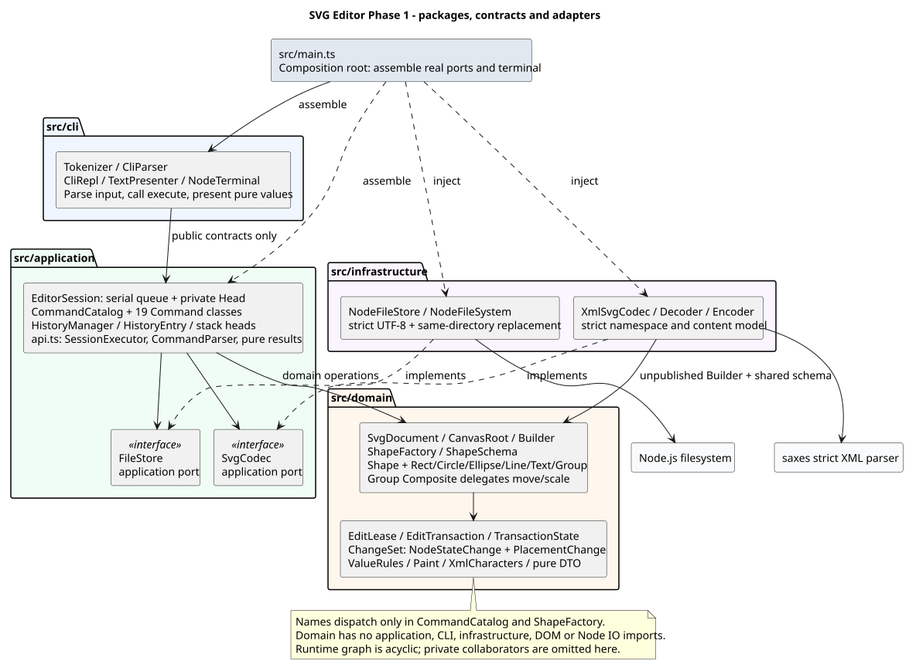
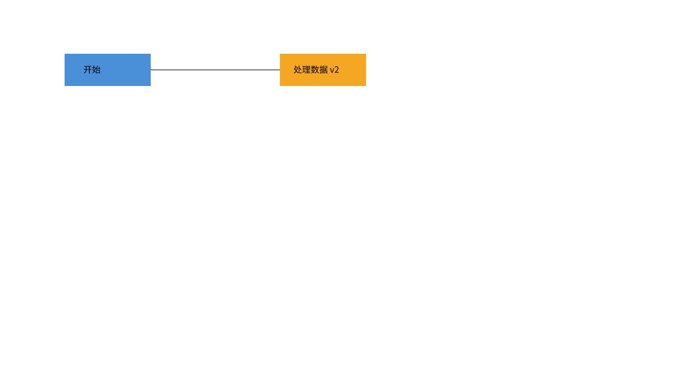
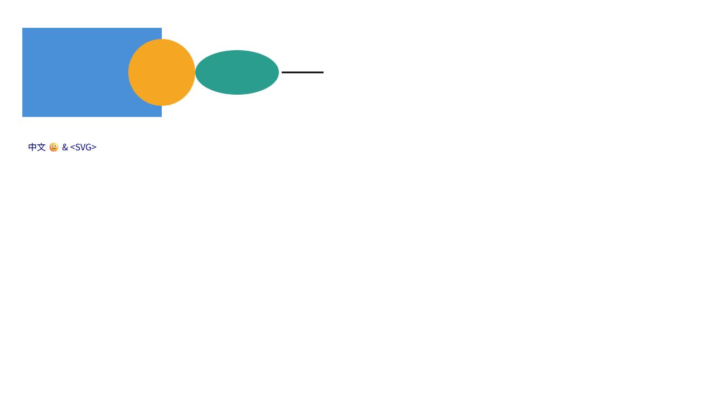

# SVG 编辑器 Phase 1 课程报告

本项目是 TypeScript OO 的本地 CLI SVG 编辑器。实现 19 个命令、六类图形和 36 个合法 set 组合；以 Command、Composite、可补偿事务和身份历史维持编辑、撤销、预览及文件发布的一致性。产品基线来自原有 LAB 和 SPEC v1.0，测试编号来自 TEST v1.0，执行与 CFG 默认值按 EXEC-P1 v1.0，原文保存在 [spec](spec/)。外围选择见 [INPUT_PROFILE.md](INPUT_PROFILE.md)。

本报告记录候选提交前已经发生的验证。2026-10-25 用户开启开发者模式后，原 FS-10 及同文件 19 项全部通过；完整 verify 的 767 项全部通过、0 failed、0 skip，315 个 local_required 全绿。此前系统 EPERM 与 BLOCKED 收据保留为过程证据。READY_FOR_USER_REVIEW 必须由最后提交后的精确 SHA 干净检出收据确认。最终提交 SHA、干净检出及 release 档的结果只写入提交外 `artifacts/acceptance/<完整SHA>.json`，以实际收据为准，不把本报告早期结果冒充最终验证。尚未推送、创建远程/PR、发布或创建/移动 final 标签；用户验收不由测试结果替代。

## 运行与复验

本轮环境为 Windows x64、Node.js v24.14.0、npm 11.9.0。使用仓库根目录和锁文件安装：

```powershell
npm ci
npm run build
npm run cli
```

交互输入示例：

```text
init 400 300
create g node
create rect card 40 50 160 60 #4a90d9 in node
create text label 60 85 "开始" in node
move node 10 20
undo
set label text "开始 v2"
save demo.svg
read demo.svg
tree
```

全部名称为 `init read save canvas create delete move scale set group ungroup addto front back tree show help undo redo`，语法由 `help` 列出。`addto containerId id`；`group newId id1 id2 ...` 至少两个不同目标；顶层 Group 不能 ungroup。CLI 是逐行命令输入，EOF 等待已经接受的操作完成。stdin/stdout 均为 TTY 才有提示符，管道无 banner；用户命令错误写 stderr 并继续下一行，致命输出失败或 EOF 仍 poisoned 时退出 1。

双引号包围完整参数，内部只转义 `\"` 和 `\\`；单引号没有特殊含义。只有首个非空白字符为 `#` 的整行是注释。可使用中文、emoji、空格路径；路径相对启动 cwd 稳定解析，不展开 `~`、`$VAR` 或 `%VAR%`。禁止把未引用的空格文本当成一个参数。API dry-run 是 `execute(request, {mode: 'dry-run'})`，没有另增 CLI 预览指令。

```powershell
npm run verify:stage -- M14
npm run verify
npm run random:ci
npm run random:release
# 完成最后提交后，在该完整 SHA 的干净检出中运行：
npm run candidate:verify -- <完整40位SHA>
```

`verify:stage` 检查到期项；`verify` 包含 strict、lint、格式、依赖、构建、全部测试及 local 随机、覆盖率、性能和全部 local_required 追踪。它会保留每步退出码并继续独立检查，整体失败仍退出 1。重放诊断参数不允许带入完整门禁。每次运行在 `artifacts/verification/runs/` 独立保存日志和 JSON，`latest-*.json` 只是索引。FS-10 的系统能力阻塞已解除，仍以完整门禁及新精确 SHA 收据判定候选。

可独立运行 `test:unit`、`test:integration`、`test:e2e`、`test:property`、`test:model`、`test:coverage`、`test:performance`、`check:deps`、`check:traceability`。随机失败保存 seed/path/replayPath、初态、配额、最小具体请求和逐步差异；具体固定反例通过 `MODEL_REPLAY_FILE` 交给 `test:model`，生成器重放使用 `FC_TARGET`、`FC_SEED`、`FC_PATH`、`FC_REPLAY_PATH`，详细参数在失败 JSON 内。它们不适用于最终完整门禁。

## 架构方案



[PlantUML 源码](architecture.puml) 与 [渲染元数据](architecture.meta.json) 一并保存。图表示包和主要协作者，省略私有辅助类；箭头表示源代码依赖或 main 装配，接口适配方向有标注。使用本地 Java 21 和经 SHA-256 核验的官方 PlantUML 1.2026.8，smetana 布局，无在线图服务上传。`npm run doc:diagram` 可重新渲染，工具 jar 缓存在忽略目录；官方来源及 jar 摘要见元数据。此文档图包含编辑器子集以外的 SVG 绘图语法，作为文档查看，不作为编辑输入。

`src/main.ts` 仅装配真实 `NodeFileStore`、`XmlSvgCodec`、Catalog、Session、REPL 和 Node 终端/输入流，没有生产 stub。先建立 readline 的迭代器再等待首次输出，避免快速管道输入在监听建立前丢失。

`src/cli` 负责分词、请求解析、结果文字和逐行控制。Parser 通过应用 `CommandParser` 获取命令契约，Presenter 只看不可变 DTO。诊断、路径、ID、文本中的 C0/DEL/C1 被展示转义；不把错误堆栈或 XML 库内部消息输出给用户。CLI 不持 live Shape/Document/事务能力。

`src/application` 负责串行 execute、命令绑定、文档发布、历史/保存点/版本和错误效果。CommandCatalog 是唯一命令名称注册点，19 个类各自运行多态行为。领域编辑通过应用协调能力执行；Session 的 Head 和全部内部协调方法为运行期 `#` 私有。请求在入队时复制冻结，后续调用者修改不能改变已接受操作。所有请求，包括查询和失败，都经过同一串行链。

`src/domain` 拥有画布、Shape 树、活动 ID 索引、共享值规则、事务和两类变化记录。CanvasRoot 独立于 Shape，不借用保留 ID；ShapeFactory 是唯一图形名称分派点，ShapeSchema 提供创建、set、显示及 XML 属性元数据。Rect/Circle/Ellipse/Line/Text/Group 各类独立文件。Group 组合统一委托后代 move/scale，每个叶子恰好变换一次；Group set 只修改自身属性，保留子节点显式样式及缺失属性。

`src/infrastructure` 实现应用端口。Codec 以 saxes 严格解析 namespace/内容模型，将纯解析记录和全局显式 ID 预留完成后再构造未发布文档；Encoder 通过共享 schema 序列化纯描述，不读取应用 Head。FileStore 捕获稳定 cwd，严格 UTF-8，按实际累计字节限制读入，同目录独占临时文件写完关闭后替换。只清理由自身创建的 temp，不先删目标文件。

依赖向内：domain 不引用 application/cli/infrastructure/DOM/Node IO；application 不引用具体端口实现；CLI 依赖应用公开入口与纯值契约。类型引用也受层次规则限制；运行期导入图无环，类型层互引不等于运行期环。`check:deps` 检查文件名与类名、所有导入和别名、两处名称分派，并逐一植入 13 条禁止边确认规则真正检出。纯测试模型不导入生产 Factory、Validator、GroupPlan、ChangeSet 或 Codec 的行为。

### 模式、事务与发布

Command 把语法绑定与执行对象关联，Session 协调多态请求，不复制另一份命令名称 switch。Composite 让 Group 和叶子具有相同编辑接口；树结构、父关系、顺序和活动索引由文档维护。Factory 和 schema 集中类型创建/元数据，避免 Parser、Codec、几何层反复按类型分派。

Builder 只在未发布候选中写入；已经发布的文档必须持有效 EditTransaction。控制端 EditLease 与编辑端事务分离。只有 NodeStateChange（自身字段/文本）和 PlacementChange（父容器、位置或分离）两类记录；后者在写前捕获不可变自身摘要，用于完整创建预览。它们不保存整棵文档快照。ChangeSet 按实际方向回放，中途受控失败按反向补偿已执行原语。prepare 后仍可 rollback，无法证明完整恢复的部分原始写入或补偿失败进入 poisoned。

Session 在临界区之前准备 HistoryEntry、下一双栈头、下一 Head、纯结果和 warnings，随后同步终结事务并替换 Head，中间不 await 或 IO。只读 init/read 候选失败保留旧可信文档，不能错误 poison 原会话。dry-run 执行真实事务后回滚，预览不包含未来 StateId，内容、保存点、路径、历史、dirty、barrier、revision 全部不变。

历史记录保存原对象及精确 before/after，不用执行反向业务或乘倒数。不可变 HistoryStackNode 共享尾部，push/pop 只改栈头。StateId 和 saved StateId 决定 dirty，不能用几何相等或文件 hash 替代。undo/redo 增加 revision，内容身份回到原 token；init/read/save/canvas 实变建立屏障清历史。空编辑只解屏障，保留 Redo 且不改变内容身份和 revision；canvas 相同尺寸是完整 no-op。

save 在调用替换端口之前准备完整成功结果及下一 Head。`committed` 才发布新路径/保存点/屏障与版本；`not-committed` 保留旧 Head；`indeterminate` 返回 external-unknown，内存不发布且不重试，不能承诺物理文件仍旧。成功业务之后的呈现失败不会回滚已保存文件。external-unknown 不 poison；领域完整性故障为 untrusted，首次故障 revision+1、dirty=null，禁止编辑/历史/save和不可信树查询，只允许 help 与可信元数据诊断、init/read 恢复。

### SVG 子集、数据规则和变化点

只支持 svg 根与 rect/circle/ellipse/line/text/g；支持规范尺寸/viewBox、限定 paint 和保留只读 font-size/text-anchor/data-kind。text 是纯 XML 子文本；保留空白、CDATA 合并结果、CR 字符引用及显式属性存在性。拒绝 DTD/PI、未知 namespace/元素/属性、复杂 text 子节点、脚本/事件、CSS、transform；不先删除不支持内容再宣称导入成功。

缺失 ID 按前序、各标签计数补 `rect1` 等，先保留全文所有显式 ID，再选最小未使用正整数，跳过任何类型已占用的候选。ID 大小写敏感，重复或非法显式 ID 直接失败。仅补 ID 为 semanticRepair，dirty=true；排版/注释/viewBox 规范化不算语义修复。

数字使用完整十进制/科学计数词法，拒绝 NaN/Infinity/尾随垃圾/溢出。画布正尺寸，图形尺寸/半径/stroke-width 可为零；负坐标允许，-0 归一化，subnormal 合法，非零结果下溢成零拒绝。text 按 Unicode 标量计数和 XML 1.0 合法字符验证。五项 ResourceLimits 构造时冻结：输入字节、活动节点、树深度、text 长度、原始属性长度；历史分离子树不计活动节点。保存输出不裁剪，也不为输入字节上限逐次全文编码。

CommandCatalog 与 ShapeFactory 的两处显式按名分派均为后续待重构点，演化为注册机制前仍集中保留。变化点保留在 Catalog、Factory/schema、应用端口和 Presenter：后续注册式扩展可替换两处显式名称表；当前未加载插件或实现 box。新增图形时先补类/元数据和独立预期，再检查创建/set/XML/查询适用面。新增命令走 Command 契约和既有事务协调。未来 GUI 可作为另一应用客户端，持值描述而非 live 对象；本阶段没有新增 GUI、完整 CSS/transform 或额外 CLI 协议。

成本：普通叶子 move/set 不全文 describe/复制/encode/hash；Group 变换随目标后代 k；结构数组插删受兄弟数 s 影响；分组允许约定的 O(ks) 最坏成本。保存/读取随字节 B 和节点 n，查询全文描述 O(n)。删除子树在撤销历史持有时保留 O(k) 是必要语义；屏障/Redo 截断后可被回收，WeakMap 不形成永久全对象注册表。不承诺一次 GC 必定回收或跨机器固定毫秒。

## 过程记录

起始仓库无提交、无源码/测试/锁文件，仅四份用户原始规范；按原路径纳入来源基线。保留已有 Git 身份，在 `codex/phase1` 形成 M00—M14 的真实增量提交，历史由 `git log --reverse --oneline` 检查。

- M00—M05：工具和 CFG、值/不变量、事务/两类记录、六图形、结构/LCA 与精确位置日志、O(1) 历史栈头。测试随每个增量接入，M00 明确没有功能测试。
- M06—M10：Session 及 CLI 适配切片，完整内存编辑/no-op/dry-run/poisoned，独立 XML 编码预言机、严格解码与补 ID、真实 Codec 加可控边界端口的 read/save 三态与队列。
- M11—M13：正式真实文件/编译 CLI、LAB 会话、全部命令协议、独立平面节点/快照状态机、seed/path/replayPath 与具体反例重放。FS-10 在系统能力缺失期间保持必须失败项；用户开启开发者模式后原断言通过，未改为人工或 skip。
- M14：覆盖率、n/k/s/B 性能、架构植入负例、跨入口值与配额边界、逐编号复核及实际证据门禁；M15 补课程报告、PlantUML、真实浏览器预览和提交外精确版本收据。

代表性缺陷均保留先失败后修复的日志和回归：REG-LIMITS-01 拒绝不完整 limits；REG-CANDIDATE-01 修正失败候选误 poison 旧可信文档；REG-ROOT-PX-01 统一根与孩子 font-size 的 px 归一化；REG-PREVIEW-SHAPE-01 补 dry create 内容摘要并保持旧历史摘要稳定；REG-ARCH-CORE-01 修正依赖库将 node:crypto 规范为 crypto 后的 Node core 规则缺口。

两次独立模型自身错误也据来源修正：empty dirty 应为 false，create 的 -0 需规范化；注入 indeterminate 不表示无路径 save 已实际进入 IO。保留失败 seed/path/replayPath 和缩减请求，未修改正确产品预期。XML 测试预言机另按 XML 1.0 行尾规则校准，防止第三方解析器默认 XML 1.1 处理 NEL/U+2028 造成错误预期。追踪编号提取补 E2E 前缀数字回归，使全部 339 项可被检查。更多过程见 [PROGRESS.md](PROGRESS.md) 与 [ARCHITECTURE_REVIEW.md](ARCHITECTURE_REVIEW.md)。

## 一致性自查

实际目录/模式/公开接口与上图、SPEC 和 INPUT_PROFILE 对照；不存在 box、生产 stub、公开 setter、父子全文 Memento 或第二份命令/图形名称分派。Group set 保留继承/显式差异，group 按数值路径与 LCA、在最后相关原分支之后插组，ungroup 按逐步当时 index 提升。只追加向前修复提交，没有重写已有历史伪装无缺陷。

SPEC 已确认接口与权限保持；纯描述的 placement 摘要增加了受影响图形内容以满足预览契约，仍只有两类记录。只读 metadata 是普通 Group 属性，没有把 data-kind=box 升级为第三方插件图形。图是包/组件概览，不能代替权限和成本测试。完整矩阵 [traceability.json](traceability.json) 保留来源位置、断言、阶段、范围、审查、实际 case 与证据，不能把局部测试通过推广为整个未来阶段通过。

当前边界偏差只有交付时序：LAB 的推送/final/截止义务保留，按用户要求推迟到验收明确授权之后；来源未提供实际截止日期，不编造。Windows 是起始即确定的必须平台，未临时改为 Linux 以回避 FS-10；其他平台可选未执行。独立需求复核由同一执行者按单独来源审查顺序完成，没有虚构另一审查者背书。可选 mutation 未运行，无 mutation score。

## 质量保证手段

本次 V8 套件 767 项：767 passed、0 failed、0 skip；单元/回归 318、集成 417、属性 16、模型/回放/资源 7、真实进程 E2E 9。性能另有 8 项。此前失败发生在 `fs.symlink(target, link, 'file')` 创建夹具处；开启开发者模式后原断言现已实际通过；injected lstat 通过不能替代它。正常 Windows 的真实替换、严格 UTF-8、实际字节累积、碰撞/写/close/rename/清理错误和不确定物理 OLD/NEW 均有实际测试。

全生产范围覆盖率：语句 95.67% (1505/1573)、行 97.18% (1380/1420)、分支 92.86% (859/925)。门槛为全局语句/行 80%、分支 75%；domain/history/session 分别语句/行 90%、分支 85%。仅纯类型文件明确排除并由 AST 再核对；main.ts 保留为 0（子进程未合并到 V8 统计），未排除入口凑比例。本次完整套件已通过，最终准确版本的覆盖率和门禁状态仍由提交外收据绑定。

测试预期来自手算、独立数据表、通用 XML 解析器或纯平面模型。REG-GROUP/STATE/SAVE 精确断言位置日志、15 步状态和文件三态；36 set、6×2 创建、poisoned 全编辑/保存、早/中/晚故障均实际执行。模型用 testUid 区分同 ID 两代对象，历史只快照内容，revision/path/save token 单独计算；所有生成命令 check=true，非法操作也实际提交给系统。

随机档为 local：每性质 50 次、模型 30×最多40命令/30节点；ci：200、100×80/40；release：1000、500×200/60。每档固定 seed 20261025 加实际新 seed，16 个性质及独立 MODEL-IO 真文件短序列均纳入。M14 ci 档与 M15 候选前 release 档均已实际通过；候选精确 SHA 的 release 实际完成数量、命令长度与分类覆盖仍以最终收据及归档为准。失败归档不被后续成功运行覆盖。

性能按 n=100/1000/5000、3 次预热、11 次样本记录 33 组 median/p95、k/s/B、heap 和 3 类保留关系；验证普通叶子不全文编码/复制、历史栈不全复制、对象仍被历史保留及释放资格。基准记录源码摘要和环境，允许机器间时延差异；当前 Vitest worker 未暴露强制 GC，报告如实注明，未把“一次 GC 必须消失”作为虚假内存结论。

`artifacts/traceability/report.json` 拒绝到期 planned/active/implemented_unverified/blocked、缺 case/证据、必须项降级、空套件或跳过、过时源码证据；339 项中可选 20、验收后 3、候选收据 1 独立统计，不计通过。稳定阶段证据在 [TEST_REPORT.md](TEST_REPORT.md)，机器级原始日志与覆盖率在忽略目录，可由命令重建。

## 代表 SVG 与用户验收

[流程图 SVG](examples/flowchart.svg) 和 [六类图形 SVG](examples/gallery.svg) 由 `npm run doc:examples` 启动实际编译 CLI、真实 save/read 生成，两个均为 8 个节点，预序 ID 与手写集合核对。输入脚本和生成摘要保存在同目录；重跑从仓库根目录进行，会覆盖这两份明确的演示产物。





真实浏览器已经观察两幅图的位置、文字、层序和继承：流程图蓝/橙节点及连线、移动撤销后的原位、修改后的中文 v2；gallery 的圆覆盖矩形、椭圆、3 单位线及继承 navy 的中文/emoji/字面实体字符。截图与 SVG/source 摘要见 [preview.json](examples/preview.json)。沙箱内 localhost 首次超时，获批普通 Windows 的只读 loopback 服务成功；没有新增产品渲染器，也没有把截图当作完整自动语义测试。

验收步骤：

1. 核对提交外收据状态、完整 SHA、干净检出、release 结果和无跟踪文件变动；FS-10 必须包含真实链接和悬空链接的通过证据。
2. 用 `npm run cli` 重走上述示例，检查 tree/show/help、Undo/Redo、错误后继续及 save/read；在浏览器打开代表 SVG 比对截图。
3. 核对架构图、需求矩阵和测试报告，针对该精确 SHA 给出验收或修改意见。候选代码变化则重新提交并生成新 SHA 收据。
4. 用户明确验收并授权之后才处理远程 push 与 final；实际截止日期仍需以课程提供值核对，当前不创建或移动标签。

已知限制：严格 Phase 1 子集不导入一般复杂 SVG；无 GUI/box/CSS/transform/额外 CLI 参数协议。文件路径检查按冻结策略处理最终条目，不承诺抵御恶意并发换路径或断电持久性；不确定替换不自动重试。Windows 用户现已开启开发者模式，原真实链接门禁及同文件回归 19 项通过；此前能力失败与旧收据保留为过程证据。
