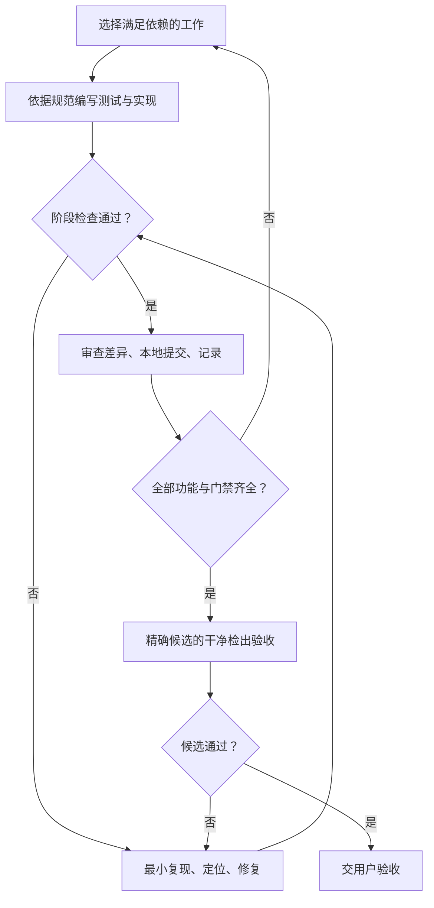

# SVG 编辑器 Phase 1：Codex 分步骤实现、测试与本地提交执行说明

**第四份项目文档：把需求、实现契约和测试方案转成可持续执行的开发任务**

- 版本：1.0。
- 配套基线：`phase_cli_1.md`、`SVG_Editor_Phase1_Implementation_Spec.md` v1.0、`SVG_Editor_Phase1_Test_Plan.md` v1.0。
- 建议文件名：`SVG_Editor_Phase1_Codex_Execution_Plan.md`。
- 建议工程位置：`doc/spec/SVG_Editor_Phase1_Codex_Execution_Plan.md`。
- 本文性质：执行设计，供 Codex 后续编写代码、测试、修复与提交。本文中的阶段、命令、配额和通过条件不是已经执行过的结果。
- 当前用户边界：先完成项目并形成有过程记录的**本地 Git 提交**，交用户验收；当前不推送远程仓库。
- 本文采用的标签时序：用户验收候选版本后再创建或核验本地 `final` 标签，然后按届时明确授权完成远程交付。这是执行安排，不是对实验最终提交义务的删除。

## 目录

1. [任务目标、文档职责与完成边界](#exec-01)
2. [推荐启动方式：Goal 与四份文档配合](#exec-02)
3. [仓库准备、长期上下文与 AGENTS.md](#exec-03)
4. [一次性确定的 P1 输入与环境细则](#exec-04)
5. [每个增量都执行的开发循环](#exec-05)
6. [M00—M15：逐阶段实现与验证](#exec-06)
7. [怎样把测试方案写成真正有效的测试](#exec-07)
8. [运行命令、随机配额与质量门槛](#exec-08)
9. [失败时如何自主定位与继续](#exec-09)
10. [本地 Git 提交与最终版本证据](#exec-10)
11. [进度记录、上下文恢复与暂停条件](#exec-11)
12. [本地候选的完成检查表](#exec-12)
13. [可直接使用的启动提示词](#exec-13)
14. [续跑、验收修正与验收后的提示词](#exec-14)
15. [来源、选择记录与使用说明](#exec-15)

<a id="exec-01"></a>

## 1. 任务目标、文档职责与完成边界

### 1.1 给 Codex 的具体目标

在实际项目仓库中完成符合 LAB/SPEC 的 TypeScript 面向对象 SVG 命令行编辑器，逐步建立测试，并留下真实、有意义的增量 Git 历史。最终交付：

- 可构建、可运行的 CLI：19 条命令、6 种图形、36 个合法 set 类型/属性组合及规定错误信息。
- 完整的文档、事务、结构编辑、历史、串行 Session、严格 SVG 编解码与文件读写实现。
- 需求驱动单元测试、集成测试、通用不变量、真实 CLI 端到端测试，以及属性测试和独立状态机模型。
- 严格类型、格式、lint、架构依赖检查和真实测试证据。
- `doc/README.md` 课程报告，包括 PlantUML 组件图或包图、模式落地、依赖规则、变化点、过程记录、一致性自查和质量保证。
- 已通过本轮门禁的本地候选提交、准确 SHA、启动和复验命令，以及绑定该候选的最终验证收据。

不新增 box 插件、GUI、完整 CSS/transform、JSONL 协议、历史持久化或其他下一阶段能力。API 的 dry-run 要实现，但不因此发明一条 `dryrun` CLI 命令。[LAB §1—§6；SPEC §1.5、§6—§13；TEST §1、§19—§20]

### 1.2 四份文档分别解决什么问题

| 标记 | 文档 | Codex 应当用它决定什么 |
| --- | --- | --- |
| LAB | `phase_cli_1.md` | 必须做什么：命令、OO 范式、两处分派、输出、课程报告与最终 Git 交付 |
| SPEC | `SVG_Editor_Phase1_Implementation_Spec.md` | 应当怎样实现：D01—D10、架构、接口、权限、事务、历史、IO 与支持范围 |
| TEST | `SVG_Editor_Phase1_Test_Plan.md` | 怎样证明正确：测试 ID、预期、夹具、不变量、性质、模型、故障与验收 |
| EXEC | 本文 | 怎样连续推进：依赖顺序、每阶段门禁、失败处理、提交、恢复、完成条件 |

四份文档应同时提供。Goal 负责维持工作目标；文档负责定义正确性和边界；仓库中的进度与证据负责续跑。四者互相配合。

项目会话中已经确认的有效决策以 SPEC 的 D01—D10 和最终契约为入口。不要假设另一个 Codex 会话天然可见当前 ChatGPT 项目的全部对话；也不要让早期讨论草案覆盖已经定稿的 SPEC。[SPEC §1—§2、§16]

### 1.3 解释优先级

遵守运行环境的系统、开发者与权限约束。在项目要求内部：

1. 用户最新明确指示决定本轮授权与交付时序，尤其是“本地提交，验收后再推送”。
2. LAB 的硬要求与 SPEC 已确认的歧义解释共同组成产品基线。SPEC 对 save 路径、空操作、屏障、group 等已有明确结论，不重新猜测。
3. TEST 确定预期及证据要求；本文只补测试实施次序、门禁和 TEST 标为 CFG 的外围细则。
4. 本文 P1 默认细则是**本次新增执行选择**，不声称 LAB/SPEC 原来写过这些具体词法、限额或平台值。
5. 未能由既有解释解决的实质矛盾，要记录条款、最小输入和影响；先完成不受影响工作，再就真正冲突请求一个明确决定。不能以“当前实现如此”为理由改需求。

如仓库已经有用户确认的 INPUT_PROFILE 或更新规范，优先核实它的版本与来源，不能用本文较旧的默认值覆盖更晚决定。

### 1.4 自动工作到哪里结束

| 状态 | 含义 | 下一动作 |
| --- | --- | --- |
| RUNNING | 仍有可实施、可验证的工作 | 持续实现、测试、修复、本地提交 |
| READY_FOR_USER_REVIEW | 本轮实现和必须自动门禁已完成，精确候选已本地提交并复验 | 交用户验收，明确人工验收项与后续 Git 交付事项 |
| BLOCKED | 必要输入、权限或执行能力确实缺失，安全替代无效 | 保存可审阅工作与阻塞证据，提出最小解除方式 |
| PAUSED_PLATFORM_LIMIT | 平台预算、会话或运行限制迫使暂停 | 保存进度和下一动作，供同一目标续跑 |

阶段结束只是检查点，不是请用户批准下一阶段的节点。

用户的人工验收、远程推送、实际 `final` 标签与截止日期核验属于后续交付阶段。不得把它们标成当前已完成，也不得为了追求“全部绿灯”擅自推送。若实际环境不能做 SVG 可视预览，E2E-08 必须明确记为待用户人工检查；代码和其他自动验证继续完成。必须功能或自动门禁仍失败时，不能使用 READY 状态。

<a id="exec-02"></a>

## 2. 推荐启动方式：Goal 与四份文档配合

**本项目推荐使用一个持续 Goal，并把四份文档保存在实际项目仓库内。**

OpenAI 官方把 Goal 定义为跨多个回合维持的目标，并要求有可核验的完成条件。它适合下一步取决于实现和测试结果的长任务。普通提示词仍可启动工作；支持 Goal 的客户端更适合本项目这种“实现—验证—修复—继续”的执行方式。[O1]

### 2.1 用户只需准备这些内容

1. 选择一个真实本地项目目录；若已有工程，就打开该工程，不另外生成互不关联的副本。
2. 把四份文件放入 `doc/spec/`，保持本文列出的文件名。已有等价位置可保留，启动时由 Codex 记录实际路径映射；不要留下两份内容不同却同名有效的规范。
3. 在 Codex 中打开这个目录，使它有正常的本地文件、测试和 Git 执行能力。
4. 使用第 13 节完整提示词。交互式 CLI 可使用 `/goal` 后附该提示词；支持 Goal 的桌面或 IDE 界面按其入口启动。若当前界面没有 Goal，直接发送相同正文，后续用第 14 节续跑。[O1][O2]
5. Codex 先完成 M00：读取实际文档、保留现有工作、建立执行入口与进度，然后自动推进。

只上传附件也可以作为初始输入，但 Codex 必须确认它确实能够读取，并把实际内容落实到工作目录。不能把“文件已在另一个聊天中上传”当作当前仓库已经拥有它。若必要附件不可访问，只请求那个缺失文件；不要重造其内容。

### 2.2 Goal 的目标写什么

目标应为“完整实现并验证本地候选，提交后交用户验收”，不是“写一个计划”或“尽量完成”。

具体完成条件已经在第 12 节和启动提示词中给出。不需要为 16 个里程碑各建一个 Goal；保持一个项目目标，在仓库里维护阶段状态即可。若有互不干扰的独立审查，可以作为并行子任务，不让多个代理同时改共享 Git 暂存区。

Goal 不扩大沙盒或审批权限，也不保证没有预算或平台中断。发生实际限制时，要保存检查点并准确报告状态；不能声称仍在后台运行。[O1][O2]

### 2.3 AGENTS.md 与进度文档的作用

官方说明 Codex 会在开始工作时读取 AGENTS.md 形成项目指引。本文因此建议把长期执行规则放成短文件，再链接到四份详细文档。不要把全部规范复制进 AGENTS.md，也不要指望 Goal 代替仓库说明。[O3]

工作计划应随着真实发现更新，并以可运行的里程碑证据记录进展；这也与 OpenAI 长任务执行计划的建议一致。本项目用 `doc/PROGRESS.md` 实现，不再额外引入一份重复的长 PLANS.md。[O4]

<a id="exec-03"></a>

## 3. 仓库准备、长期上下文与 AGENTS.md

### 3.1 建议文件布局

| 位置 | 内容 | 版本管理 |
| --- | --- | --- |
| `doc/spec/phase_cli_1.md` | 原始实验要求 | 提交，保留来源 |
| `doc/spec/SVG_Editor_Phase1_Implementation_Spec.md` | 实现基线 | 提交 |
| `doc/spec/SVG_Editor_Phase1_Test_Plan.md` | 测试设计基线 | 提交 |
| `doc/spec/SVG_Editor_Phase1_Codex_Execution_Plan.md` | 本文 | 提交 |
| `AGENTS.md` | 简短、长期执行规则 | 提交；保留并合并已有规则 |
| `doc/INPUT_PROFILE.md` | P1 的 CFG-01—CFG-17 实际选择、版本、理由 | 提交 |
| `doc/PROGRESS.md` | 里程碑、决策、缺陷、验证概述、下一步 | 随有意义的增量提交 |
| `doc/TEST_TRACEABILITY.md` | 测试 ID/子场景→测试文件→状态→证据 | 提交 |
| `doc/TEST_REPORT.md` | 已发生的验证事实及限制 | 提交 |
| `doc/README.md` | LAB 要求的最终课程报告 | 提交，逐步补全 |
| `artifacts/progress/runtime.json` | 精确当前 HEAD、当前失败和恢复状态 | 忽略，不进入被测提交 |
| `artifacts/acceptance/<候选SHA>.json` | 候选提交后生成的准确验证收据 | 忽略，交付时给出位置 |
| `artifacts/logs/`、`coverage/` | 运行日志和覆盖率产物 | 通常忽略；不提交大体积重复报告 |

路径是新工程建议。如果已有项目使用不同而清晰的布局，应延续并在 M00 记录映射，不为统一名字大规模搬动用户文件。最终课程报告的 `doc/README.md` 是 LAB 固定落点，不随意替换。

### 3.2 首次检查清单

Codex 开始修改前应核对：

- 实际工作目录、Git 根、当前分支、HEAD、工作树与暂存区中已有修改。
- 当前 AGENTS.md 及相关目录指引；已有源码、测试、package.json、锁文件和运行方式。
- 四份规范是否完整、版本是否一致；记录内容 hash，读取时不要把截断输出当全文。
- Node、包管理器和 Git 实际可用性；项目已有依赖优先沿用。
- 已有项目先跑最小相关基线检查，区分旧失败和本次引入的失败。
- 用户已提供或环境已配置的 Git 身份与签名策略。缺身份时先完成可审阅的 M00 增量，再按第 10 节处理，不能编造邮箱。
- 没有仓库时，可在明确的项目根初始化本地 Git；不要把上级通用目录初始化为项目。

### 3.3 建议 AGENTS.md 模板

以下是供 Codex 在 M00 合并到项目根的模板，不要求用户另外准备第五份文档。若已有 AGENTS.md，保留有效规则，只加入本项目缺少的内容。实际脚本尚未建立时据实标注，不写成功空壳。

```markdown
# SVG Editor Phase 1 — Project instructions

## Target
Complete the Phase 1 TypeScript OO SVG CLI editor and its tests.
Deliver a verified local Git candidate for user review.

## Sources
Read the actual files under doc/spec/:
- phase_cli_1.md
- SVG_Editor_Phase1_Implementation_Spec.md
- SVG_Editor_Phase1_Test_Plan.md
- SVG_Editor_Phase1_Codex_Execution_Plan.md

Use LAB requirements and the confirmed SPEC contracts as the semantic baseline.
Use doc/INPUT_PROFILE.md for adopted CFG decisions.
Do not invent requirements from current implementation output.

## Work loop
Follow M00–M15. For each meaningful increment:
derive assertions from the sources → implement → run relevant tests and
static checks → diagnose/fix failures → review the diff → commit locally.
Continue to the next milestone without asking for routine confirmation.

Keep doc/PROGRESS.md and doc/TEST_TRACEABILITY.md current.
On resume, inspect actual Git state and evidence before trusting progress notes.
Future tests are planned, not passed. Never use empty success scripts,
.only, unexplained skips, relaxed assertions or reduced coverage to claim success.

## Architecture
Preserve strict OO, one class per matching filename, Command and Composite.
Keep command-name dispatch in CommandCatalog and shape-name dispatch in ShapeFactory.
Keep domain independent of CLI, infrastructure, DOM and filesystem.
Do not expose mutable domain/session internals for tests.
Preserve transactions, history identities, no-op/barrier rules, strict SVG subset,
serial execute and three-outcome save exactly as specified.

## Validation
Use the real package scripts established during M00–M14.
Stage checks cover the current increment and affected prior behavior.
Final verify must reject missing mandatory coverage and include the full contract.
Record actual commands, scope, exit codes and evidence; never fabricate results.

## Git and boundaries
Preserve pre-existing user changes and staged content.
Review paths and staged diff before each local commit.
Do not rewrite history or bypass existing hooks/signing rules for convenience.
Do not push, create PRs, publish, or create/move final during this implementation run.
After all local gates pass, return the exact candidate SHA for user acceptance.
A later explicit acceptance determines final-tag and remote-delivery actions.

## Completion
Run final validation from a clean checkout of the candidate commit.
Keep the exact final verification receipt outside the tested commit.
Return READY_FOR_USER_REVIEW only when the local completion criteria hold.
For real blockers or platform limits, save an honest checkpoint and next action.
```

首次创建该文件后，Codex 应在当前任务中显式读取并遵循它；后续启动也应读取适用指引。不要以“已经写进文件”为由忽略当前启动提示词中的同样要求。

<a id="exec-04"></a>

## 4. 一次性确定的 P1 输入与环境细则

本节填补 TEST §2 的 17 个 CFG 项。启动提示词会明确采用 **EXEC-P1 v1.0**；Codex 将选择复制并落实到 `doc/INPUT_PROFILE.md`，不用逐项询问。已有更晚的用户确认规则优先。

这些默认值是为了让实现和测试拥有同一组边界，不改变 SPEC 的已确认架构或命令语义。细节见本节各小表；任何调整都必须记录版本、原因和受影响测试。

### 4.1 CFG 总表

| CFG | EXEC-P1 默认选择 |
| --- | --- |
| 01 | init/canvas 只接受 0 或 2 个尺寸；1 个为语法错误。无参 init 为 800×600，无参 canvas 查询。 |
| 02 | group 至少 2 个不同目标；重复目标、祖先与后代同时选择仍拒绝。 |
| 03 | 画布宽高、scale 因子为有限正数；形状尺寸/半径、stroke-width、font-size 为有限非负数；坐标可负。 |
| 04 | 完整十进制/科学计数；-0 规范为 +0；接受可表示的非零 subnormal；拒绝非零输入或非零缩放乘积下溢为 0。 |
| 05 | CLI 裸数；SVG 长度接受裸数或紧跟小写 px；viewBox 是 4 个裸数，数值严格为 0 0 width height。 |
| 06 | 参数可整体用双引号包裹；引号内仅双引号、反斜杠有专门转义；无 shell 展开、行内注释或多行命令。 |
| 07 | ASCII ID 子集；大小写敏感，不 trim。普通图形 ID 为 svg 或 in 合法，不将字符串 svg 用作根标识。 |
| 08 | Paint 接受 none、指定标准的全部命名色、3/6 位 hex；规范小写，保留命名/hex及3/6位形式；其他语法拒绝。 |
| 09 | 导入位置字段可缺省 0，并保留显式存在性；尺寸/半径按表必填。根 width/height 必填，不由 viewBox 推导。 |
| 10 | 根/g/叶可保留明确表中的样式和只读展示属性；根 id 拒绝；data-kind 只在 g 上作为受约束元数据。 |
| 11 | 严格 UTF-8、XML 1.0；允许开头一个 BOM、普通 XML 声明、注释、纯文本 CDATA；拒绝 DTD/额外 PI/子文本元素。 |
| 12 | 输入 10 MiB、活动图形 10,000、深度 64、单个 text 100,000 Unicode 标量、单属性值 4,096 Unicode 标量。 |
| 13 | maxSvgBytes 仅为输入上限；不新增 save 字节上限或第六项 ResourceLimits；往返性质保留解码资源准入前提。 |
| 14 | 路径相对启动时注入的 cwd；不展开 ~ 或环境变量；拒绝最终路径为 symlink/非普通文件；保存允许新建普通文件。 |
| 15 | 正常结果 stdout，warning/error stderr；交互 TTY 使用 svg>，管道无提示符；无额外 banner；正常 EOF 等待完成再退出。 |
| 16 | 兼容的工具版本在实际环境确定并锁定；不冻结未规定的多重错误优先级，固定文案用单故障测试。 |
| 17 | 首次进入 poisoned 使 revision +1；保留最后可信诊断元数据，dirty=null，禁止回放；失败恢复不再递增。 |

### 4.2 数值、单位、ID 与引号

裸数语法：

```text
^[+-]?(?:[0-9]+(?:\.[0-9]*)?|\.[0-9]+)(?:[eE][+-]?[0-9]+)?$
```

- 接受 `0`、`-2`、`+3`、`1.25`、`.5`、`1.`、`1e3`、`-2.5E-4`。
- 拒绝空串、`0x10`、`0b10`、`1_000`、`1,000`、`NaN`、`Infinity`、`10oops`、`1e`；匹配后仍检查有限性和字段范围。
- 数值、paint、枚举解析允许剥离两端 XML 空白 SP/TAB/CR/LF，包括被双引号包裹的 CLI 数值和 API set 数值字符串。原始值先做长度检查，不能 trim 后绕过限额。ID、data-kind、text 不 trim。
- API 中声明为 number 的固定字段必须实际为 number，拒绝 null、boolean、数组、对象的隐式转型。set 的数值属性可收 number 或合规数字字符串；paint/text 要求 string；API set 数字字符串不接受 px。
- 非零十进制转 Number 后为 0，例如 `1e-400`，拒绝；`0e-400` 合法。原非零字段乘正因子后为 0 拒绝；真实零和 move 的合法相消到 0 合法。普通浮点舍入允许，撤销仍精确恢复保存的状态。
- SVG 长度的 px 必须紧跟数值且为小写；编码统一为裸数。viewBox 以 XML 空白或一个逗号及其两侧空白分隔，拒绝重复/尾随逗号与单位；4 个数与画布数值严格比较，不用 epsilon 接受非规范坐标系。
- ID 正则为 `^[A-Za-z_][A-Za-z0-9_.-]*$`，长度受属性限额；中文 ID、空白 ID、首字符数字拒绝。中文文本与路径不受此 ID 子集限制。
- 双引号包裹整个参数；闭引号后需空白或行尾，裸参数中嵌入引号视为语法错误。引号内 `\"`→`"`、`\\`→`\`；其他反斜杠序列保留原字符，例如 `\n` 不自动变换行。引号外反斜杠为普通字符，单引号无特殊分词意义。
- 首个非空白字符为 `#` 的行是注释；命令参数中的 `#` 完整保留。末尾 `in <group>` 按 token 边界识别，不能扫描 text 内部的字符来判断父容器。

### 4.3 Paint 的固定集合与等价

命名色集合采用 W3C CSS Color 4 §6.1 的 named-color 表，并在实现中固定为只读数据，记录其来源版本；运行期不访问网络。该表的关键词大小写不敏感，transparent/currentcolor 属于规范中的其他类别。本项目只选择命名色表、none 与 3/6 位 hex，并未宣称支持完整 CSS 颜色。[O5]

规范化示例：`RED→red`、`#ABC→#abc`、`#AABBCC→#aabbcc`。不把 `#abc` 展开为 `#aabbcc`，不把 `red` 改为 `#ff0000`，不合并 gray/grey 等不同 token。

拒绝 4/8 位 hex、transparent、currentColor、inherit、initial、unset、系统颜色、rgb()/hsl()、url()/var() 等。状态等价比较“显式存在性 + 规范 token”：RED 改 red 可为空编辑；#abc 改 #aabbcc 属于显式值变化，即使视觉同色。

### 4.4 SVG 导入几何与存在性

| 节点 | 必填几何 | 可缺省几何 |
| --- | --- | --- |
| svg | width、height，均 >0 | viewBox 可缺省，但不用于推导尺寸 |
| rect | width、height，均 ≥0 | x=0、y=0 |
| circle | r ≥0 | cx=0、cy=0 |
| ellipse | rx、ry，均 ≥0 | cx=0、cy=0 |
| line | 无 | x1=y1=x2=y2=0 |
| text | 无 | x=0、y=0；无文本子节点时为空串 |
| g | 无 | 无几何 |

CLI create 仍需 LAB 规定的完整参数，不能因为导入允许省略位置而放宽 CLI 语法。尺寸必填是本项目严格子集的选择，不声称完整 SVG 标准要求全部显式填写。

缺失坐标拥有有效值 0，同时保留“未显式写入”状态：

- move 0 0、scale 1 不补属性。
- move 使缺失坐标的有效值实际改变时，才把该字段显式化。
- 缩放缺失的有效 0 不补属性。
- set x 0 对原本缺失的 x 是显式写入，构成变化。
- undo/redo 同时恢复数值与存在性。

根 viewBox 是尺寸的规范派生值，编码恒生成，不存第二份可变坐标系状态。缺省位置、px 转裸数、viewBox 规范化不构成 semanticRepair；自动补 ID 才构成该标记。[SPEC §5.4、§5.6、§10]

### 4.5 导入与序列化属性白名单

| 属性类别 | svg 根 | g | 六类型中的叶子 |
| --- | --- | --- | --- |
| 根尺寸/viewBox | 按根规则 | 拒绝 | 不作为根属性接受 |
| id | 拒绝 | 显式合法或导入补全 | 显式合法或导入补全 |
| 自身几何 | 根尺寸 | 无 | 只接受本类型上一表字段 |
| fill/stroke/stroke-width | 保留 | 保留，可 CLI set 自身 | 保留，可 CLI set 自身 |
| font-size | 非负有限 SVG 长度，保留 | 同左 | 同左，所有叶类型都保留 |
| text-anchor | start/middle/end，保留 | 同左 | 同左，所有叶类型都保留 |
| data-kind | 拒绝 | ID 同款 ASCII token，纯元数据 | 拒绝 |
| namespace 声明 | 按 XML 语法处理 | 同左 | 同左 |
| 其他属性 | 拒绝 | 拒绝 | 拒绝 |

text-anchor 的枚举采用小写，其他拼写拒绝。所有可选属性缺失时保持缺失，不输出有效默认值。font-size/text-anchor/data-kind 只读保留，不新增 CLI set 能力；36 个合法组合仍按 LAB/SPEC 附录 A。

元素按 namespace URI + local name 判断，必须属于 SVG namespace。接受合法声明/前缀；未使用的声明可在规范输出中省略。数据属性必须是白名单中的无命名空间属性；xml:space、xml:lang、xlink:href、带前缀的 id 等拒绝。输出使用根默认 SVG namespace。

`g data-kind="box"` 仍是普通 Group；它不激活插件、不保护部件、不添加专用 set 或显示能力。

### 4.6 XML、文本和资源规则

严格 UTF-8；开头最多一个 BOM，并计入输入字节数；输出不带 BOM。XML 声明只接受 version=1.0，encoding 缺省或大小写不敏感的 UTF-8，standalone 可为 yes/no。DTD 和其他处理指令拒绝；不得用原始字符串中包含“DOCTYPE”就失败的粗略扫描误拒绝普通文本或 CDATA。

root/g 允许图形孩子、注释和 XML 排版空白；非文本叶只允许注释/排版空白；text 允许字符数据、CDATA 和注释，拒绝子元素。注释可省略，CDATA 与字符片段按顺序合并；text 中的合法空白完整保留。排版空白仅 SP/TAB/CR/LF，NBSP 不属于可随意丢弃的容器空白。

XML 的字面 CR/CRLF 按规范化规则处理；字符引用 CR 可保留实际 CR，编码时输出字符引用。拒绝 NUL、XML 禁止字符和未配对代理项。文本与属性转义分别处理，不能二次转义。[SPEC §10；TEST §11]

| 限额 | 默认值 | 计量方式与边界 |
| --- | --- | --- |
| maxSvgBytes | 10 × 1024 × 1024 | 真实 UTF-8 输入字节，含 BOM；FileStore 边读边限额，直接 decode 字符串也核对 |
| maxNodeCount | 10,000 | 最终活动 Shape，含 g、不含根；历史保留的分离子树不计活动配额 |
| maxTreeDepth | 64 | root=0，直接孩子=1；重挂检查整棵子树高度 |
| maxTextLength | 100,000 | 每个 text 全部解码文本的 Unicode 标量总数，不能按片段分别过关 |
| maxAttributeLength | 4,096 | 解码后、规范化前的属性值及对应 CLI 实际值的 Unicode 标量数 |

text 内容即使通过 set 输入仍走 maxTextLength，不套用属性限额；路径不是 SVG 属性。组合字符或 ZWJ 序列按标量数，不按可见字形数。测试注入小限额，以 L−1/L/L+1 检查；生产 limits 在 composition 建立并冻结。

save 不设额外输出字节上限，不因输出超过 maxSvgBytes 主动拒绝；再次 read 仍可能因输入上限失败。实际编码或结果准备若发生可捕获失败，按 IO-03/04 在调用 replaceUtf8 之前失败，保留旧 Head；不保证任意单项配额组合都能在有限机器内存中编码成功。通过小配额与故障注入测试这些边界，不在常规 CI 分配巨量文本。不能裁剪输出，也不能让每次编辑为了输入上限全文编码或 hash。

### 4.7 文件系统、输出与故障态

**路径。** FileStore 注入启动时捕获的 cwd；相对路径解析为稳定绝对路径，不因之后 cwd 变化改义。允许空格、中文和平台合法字符，拒绝空路径/NUL；不做 ~、$VAR 或 %VAR% 展开；扩展名不替代内容验证。

read/save 均拒绝最终路径条目为符号链接，包括悬空链接；read 必须为普通文件，save 可新建或替换普通文件，父目录须已存在。祖先目录的符号链接按平台正常解析；这不是对恶意本地并发换路径的防御承诺。M00 将实际可用平台登记为本轮必验平台，默认优先 Linux 本地文件系统；若实际工作环境是 Windows/macOS，则从一开始明确该平台的验证范围，不虚构 Linux 结果。用户指定的必验平台优先；已经确定的必须平台验证不能在最后临时降为人工待验。额外平台可记为可选未执行。

同目录独占 temp→写完→关闭→替换，保留三态结果。temp 名称与有限碰撞重试次数由适配器集中确定并测试；只清理自己创建的文件。无法证明替换未发生时返回 indeterminate，不能把所有 rename 异常都归类 not-committed。[SPEC §11；TEST FS/IO]

**终端。** stdin 和 stdout 均为 TTY 时显示 `svg>`；管道不显示提示符，无新增 banner。正常结果 stdout，warning/error stderr，单行诊断按规定转义。CLI 依次 await execute 与呈现；EOF 等待已接收工作完成再结束。普通用户命令错误允许后续命令继续，正常 EOF 退出 0；致命启动/呈现错误、未处理进程异常、EOF 时仍 poisoned 退出 1。

呈现失败不回滚已提交业务，不重试 save、不重复 execute。停止提交后续新请求；仍有已启动文件操作时等待其明确结束，不靠强制 process.exit 或 Promise.race 假装取消。[SPEC §11.7；TEST CLI-14、IO-08]

**Poisoned。** 首次进入故障态时 revision +1，dirty=null；保留最近可信内容身份、保存点、路径与不可变历史诊断元数据，但禁止回放。不得从不可信树重新计算可信内容信息。拒绝请求和失败恢复不再次加版本；成功 init/read 建立全新可信文档，并从故障态当前 revision 再 +1。save 的 external-unknown 不进入 poisoned。[SPEC §12.3；CFG-17]

### 4.8 工具版本与未规定错误

Codex 在 M00 根据已有锁文件、实际运行环境和官方兼容性选择版本；不要按本文编写日期猜“最新版”。XML 库必须能够支持 namespace、严格错误、DOCTYPE/PI 拒绝、文本/CDATA 和资源限制；选库不能成为放宽契约的理由。

多重错误优先级未规定时，不新增复杂全局排序工程。使用确定验证流程，用单故障输入锁定固定错误；新增诊断由 Presenter 集中映射，不把 XML 库内部异常直接输出给用户。

<a id="exec-05"></a>

## 5. 每个增量都执行的开发循环

### 5.1 推荐节奏

**同一功能的实现与测试放在同一个增量中完成；高风险组合测试随相应能力提前加入，最终阶段再扩大规模。**

不强制把所有测试都写在实现之前。明确的规则、边界和回归缺陷优先先写测试；领域接口探索可在同一工作树中交替实现与测试。任何一种方式都要在“已完成”提交前有真实验证，不把测试集中拖到全部代码写完之后。

每个循环依次做：

1. **选工作。** 读取当前里程碑、依赖、相关 SPEC 条款与 TEST ID。
2. **确定预期。** 用手算、固定夹具或独立模型写出结果，列正常、边界、失败和恢复状态。
3. **做一个可验证增量。** 实现真实路径与对应测试；生产代码不挂假成功或公开测试 setter。
4. **运行局部检查。** 新用例、受影响旧回归、类型/静态/依赖检查，核心编辑附不变量。
5. **诊断失败。** 分类、保存最小复现、修复；对真实缺陷加入能失败的固定回归。
6. **扩大到阶段门禁。** 运行该阶段的已实现能力集合，确认旧功能未回归。
7. **审查与本地提交。** 检查实际 diff、暂存内容、测试证据，形成有意义的提交。
8. **记录并继续。** 保存实际提交 SHA 和下一动作，自动进入后续工作。



此图解释开发流程，不替代 LAB 要求的项目架构 PlantUML 图。

### 5.2 三种“通过”必须区分

| 检查 | 通过说明 | 不能据此宣称 |
| --- | --- | --- |
| 阶段入口 | 来源、CFG、依赖和本次断言已明确 | 功能已实现 |
| 阶段退出 | 当前增量与受影响已有功能通过规定检查 | 未来功能已覆盖，整个项目完成 |
| 最终候选 | 完整追踪无必须缺口，指定提交干净复验通过 | 用户已验收，远程提交与 final 已完成 |

M00 纯文档和工具链初始化可以没有功能测试；必须明确记为“尚无功能测试”，不伪造占位断言。从 M01 真实值规则开始，相关测试必须非空。

未来用例列为 planned，注明负责里程碑。不要为尚未创建的模块提前写大量无法导入的测试，再用全局 skip 隐藏；也不能把 planned 计入 passed。综合用例可以分层实施，但只通过领域部分时，不得将整个 Session/CLI 用例标为完成。

### 5.3 里程碑与提交的关系

一个里程碑可以有多个绿色提交；一个提交也可以同时包含实现、测试和必要文档。重点是变更可解释、有对应验证、历史真实，不追求“恰好 16 次提交”。

核心风险首次出现时就测试：

| 能力首次出现 | 立即需要的证据 |
| --- | --- |
| 值规则 | 正反边界、完整词法、统一入口语义 |
| 事务/树 | 独立不变量、写前失败、prepare 后回滚、身份/索引恢复 |
| group/ungroup | 手算层序、跨父与中间位置、失败补偿 |
| History/Session | no-op、Redo、屏障、dirty、revision、串行入口 |
| Codec | 手写 expected、独立 XML 检查、文本/存在性/拒绝子集 |
| FileStore/save | 真实文件与三态，不能只测内存假端口 |
| CLI | 固定文案、参数边界、真实进程与错误后继续 |


<a id="exec-06"></a>

## 6. M00—M15：逐阶段实现与验证

默认按下表顺序推进。对于已有代码的仓库，先核验现状和证据，把已经完成的部分映射到对应里程碑；不用删掉重做，也不为凑阶段数制造提交。每步列出的测试是主要入口，完整追踪仍以 TEST 全部适用行和参数化子场景为准。

| 里程碑 | 可验收增量 | TEST 阶段 |
| --- | --- | --- |
| M00 | 文档基线、工具链、输入细则、Git 现场和质量入口 | T0 |
| M01 | 值规则、纯契约、比较器正反例与首批真实测试 | T0/T1 |
| M02 | rect/g + Document/Builder + 事务两原语的最小可回放内核 | T2 |
| M03 | 六类型、36 个 set 组合、Composite 几何 | T1/T2 |
| M04 | 分组、解组、重挂、层序、整棵子树删除 | T2 |
| M05 | 不可变历史、身份校验、屏障和空编辑 | T3 |
| M06 | Session 与 CLI 适配的内存集成切片 | T3/T5 的子集 |
| M07 | 全部内存编辑、canvas、dry-run、补偿和故障隔离 | T3 |
| M08 | 可独立验证的 SVG 编码 | T4 |
| M09 | 严格 SVG 解码、自动 ID、安全和资源准入 | T4 |
| M10 | read/save 应用协议、保存点、队列和三态结果 | T3/T4 |
| M11 | 真实 NodeFileStore，首次完整生产入口装配 | T4/T5 |
| M12 | 19 命令完整 CLI 协议与课程会话 | T5 |
| M13 | 独立模型、长序列、随机失败回放与固定回归 | T6 |
| M14 | 全范围覆盖率、资源/性能、架构与独立复审 | T6/T7 |
| M15 | 课程报告、本地候选、干净检出复验与交付 | T7 |

**三个不同的“可运行”：** M02 的领域闭环、M06 的真实 Session/CLI 适配测试链、M11 的真实 CLI 进程。M06 的文件替身仅在测试中；不能宣称那时已验证真实 SVG 文件端到端流程。

**跨阶段测试状态：** 例如 STR-02 的领域结构断言可在 M04 通过，Session 历史断言在 M07 完成，真实 CLI 路径在 M12 验证。账本分别列子场景，所有必要部分通过后才关闭整条需求。

### 6.1 M00 建立可复现基线和阶段门禁

**依赖：** 无；先检查实际工作区是否已有代码/未提交用户修改，优先延续已有实现。

**实现边界：**

- 将四份项目文档映射到工程目录，不改动其已确认语义；建立进度账本、需求追踪和 CFG 决策记录。
- 检查/建立 TypeScript 工程、测试运行器、锁文件、strict 配置、lint/格式、依赖检查；避免一次性生成全套空实现。
- 将本文 EXEC-P1 的 CFG-01—CFG-17 登记到 INPUT_PROFILE；核实已有更晚决定和实际平台。首先落实影响字段建模的规则，其余在首次使用时核对，不逐项询问用户。
- 规划 `SemanticSnapshot`/独立不变量检查器及手工正反样例；可在有实际值规则和描述契约的M01实现，不为了让工具链显示测试通过而提前造空业务。
- 建立 `verify:stage` 聚合当前已建立的真实检查；最终 `verify` 在完整门禁建立前明确未就绪，不能用阶段性通过冒充完整验收。计划未建入口放进账本，不提供返回0的空壳。

**首批检查：** 文档/配置格式、实际工具版本与锁文件安装一致性、目录和依赖规则配置审查。若纯bootstrap尚无源码/功能测试，相关状态如实写“不适用/待M01真实值规则后运行”，不把0测试计为通过。ARCH-01/02/11的真实违规夹具验证最迟随M01/M02源码出现启动。

**过关证据：** 工具依赖可复现，下一阶段测试入口使用真实运行命令且不配置空测试假绿；CFG选择有来源/理由/影响行记录；明确尚未实现任何产品能力。这个初始化提交可没有功能测试。

**提交主题：** `chore: establish project baseline and quality gates`

### 6.2 M01 实现领域值规则与纯契约

**依赖：** M00。

**实现边界：**

- DocumentId/StateId 的不透明类型边界；领域创建值、描述值、ContainerRef、StateTarget/Memento、资源配置等纯契约。
- 数值、尺寸、文本/XML合法字符、ID、Paint、只读展示属性的明确值对象/验证器；对实际支持规则统一处理，不能散落不同 parser 中。
- 根与叶子可选属性存在性表示提前决定；禁止把“缺失”与显式默认值混合。
- 独立预期表来自 CFG/SPEC，不通过生产验证器自动生成“正确答案”。
- 实现并验证Snapshot/不变量测试辅助的适用值部分；从本阶段开始Vitest必须执行真实非空用例，架构规则用type-only违规fixture验证。

**首批测试：** VAL-01—VAL-06 的直接值层；XML-14 的字符值层；GEO-10 适用数值边界；LIM-07/08 的长度值层；ARCH-01/02/11；Snapshot顺序、缺失属性、精确文本正反例。

**过关证据：** 接受和拒绝类各有手工边界；-0、科学计数、零尺寸和长度计量均可复现；当前声明不引用 DOM/fs/application 反向类型。

**提交主题：** `feat(domain): define validated values and immutable contracts`

### 6.3 M02 打通最小可回放领域内核

**依赖：** M01。

**实现边界：**

- 在同一里程碑共同完成 CanvasRoot、Shape 基类、RectShape、GroupShape、ShapeFactory 的这两种注册、SvgDocumentBuilder、SvgDocument 的活动索引/计数/父序列。
- 同时落地私有写权限、EditTransaction/EditLease 生命周期、NodeStateChange、PlacementChange、ChangeSet 与实际方向补偿日志。
- 只实现足够打通真实路径的行为：Builder 建未发布候选；build 关闭权限；事务创建 rect/g、改变 rect 自身状态、挂接/摘除/重排；prepare 后可 commit 或 rollback。
- Builder 是候选的独占入口，不借公开 setter 建测试夹具。Shape 的实际几何函数直接走真实事务；不先建立无法回放的临时业务写路径。
- 业务结构接口的后续 group 等算法可在 M04 添加；不能先挂到用户入口再用 TODO/假成功占位。

**为什么一起做：** Document、Shape、Builder 与事务相互引用，这是一次小型垂直切片的共同依赖。先写“所有Shape但事务以后再补”通常会产生无法回收的 setter 旁路；先做“完整事务但没有真实节点”则只能验证测试替身。让两种真实节点通过两个真实原语，足以验证权限与恢复闭环。

**首批测试：** TX-01—TX-08 中适用的状态/放置/生命周期部分；TX-09 封装检查；CRT-01/03/04/05/07 的 rect/g 领域部分；INV-01—INV-12 中可观察项；FAIL-02/03 的原语前失败；STR-16/17 的根与活动成员。

**过关证据：** 构建→变更→prepare→rollback 能恢复节点对象、树、索引、计数和属性存在性；commit/rollback 后权限失效；跨文档、重复 ID、循环和失配在写前拒绝；下一事务可运行。生产依赖和公开接口没有为测试开洞。

**提交主题：** `feat(domain): add transactional document core and reversible changes`

### 6.4 M03 补齐六种图形与几何属性行为

**依赖：** M02。

**实现边界：**

- 加 CircleShape/EllipseShape/LineShape/TextShape；完成六类 create schema、36 set 组合和统一描述。
- 各叶子负责 move/scale/set；Group 递归 move/scale，set 仅自身；不改 stroke-width/font-size。
- 所有尺寸/文本/属性合法性在写入前验证；递归后段溢出通过事务补偿；自身状态/描述/Memento 独立不可变。
- Factory 持有唯一类型定义，同时为未来创建参数与导入 schema 供给信息，不在其他模块复制图形分派。

**首批测试：** CRT-01—CRT-08 领域部分；GEO-01—GEO-10 领域及精确回放部分；SET-01—SET-09 领域部分；INV；轻量 PROP-04/05/12 的领域性质。

**过关证据：** 六类×默认根/指定容器字段正确；36合法属性组合逐项运行；三级混合组一次变换、空组非法因子拒绝；第二个叶子溢出可精确恢复前面已改节点；无外部 switch(tag) 业务内核。

**提交主题：** `feat(domain): implement six shapes and composite geometry`

### 6.5 M04 完成全部结构编辑算法

**依赖：** M03。

**实现边界：**

- GroupPlan 的原文档顺序/LCA/最后分支算法；group、ungroup、addto、front/back、delete 全部复用 Placement 原语。
- 原语记录执行时中间位置；挂接/摘除维护整棵子树索引，分离子树内部 parent 保留但不活跃。
- 节点数、树深度限制落实在真实结构变更；不因暂时重复计数误拒绝同父重排。

**首批测试：** STR-01—STR-17 的领域与 ChangeSet 回放；REG-GROUP；TX-05/11/12；FAIL-03 在 group/ungroup 的不同阶段；LIM-02—LIM-06；轻量 PROP-06/14/15 领域性质。

**过关证据：** 同父、跨父、反序参数、最后分支保留/移走均精确；中途失败回滚；跨文档/祖孙/重复目标拒绝；还未接 Session 的历史状态断言明确保留待 M07 补齐。

**提交主题：** `feat(domain): implement atomic grouping and hierarchy edits`

### 6.6 M05 实现不可变历史值与身份规则

**依赖：** M04 已有真实 ChangeSet。

**实现边界：**

- HistoryEntry、HistoryManager 不可变双栈、barrier、栈顶 DocumentId/StateId/对象验证。
- afterEdit(null) 只解屏障保留两栈；实变追加清 Redo；afterBarrier 清栈；Undo/Redo 移原条目。
- 历史保存真实节点和 ChangeSet，不按 SvgId 重新定位，不复制全文/全历史数组。

**首批测试：** HIS-03/04/05/07/09/12/13 的 HistoryManager 单元部分；创建真实 ChangeSet 后按状态 token 验证；ARCH-10；PERF-06 的结构性检查。

**过关证据：** 旧 HistoryManager 不被 after 方法污染；成功 no-op 不清 redo；错误 document/state/entry 被识别；链式栈 O(1) 头更新由实现审查和代表样例确认。

**提交主题：** `feat(application): add immutable history and content identity checks`

### 6.7 M06 建立 Session 与 CLI 适配集成切片

**依赖：** M05。

**实现边界：**

- CommandCatalog 的唯一名称定义、Command/Coordinator 多态、私有 SessionHead、排队 execute、请求复制冻结。
- 接入 init、help、tree、show、create、move、undo、redo 的真实路径；正常编辑先 prepare 下一历史/Head/DTO，再同步发布。
- 实现最小 REPL/Parser/Presenter 适配类，使用同一个 Catalog；在测试进程里以内存输入输出接入真实 Session，不为了早期演示建立第二套分派。
- 未完成命令不对外假成功；阶段报告明列当前子集。这只是开发中切片，不是 Phase 1 已完成。
- FileStore/Codec 在 Session/CLI 集成测试使用测试目录中的假端口。SPEC 构造依赖要求真实 codec/files，正式生产装配和 `npm run cli` 首次可运行明确安排在 M11；本阶段不为填构造参数把生产假端口接入 main。

**首批测试：** DOC-01/02；CLI-01/02/05/07/11/13 的当前命令子集；QRY-01—QRY-04 当前子集；HIS-01/02/03/04/06/07/12；FAIL-01/04/05；QUEUE-03/04 当前请求；ERR-01/02/03/04/11/13；内存适配链输入 init→create→move→undo→tree。HIS-09 与 QUEUE-05 的完整 Session 场景依赖 delete，留到 M07。

**过关证据：** 真实适配类在测试装配中可运行非空会话（不是生产CLI端到端验收）；错误后下一条仍执行；正常实变、撤销、重做均通过同一 execute；查询不泄露 live Document；prepare 后失败完整回滚。最小 CLI 不承担编辑算法。

**提交主题：** `feat(application): connect session execution and CLI adapters`

### 6.8 M07 接齐全部内存命令与故障语义

**依赖：** M06。

**实现边界：**

- 接入剩余编辑命令、canvas 查询/修改、dry-run、全部空操作与历史屏障规则。
- 完整失败补偿、prepared 回滚、history replay 中止、poisoned 隔离与 init 恢复；read 恢复在 M10 补齐。
- CanvasRoot 自身事务但不加用户历史；同尺寸 canvas 不解/设屏障。
- 将此前领域测试的应用状态断言补齐：contentChanged/sessionChanged、dirty/revision、Undo/Redo、barrier。

**首批测试：** CRT/GEO/SET/STR/HIS 当前内存场景完整，显式补齐 HIS-09、QUEUE-05 的删除/同名新对象场景；DOC-04/05，DOC-09 先测无保存点的非法canvas子场景，完整保存点版本到 M10；TX-09/10；FAIL-01—FAIL-11；DRY-01—DRY-08（未注册read/save的模式检查明确留M10）；FAULT-01—FAULT-04/06 的已注册命令及 init 部分，poisoned 后 save 拒绝子场景留 M10；PROP-01—PROP-06/09/10/12—15 轻量；REG-GROUP；REG-STATE 暂不含真实 save 行。

**过关证据：** 有 redo 的 no-op/失败/dry-run 后仍能重放；一条 group 一个历史条目；跨节点溢出、准备失败和补偿失败被区分为 unchanged/untrusted；只允许全新可信文档恢复 poisoned。所有未满足依赖的测试子行明确留待后续，不伪造保存点。

**提交主题：** `feat(application): complete edit commands dry-run and fault recovery`

### 6.9 M08 完成独立 SVG 编码器

**依赖：** M03 的完整描述模型，主线在 M07 后执行。

**实现边界：**

- encode 只消费 DocumentDescription，正确 namespace/viewBox/有序孩子/属性存在性/只读属性/metadata。
- 文本与属性不同转义、CR 字符引用、精确有限 double、无 text 漂亮打印空白。
- 可将编码实现先置为独立内部协作者，M09 再形成完整 XmlSvgCodec；不要用生产 `decode=throw TODO` 适配器接应用。

**首批测试：** XML-09—XML-16 中编码部分、XML-24 编码隔离；手写语义→独立 XML 检查；F-SIX/F-ATTR/F-TEXT；LIM-10 编码超过输入上限边界按 CFG-13。

**过关证据：** 不依靠自家 decoder 验证编码；缺失 fill 不输出、文本仅转义一次、中文/emoji/CR 保留、属性/兄弟顺序满足契约；没有 IO/Session 副作用。

**提交主题：** `feat(svg): encode supported SVG without semantic loss`

### 6.10 M09 完成安全 SVG 解码与确定性补 ID

**依赖：** M08、Builder/Factory/资源值规则。

**实现边界：**

- 安全 XML 库在 infrastructure 内；禁 DTD/外部实体/额外 PI/不支持元素属性；按 URI+local name 识别。
- 解析为无 DOM 描述，再走同一 Factory/Builder；全文预留显式 ID，再按文档顺序补缺失 ID。
- 候选验证成功才返回 DecodeResult；警告和编号器候选局部；semanticRepair 仅缺 ID。
- 导入限制从此阶段起即验证，不能等性能阶段才补安全边界。

**首批测试：** XML-01—XML-24 完整 Codec 范围；ID-01—ID-11 的 decode 部分；SEC-01—SEC-08；LIM-01/02/04/07/08 的 decode 部分；PROP-07/08/11 轻量；VAL 各适用读取入口。

**过关证据：** 正反例、独立手写 expected DTO、全子集 round-trip 与规范化幂等同时通过；拒绝外部访问次数为0；尾部错误无部分文档或警告泄露；领域对象无 DOM引用。

**提交主题：** `feat(svg): add strict decoding and deterministic ID repair`

### 6.11 M10 实现 Session 读写协议和异步队列边界

**依赖：** M07 + M09；本阶段使用可控 FakeFileStore 与真实 Codec。

**实现边界：**

- Session read 候选发布、路径与保存检查点、warnings、补 ID dirty；read 恢复 poisoned。
- Session save 完整准备成功 Head/DTO 后调用文件端口；committed/not-committed/indeterminate 三态处理，不自动重试。
- 阻塞端口时所有查询/编辑/历史请求排队；错误后继续；路径解析由端口完成。
- 使用明确闸门决定异步顺序，不靠 sleep/真实文件竞争制造偶然结果。

**首批测试：** DOC-03/06/07/08/09；HIS-05/08/10/11 完整；REG-STATE；IO-01—IO-10 应用协议；QUEUE-01—QUEUE-07；FAULT-05/06，以及 FAULT-01 中 poisoned 后 save 拒绝且 encode/replaceUtf8 均不调用的子场景；FAIL-12；ID-06/10/11 Session语义；REG-SAVE；DRY-08 全请求。

**过关证据：** 正常/失败/不确定保存分别保持正确 Head；file commit 前已准备结果；请求副本不随调用者改变；read 失败旧历史和警告保持；保存点后 undo dirty 恢复正确。

**提交主题：** `feat(application): implement atomic read and three-outcome save`

### 6.12 M11 实现真实 Node 文件适配器

**依赖：** M10 的已验证端口协议。

**实现边界：**

- 相对路径基点、符号链接等 CFG-14 实际策略；严格 UTF-8、读取实际字节上限。
- 同目录独占 temp→完整写完并关闭→替换；不先删除目标；自己拥有 temp 的清理；保存结果三态保留阶段证据。
- 把真实 NodeFileStore 装配入实际 CLI，同时注册真实 read/save Command；没有内存伪文件或假Codec进入生产。
- 这是正式生产入口 `npm run cli` 首次必须可运行的里程碑：Codec、FileStore、Session、Catalog 都是真实实现。立即运行 init→create→save→read→tree 的真实临时目录冒烟；M12才扩大为全部课程会话。

**首批测试：** FS-01—FS-11；IO 真实端口代表用例；LIM-01 的流字节数；QUEUE-06 保存真实前序内容；ERR-09/10；E2E-05/06 的真实文件部分。

**过关证据：** 独立临时目录里新建/覆盖/非法UTF-8/截断/碰撞/写close失败测试；OLD完整性、temp所有权与不确定结果准确；失败后下一次合法保存可成功；无超时后放行队列的竞态。

**提交主题：** `feat(io): add bounded UTF-8 reads and safe file replacement`

### 6.13 M12 完成 CLI 外部协议和课程端到端验收

**依赖：** M11。

**实现边界：**

- 补齐19命令 parse/bind/help；双引号/in/#/多参缺参；Presenter 的规定错误、摘要、tree/show与控制字符转义。
- 固定 stdout/stderr/EOF策略；提交后呈现失败不回滚、不重复 execute。
- 使用编译后的实际启动入口复现 LAB 两份正例会话；box版本B不作为实现目标。

**首批测试：** CLI-01—CLI-14 全量；ERR-01—ERR-14；QRY-01—QRY-06；E2E-01—E2E-07；PROP-16 CLI/API轻量对应；IO-08；19命令/36组合追踪一次全查。

**过关证据：** 真实进程、真实端口、独立临时目录中脚本可回放；5/7/8计数动态正确；错误后下一行继续；EOF不截断最后save；帮助与真实语法来自同Catalog；无关支持范围没有放宽。

**提交主题：** `feat(cli): complete command protocol and lab acceptance flows`

### 6.14 M13 扩展独立参考模型和长序列随机验证

**依赖：** M12；此前已运行多轮轻量性质，本阶段不是第一次写测试。

**实现边界：**

- 独立简单数据模型、快照历史、测试专用节点uid、一次性构造 group 最终结果；不导入生产行为/事务/Codec。
- 命令随机生成同时覆盖合法、非法、no-op、Redo、屏障、保存三态和read补ID；不能靠check把错误命令全跳过。
- 保存 seed/path/replayPath/最小具体命令序列；每个确认缺陷形成固定回归后修复。

**首批测试：** PROP-01—PROP-16 完整；MODEL-01—MODEL-10；已有REG-GROUP/REG-STATE/REG-SAVE；按TEST轻量与扩展运行档分别记录。

**过关证据：** 手算固定轨迹检验模型；模型独立依赖检查；状态覆盖含真实失败/Redo/no-op；失败可重放缩减；修复不通过改预期迎合实现。

**提交主题：** `test: add independent state model and reproducible property coverage`

### 6.15 M14 全范围质量门禁与性能架构复核

**依赖：** M13，全部承诺功能已经可运行。

**实现边界：**

- 全量 ARCH/资源边界/性能与内存趋势；实际功能完整时启用TEST覆盖率建议门槛，并记录选择。
- 补足必须故障分支的证据，重点保存不确定、prepared后失败、poisoned恢复、同名对象、继承存在性。
- 独立从LAB/SPEC审查，不只让实现者宣称测试绿；可选小规模定向变异检验已有断言，不强制上全系统自动化变异。

**首批测试：** ARCH-01—ARCH-11；LIM-01—LIM-10；PERF-01—PERF-08；全部必须测试/轻量随机；覆盖率include全相关生产文件；若选择变异则MUT定向样例。

**过关证据：** 没有遗漏必须需求；coverage统计范围真实；结构性O(n)全文复制或历史数组复制违规消除；可解释的group O(ks)不误判；无永久全节点注册表；所有修复有固定回归。

**提交主题：** `test: enforce complete quality gates and architecture checks`

### 6.16 M15 形成可供用户验收的本地候选

**依赖：** M14。

**实现边界：**

- 补完整 `doc/README.md` 的架构方案、PlantUML组件/包图、模式落地、依赖规则、变化点、过程记录、一致性自查和真实质量证据。
- 测试报告/CFG/阶段账本与实际代码一致；说明当前用户要求下远程推送与final tag仍待验收后处理。
- 完成最后必要本地提交；对明确候选SHA从干净检出运行构建、verify/端到端/最终已定门槛；准备可信代表SVG并按能力完成E2E-08预览。
- 若缺浏览器，完成其他证据后明确 E2E-08 待用户人工预览，不编造可视化通过，也不因此停止开发。M00 已确定的必验平台或必须自动验证能力缺失时，仍按真实阻塞处理，不能转成人工待验来取得 READY。
- 交付实际提交列表/候选SHA、启动与验收命令、测试摘要、尚有边界。停止点是“全部本地工作完成、等待用户验收”，不是每个里程碑都等确认。

**首批测试：** DEL-01/05/06/07；按 DEL-08 的可复现原则验证本地候选干净检出；E2E-08；全部本地门禁。DEL-02远程推送、DEL-03/04实际final tag及截止义务记为“按用户要求等待验收”，不记成功也不当作本轮需突破的阻塞；候选SHA一致性现在验证，但不声称tag已经存在。

**过关证据：** 用户可以检出确切本地版本、安装锁依赖、运行CLI和验证；报告不编造通过率；所有源码/测试/文档必要变更已本地提交，工作区无未解释修改；没有推送远程。

**提交主题：** `docs: finalize local acceptance evidence and implementation report`


### 6.17 哪些工作可以并行

接口稳定后，M08 编码器可以基于 M03 的描述模型独立推进；需求审查、架构复核、夹具手算也可并行。主负责人仍负责合并、门禁和提交，不能让多个代理争用同一工作树的 Git index。

M02 的 Shape/Document/Builder/事务应作为一个小闭环实现，不拆成一堆永远没有真实调用者的空类。并行若迫使各自发明不同的 schema、权限或 DTO，优先顺序完成。

出现有价值的独立缺陷修复时，可以插入修复提交；不为保持表格整齐把已知缺陷留到 M14。架构与安全约束在实现时就生效，M14 负责全面复核。


<a id="exec-07"></a>

## 7. 怎样把测试方案写成真正有效的测试

### 7.1 先建追踪，再写可执行断言

TEST 中一个编号可能代表多种类型、参数或层次，不等于一个 test 函数。尤其要把 36 个 set 组合、6 类型 × 根/指定容器，以及成功/普通失败/不确定/故障态分开追踪。

`doc/TEST_TRACEABILITY.md` 至少包含：

| 字段 | 用途 |
| --- | --- |
| 来源 | LAB/SPEC 条款，TEST ID，必要的 CFG 版本 |
| 子场景 | 类型、入口、前置状态、边界数据和预期 |
| 负责里程碑 / required_by | 何时具备依赖、何时必须完成；阶段检查只选择已到期子项 |
| 执行范围 / gate_scope | local_required、candidate_verification、manual_acceptance、post_acceptance 或 optional，定义见下表 |
| 测试位置 | 实际文件和 test 名称，不填尚不存在的假路径 |
| 状态 | planned / active / implemented_unverified / verified / committed / blocked；适用范围可用 deferred_manual / deferred_post_acceptance / not_run_optional |
| 证据 | 实际运行命令、范围、结果、日志/提交或被测树标识 |
| 备注 | 只完成哪一层、什么尚待后续、为什么有条件不适用 |

有条件不适用必须有范围依据；难测、尚未实现或测试失败不属于“不适用”。M00 先登记全部要求、子项范围与负责阶段，不必提前创建所有测试源码。

| gate_scope | 允许范围与关闭条件 |
| --- | --- |
| local_required | 本轮功能、必须自动测试、架构与报告。到期子项只接受 verified/committed 且有实际证据；planned、active、implemented_unverified、blocked 均不能过门禁。 |
| candidate_verification | 仅精确候选 SHA 的干净检出、最终复验与收据绑定等收尾子项。由提交之后的真实收据关闭，不要求先在被测提交内写入它自己的验证结果。READY 前必须全部完成。 |
| manual_acceptance | 仅已确认环境无法完成的 E2E-08 可视预览；记录 deferred_manual、代表 SVG、原因与用户验收步骤，不计 passed。其他必须自动项不能移入。 |
| post_acceptance | DEL-02 远程推送、DEL-03 实际 final 标签、DEL-04 截止核验，以及明确依赖标签的后续核验；记 deferred_post_acceptance，不能计 passed。候选本身的版本一致性仍是本轮要求。 |
| optional | TEST 的可选变异、额外非必验平台等；未做记 not_run_optional。不得把困难的必须项重新归类为 optional。 |

阶段门禁检查到该里程碑为止的 local_required 子项；最终 verify 检查全部 local_required 子项。M14 建立最终脚本但用 verify:stage M14 过阶段门禁，M15 报告等尚未到期项不会卡住 M14。M15 报告完成后，最终 verify 才应全绿。candidate_verification 是最终验证的输出条件，不作为要求“收据预先存在”的循环前置；在 Git 外收据中逐项关闭即可，无需再改已提交的追踪表。

### 7.2 测试目录与辅助能力

沿用 TEST 的目录分层：unit/domain、unit/application、unit/cli、integration/codec、integration/files、integration/session、e2e、property、model、architecture、performance、fixtures、support、regressions。

辅助能力应先有少量手工正反例：

- **语义快照**：保留类型、公开 ID、层级、顺序、数值、文本、属性存在性、受支持只读属性与元数据。比较器不能排序孩子、合并默认值、trim 文本或用宽松误差掩盖精确恢复。
- **会话观察**：通过 execute 的结构化结果与查询 DTO 观察内容和状态；不新增 Session.getHead、live Document getter 或历史 setter。
- **完整领域不变量**：由测试自己遍历真实领域对象与活动索引，验证唯一性、无环、父归属、计数、活动集合和索引身份，不只调用生产 assert 再相信它。
- **Session 外部不变量**：对公开描述能观察到的结构约束作断言；隐藏索引和对象身份的完整检查放在测试自行拥有 Domain/History 实例的单元测试中。
- **故障点**：在端口或私有内部协作者边界注入可控失败，不向用户 API 暴露“破坏状态”按钮。
- **异步闸门**：用 Deferred/受控 Promise 精确安排 read/save 和排队请求，不靠 sleep 制造时序。
- **临时文件**：每用例独立目录，结束时只清理自己创建的内容。

Test helpers 允许简单数据结构；这不构成把生产领域模型改成公共数据袋的理由。[TEST §3—§6、§10—§12]

### 7.3 一个确定性用例应当怎样写

以 STR-01 为例，预期必须先从 SPEC 推导：

| 时点 | 手写预期 |
| --- | --- |
| 初始 | root=[A,B,C,D] |
| 执行 group G D B | root=[A,C,G]，G=[B,D]；不能按参数顺序 D,B |
| 本次历史 | 恰好增加一个 Undo 条目 |
| undo | 恢复完整初始内容与原位置；revision 继续递增 |
| redo | 恢复同一个分组结果；不能重跑 group 业务规划代替回放 |

下面是测试骨架。`makeRealSessionWithTestPorts` 使用真实 Session/Domain/History，仅文件端口等外部依赖使用测试替身；`observeSemanticDocument` 只通过公开查询 DTO 取值。辅助函数由 test/support 按实际 DTO 契约实现，不要求生产新增接口。

```typescript
test('[STR-01] grouping follows document order and is one undo unit', async () => {
  const session = makeRealSessionWithTestPorts();
  await mustSucceed(session.execute({ command: 'init' }));

  for (const id of ['A', 'B', 'C', 'D']) {
    await mustSucceed(session.execute({
      command: 'create',
      shape: { type: 'rect', id, x: 0, y: 0, width: 10, height: 10 },
    }));
  }

  const before = await observeSemanticDocument(session);
  const grouped = await mustCommit(session.execute({
    command: 'group', newId: 'G', ids: ['D', 'B'],
  }));
  const after = await observeSemanticDocument(session);

  expect(rootIds(after.document)).toEqual(['A', 'C', 'G']);
  expect(childIds(after.document, 'G')).toEqual(['B', 'D']);
  expect(grouped.status.history.undoCount)
    .toBe(before.status.history.undoCount + 1);

  const undone = await mustCommit(session.execute({ command: 'undo' }));
  expect((await observeSemanticDocument(session)).document)
    .toEqual(before.document);
  expect(undone.status.revision).toBe(grouped.status.revision + 1);

  await mustCommit(session.execute({ command: 'redo' }));
  expect((await observeSemanticDocument(session)).document)
    .toEqual(after.document);
});
```

骨架的关键是预期数组由测试手写；不能调用生产 GroupPlan 计算期望。对象引用稳定性另用领域/History 单元测试检查，不能把内部对象泄露进 Session 查询。

对 GEO-07 等失败用例，要额外从“存在 Redo”的起点执行，并断言文档、U/R、屏障、保存点、路径、dirty、revision 都符合该失败类别。仅检查报错字符串不够。

### 7.4 状态等价不能混在一起

| 场景 | 应比较 | 不应强行相等 |
| --- | --- | --- |
| 普通可证明 unchanged 的失败 | 文档和全部相关会话状态 | 无需忽略 revision 来迁就实现 |
| 成功编辑再 undo | 文档语义、内容身份、原对象/位置在适当层次恢复 | 整个 SessionStatus；revision 不回退 |
| undo 再 redo | 对应条目仍可回放时恢复编辑后内容 | 被新实变/屏障截断后仍要求 redo 成功 |
| dry-run | 文档、历史、dirty、path、revision 不变；preview 与同前态正式执行对应 | 把预览创建的临时对象身份当正式对象身份 |
| SVG 往返 | 图形语义、显式存在性、顺序、文本、支持元数据 | XML 原始字节、路径、Session 身份和历史 |
| save external-unknown | 内存 Head 不发布；向调用者明确外部未知 | 目标文件必然旧值；不得误标普通 unchanged |
| untrusted | poisoned、dirty=null、隔离与恢复规则 | 不可信树仍满足完整领域不变量 |

不要把 group/ungroup 当通用互逆，也不要用乘倒数撤销 scale。缺失 fill 与显式 fill=black 不能在快照中合并。[TEST §1.4、§4、§9—§13]

### 7.5 属性与状态机怎样增量接入

M03 起加入轻量几何与不变量性质，M04 加结构性质，M07 加历史/dry-run，M09 加 Codec。M13 才扩大命令序列、状态覆盖和随机规模，不是第一次引入这些测试。

独立模型遵循以下规则：

- 使用简单平面节点和测试专用 uid，区分“相同 SVG ID 的不同对象”。
- 模型历史可以存文档内容的完整前后快照；不能把 revision、当前路径、saved token、Undo/Redo 栈或 barrier 整体塞进快照并随 undo 回退。
- 内容身份、保存点、会话版本和屏障独立建模；不得改成文档 hash 相同即 clean。
- group 由模型直接推导最终树，独立实现文档顺序与 LCA；顺序路径按数字数组比较，避免第 10 个孩子排到第 2 个前面。
- 不调用生产 Factory、Validator、GroupPlan、ChangeSet 或 Codec 来推导预期。
- 生成器包含正常、失败、no-op、Undo/Redo、屏障和文件三态；有意的非法命令必须真的执行，不能被 check 全过滤。
- 使用异步模型运行；失败保存 seed/path，以及 commands 所需 replayPath 和具体最小命令序列。状态机序列不能只有一句“seed=某值”而丢失生成配置。
- 每个确认缺陷先成为固定回归，再修复、重放该反例并运行相关性质。随机生成器可以继续演进，固定回归不能丢。

给每类命令、失败效果、no-op、Redo、屏障转移做覆盖计数，确认它们实际出现；运行次数不是状态覆盖的替代品。[TEST §13—§14]

### 7.6 独立审查与可选变异

具备多代理能力时，让未参与相关模块实现的代理从 LAB/SPEC 审查需求、测试预期和架构。不能让审查只看“测试全绿”摘要。没有独立代理时分开进行来源审查与实现审查，并据实说明审查方式。

变异测试可在 M14 选择高风险点：错误 group 顺序、no-op 清 Redo、rollback 漏原语、保存先发布 Head、decoder 静默丢属性等。它是可选增强，不能成为必须安装额外工具才能交付的阻塞；未执行就记录未执行，不伪造 mutation score。[TEST §18]

<a id="exec-08"></a>

## 8. 运行命令、随机配额与质量门槛

### 8.1 脚本协议

以下是新工程应逐步建立的真实 package scripts。已有项目可保留等价名称并在进度记录映射。每个脚本必须执行实际工具，传回失败退出码；未实现脚本不能用 echo/exit 0 占位。

| 入口 | 责任 | 最迟具备 |
| --- | --- | --- |
| `npm run build` | 可重复编译生产入口 | M11 |
| `npm run cli` | 运行真实 CLI，不能接生产假端口 | M11 |
| `npm run typecheck` | 生产与测试 TypeScript strict 检查 | M01 |
| `npm run lint` / `npm run format:check` | 静态规则/格式 | M01 |
| `npm run check:deps` | 分层、禁止导入、type-only 依赖和规则违规夹具 | M01/M02 |
| `npm run test:unit` | 领域/历史/CLI 单元 | M01 起增长 |
| `npm run test:integration` | 真实协作者集成，替身仅在边界 | M06 起增长 |
| `npm run test:e2e` | 实际编译入口、真实进程/文件 | M11 冒烟，M12 完整 |
| `npm run test:property` | 属性与缩减回放 | M03 起增长 |
| `npm run test:model` | 独立异步状态机 | M13 |
| `npm run test:coverage` | 明确范围和阈值的真实覆盖率 | M14 |
| `npm run test:performance` | 独立基准与资源/内存趋势 | M14 |
| `npm run check:traceability` | 按 gate_scope/required_by 检查：到期 local_required 必须 verified/committed 且有证据；其他范围有合法、明确状态 | M14 |
| `npm run verify:stage -- M07` | 当前阶段的明确门禁集合 | M00/M01 起建立 |
| `npm run verify` | 全部 local_required 的完整门禁，含完整性检查与轻量随机；不预先要求自身最终收据 | M14 建立，M15 才满足全部前置 |
| `npm run test:mutation` | 可选定向变异 | 仅选择实施时建立 |

`verify:stage` 可用一个简短脚本与阶段表实现，无需另造通用工作流框架。未知阶段、阶段要求缺少脚本或测试意外为空，应失败；M00 无功能测试是显式例外。完成前的 `verify` 应明确报“完整验收尚未就绪”，不能偷偷退化成阶段检查返回成功。

`check:traceability` 只是防遗漏入口；ID 出现在源码或文档里不证明该行为正确，最终仍需实际测试与人工追踪复核。阶段脚本显式传递阶段范围（例如 `--stage M14`）；最终 verify 不传阶段过滤，检查全部 local_required。它不能只排除 planned/blocked 而放过 active/implemented_unverified。所有已实现必须测试持续纳入常规套件，不能只运行新文件。candidate_verification 的闭合以本次最终收据为准；人工/验收后/可选待办从不计入通过数。

### 8.2 检查频率

| 时机 | 应运行 |
| --- | --- |
| 修改一小步 | 最相关确定性测试、相应类型检查 |
| 提交一个功能增量前 | 当前阶段门禁、受影响旧回归、lint/格式/依赖检查、适用不变量 |
| 改事务/History/Session/Codec/IO 的公共边界 | 该边界全部已有核心回归；不要仅跑刚改的单用例 |
| M13/M14 | 完整单元/集成/E2E、属性/模型、架构、限额与覆盖率 |
| M15 精确候选 | 锁文件安装、build、verify、覆盖率和最终随机档；性能证据对应候选或已核实不变代码 |
| 随机失败 | 指定 seed/path/replayPath 重放→缩减→固定反例→修复→相关回归 |

不必在每一次保存代码后运行最昂贵的全套压力测试；也不能为节省时间跳过与实际修改有关的旧回归。充分消除具体风险后继续推进，避免重复同一组没有新信息的检查。

### 8.3 随机运行档

采用 TEST 的建议规模，作为 EXEC 默认执行档。项目脚本需要真实读取 `TEST_PROFILE` 并向 fast-check 传参；这些环境变量不是工具自动内置约定。

| 档名 | 属性 | 状态机 | 节点规模 |
| --- | --- | --- | --- |
| local | 每个适用属性 50 次 | 30 组 × 最多 40 命令 | 最多 30 活动节点 |
| ci | 每个适用属性 200 次 | 100 组 × 最多 80 命令 | 最多 40 活动节点 |
| release | 每个适用属性 1,000 次 | 500 组 × 最多 200 命令 | 最多 60 活动节点 |

- 日常阶段至少 local；阶段中尚无模型时只运行已具备性质，不能把 model 写成通过。
- M13/M14 完成 ci 档，M15 最终候选执行 release 档。
- `verify` 默认含 local 档；最终额外运行 release，不把高配额强加到每个小提交。
- 平台资源确实无法完成 release 时，保留已经完成的规模、失败/耗时和暂停原因。不要静默降配额后声称规定门禁通过；可先交付明确待验项，最终状态不得冒称全部门禁完成。
- 随机失败保存固定参数；换 seed 不会解除旧失败。必要时只对指定 test 注入重放参数，避免污染所有性质。

例如，下列命令在脚本已实现后使用；Windows 等平台应提供等价 runner 参数或跨平台封装，不假设 POSIX 环境变量语法到处适用：

```bash
npm run verify:stage -- M07
TEST_PROFILE=ci npm run test:property
TEST_PROFILE=ci npm run test:model
TEST_PROFILE=release npm run test:property
TEST_PROFILE=release npm run test:model
```

如支持 `FC_SEED`、`FC_PATH`、`FC_REPLAY_PATH`，seed/path 传给 assert，replayPath 传给 commands；以锁定版本官方 API 为准。报告记录实际采用值和生成器版本。

### 8.4 覆盖率与架构门禁

功能完整后采用 TEST 的默认建议：

| 范围 | 行/语句 | 分支 |
| --- | --- | --- |
| 核心领域、事务、结构算法、历史与 Session | 至少 90% | 至少 85% |
| 全部生产代码 | 至少 80% | 至少 75% |

M14 前可以统计，不用未来模块的全项目阈值阻塞早期开发。M14 起按已确定范围执行；纯类型、生成文件等合理排除项在配置和报告中明确，不能排除困难业务代码凑比例。

以下风险不以覆盖率代替：跨父分组中间位置、同 ID 不同对象、浮点原值恢复、prepare 后失败、dry-run、回放补偿失败、poisoned 恢复、保存三态、提交后呈现失败。

架构门禁至少检查：

- domain 不依赖 application/cli/infrastructure/DOM/fs；application 不引用具体基础设施。
- CLI 走应用入口；main 负责装配，测试模型不进入生产依赖。
- 所有 import，包括 type-only，都遵守方向。
- 一类一文件且文件名对应类名；Command、Composite 的行为真实落地。
- 两处分派没有复制到 parser、Codec 或业务逻辑；属性 schema 复用，不等于复制 switch(tag)。
- Session/Document 的权限封装没有被测试方便性破坏。
- 普通叶子编辑不全文复制/编码/hash；历史不是每步复制全栈；没有永久持有全部历史节点的注册表。
- group 的 O(ks) 等已确认复杂度不被误报成要求统一 O(k)；性能指标按实际 n/k/s/B 与环境报告。[SPEC §4、§7—§9、§13；TEST §16—§18]

<a id="exec-09"></a>

## 9. 失败时如何自主定位与继续

失败后先判断是哪种问题。**修复测试本身可以，但必须有独立来源依据。**

| 失败类型 | 自动执行动作 | 禁止用来制造通过的做法 |
| --- | --- | --- |
| 产品行为违背基线 | 固定最小反例，定位根因，修实现，再跑相关旧回归 | 把正确预期改成当前输出 |
| 测试/模型预期错误 | 从 LAB/SPEC/CFG 手算并记录理由，修预言机，保留区分能力 | 看到 snapshot 不同就批量更新 |
| 当前目标尚未实现 | 完成该能力及验证；未来能力继续 planned | 把未实现改为“不适用” |
| 属性/状态机失败 | 保存 seed/path/replayPath、初态和具体序列，缩减并固定回归 | 换 seed 直到绿，丢弃原失败 |
| flaky/时序污染 | 保留首次失败，检查共享路径、未 await、真实 sleep，改成确定调度 | 自动重试到通过，高超时掩盖死锁 |
| 环境/依赖失败 | 核对锁文件、工具和兼容性，使用已有授权内的安全替代 | 禁用校验/安全策略，伪造成功退出码 |
| 原有仓库失败 | 记录基线；与任务相关的继续修复，无关的保留并隔离 | 删除用户文件或把旧失败隐去 |
| 实质规范冲突 | 列条款和反例，完成其他工作，再请求一个明确决定 | 修改规范为当前实现开脱 |
| Git 身份/签名/权限阻塞 | 完成可审阅绿色增量，保存状态，提出最小缺失信息 | 编造身份、绕过钩子/强制签名、假称提交成功 |

### 9.1 标准缺陷记录

在 PROGRESS 的“问题与决策”区记录：

```text
来源条款 / TEST ID
初始状态与最小输入
预期与实际
失败分类与根因假设
尝试过的修复、运行命令与结果
确认根因
最终修复与新增固定回归
对应提交 / 尚未解决的下一动作
```

三次相同重跑没有新信息时，应改变假设、缩小反例或增加有针对性的观测，不以“已试三次”为理由自动要求用户接管。若仍可获得新证据，就继续；真正缺权限、必要输入或执行能力时才按阻塞流程暂停。

### 9.2 测试失败与提交

红色中间状态可以留在工作树中用于开发，但不作为“该阶段已完成”的提交。最后的绿色提交应包含修复和能抓住该缺陷的回归。已经提交的旧缺陷用向前修复记录过程，不通过改写历史伪装没有出过问题。

测试不得通过 `.only`、未说明 skip/todo、`--passWithNoTests`、宽泛吞异常、`|| true`、减少必测类别、排除难测文件或自动更新预期取得绿灯。可选项未执行据实披露；不是每个可选工具都必须安装。

### 9.3 环境限制不会变成完成证据

依赖安装或命令被自动审批拒绝时，先判断有没有正常、安全、已授权的替代路线；不能绕过访问控制。确实无法继续，必须报告被拒动作、实际原因和已完成内容。

缺少浏览器时继续完成所有自动测试和 SVG 文件产物，将可视预览列入用户验收。缺少必须的测试运行能力时，则不能声称自动门禁通过。二者应分开处理。


<a id="exec-10"></a>

## 10. 本地 Git 提交与最终版本证据

### 10.1 保留实验要求，调整当前交付时序

LAB §1.1 要求全程 Git、增量开发历史、最终推送远程，并在最终提交处打名为 final 的标签且在截止前完成。当前用户明确要求先本地提交、由用户验收后再推送，因此：

| 项目 | 当前执行 | 验收之后 |
| --- | --- | --- |
| 有意义的分步提交 | 必须，随绿色增量持续进行 | 保留真实过程 |
| 本地候选 SHA | 必须，绑定实际验证 | 用户针对该 SHA 验收 |
| 远程 push | 不执行 | 按明确授权推送实际获准版本 |
| final 标签 | 本执行方案暂不创建/移动 | 对获准且已验证的最终提交创建或核验 |
| 截止日期核验 | 来源未给具体日期，不编造 | 用户提供真实截止后核验 |
| 课程报告 | 本轮完成 | 若验收修改，保持与最终代码一致 |

把 final 留在验收后是本文的时序建议：避免用户提出修复后反复移动“最终”标签。它不意味着可以遗漏课程的标签要求。若用户以后明确要求先打本地标签，则按该最新指示核验并执行；当前启动提示词采用暂不打标签的安排。

### 10.2 每次提交前后做什么

1. 核对当前分支和预存用户改动，检查本次源代码/测试/配置与已验证内容一致。
2. 用明确路径或可核对的 hunk 暂存本次变更，不盲目 `git add .` / `git add -A`。
3. 检查 staged diff、名称列表、空白错误，以及是否意外包含用户预存暂存内容、生成物或无关文件。
4. 确保测试运行的是将要提交的行为。若工作树有未暂存的相关修复，不能把该测试结果归给较旧的暂存内容；先完成隔离或验证实际暂存树。
5. 运行阶段门禁，记录真实范围、退出码与证据；提交实现、测试和必要文档。
6. 检查提交实际成功，读取真实 SHA，将它写入不跟踪的 runtime 状态或下一次进度更新。
7. 自动继续下一项，不为一次普通本地提交重新请求业务确认。

本地提交主题可采用 M00—M15 给出的 Conventional Commits 风格，但课程没有要求这个格式；清楚表达行为即可。可以拆成若干绿色提交，不制造空提交凑数量，也不在项目结束时补一个巨型提交冒充增量开发。

### 10.3 已有用户工作、身份和钩子

启动时分别记录工作树和暂存区。已有暂存内容不能被普通 commit 顺带纳入。需要隔离时，优先使用独立本地 worktree/分支；不能通过清空用户 index、reset、clean 或自动 stash 来取得“干净”。

如果预存修改是任务必需输入，要将其作为实际基线考虑。能安全分离就继续；归属明确且已授权可纳入；只有不可分离且授权不明时，才提出具体问题。不为美化历史自动 amend/rebase/reset，也不强制移动已有引用。

使用已配置、有效的 Git 身份。缺 user.name/user.email 时，先完成当前可审阅的绿色增量，再一次性请求该仓库作者信息；已有用户提供值直接复用。不要猜别人的邮箱、编造机器人身份或擅自改 global 配置。

遵守已有签名与钩子策略，不用 `--no-verify` 或关闭签名绕过失败。若实际观察到某个钩子会推送或做其他当前未授权远程写入，不直接触发该动作，保留可审阅工作并报告具体阻塞。

提交尚未成功，就不能写“已提交”。在身份/权限阻塞下，可以继续不受影响的审查，但不要累计全部实现后以一次提交替代应有过程。

### 10.4 避免“报告写自己的最终 SHA”循环

把最终 commit 的 SHA 写入该 commit 内的报告，会改变 commit 自身。不要重复“提交→把 SHA 写进报告→再提交”。

本项目采用两层证据：

| 证据 | 记录内容 | 为什么这样放 |
| --- | --- | --- |
| Git 内 `doc/TEST_REPORT.md` | 真实阶段测试、环境、覆盖范围、结果、缺陷、限制；可写已存在且实际测过的阶段 SHA | 报告本身属于候选内容，不填写自身尚未知的最终 SHA |
| Git 外/忽略目录的 acceptance 收据 | 精确最终候选 SHA、tree、报告 blob、干净检出、实际命令/结果、随机参数、日志和待人工项 | 在提交之后生成，不改变被测提交 |

这两份证据共同满足 TEST §20.1 的版本绑定要求。报告清楚说明最终准确绑定以收据为准，不能把早期阶段 SHA 伪称最终候选。

### 10.5 最后一次交付的可执行顺序

1. 完成代码、测试、INPUT_PROFILE、追踪账本、课程报告与稳定测试报告。
2. 运行预提交门禁，报告只填写已经发生的事实。
3. 形成本地候选提交 C。
4. 从 **C 的干净检出**安装锁文件依赖，构建并执行最终门禁。可使用受控本地 worktree；运行产物在忽略目录内，测试不得改跟踪源码或自动更新 snapshot。
5. 若失败，修复并提交 C2，再对 C2 验证。保留 C 的真实历史，不悄悄移动标签。
6. 若通过，写 `artifacts/acceptance/<C的完整SHA>.json` 或仓库外同等收据，更新 runtime 状态。
7. 不再改跟踪文件；交付 C、报告与收据位置、启动命令和用户验收步骤。

收据至少包含以下实际值；这是字段要求，不是已存在结果：

```text
status / candidate_commit / candidate_tree / report_blob
source_versions / input_profile_version
OS / Node / package-manager / dependency-lock identity
clean_checkout_before_checks / tracked_files_unchanged_after_checks
checks: actual command, scope, exit code, counts, evidence path
random_profiles: actual numRuns/maxCommands/seed/path/replayPath where applicable
manual_items / unexecuted_optional_items
pending_user_acceptance=true
remote_write_performed=false
```

所有统计填写真实结果；没有发生的 path/replayPath 可省略，不用示例数字填充。候选变更后产生新收据，旧验收与旧证据不自动适用于新提交。

用户验收后，可把收据摘要写入 annotated final tag 的说明；标签引用不改变候选 commit。已有 final 指向同一获准提交时核验复用，指向其他提交时不得自动强制移动。

<a id="exec-11"></a>

## 11. 进度记录、上下文恢复与暂停条件

### 11.1 跟踪进度与运行状态分开

`doc/PROGRESS.md` 随功能提交保存稳定概述：

```markdown
# Phase 1 Implementation Progress

## Target and boundaries
Complete the verified local candidate; user review precedes final tag/push.

## Source baseline
LAB / SPEC / TEST / EXEC versions and hashes.
INPUT_PROFILE version and actual source paths.

## Milestones
| Milestone | Status | Implemented and verified scope | Remaining work |
| ...       | ...    | ...                            | ...            |

## Decisions and deviations
Source clause, choice, reason, affected tests, evidence.

## Defects and regressions
Minimal reproductions, causes, regression IDs, resolution.

## Last completed work and next action
Describe a concrete next command or code/test change.
Do not claim this file contains its own final commit SHA.
```

`artifacts/progress/runtime.json` 或等价不跟踪文件保存实时信息：repo/branch/current HEAD、last_green_phase_commit、final_verified_commit、当前里程碑、下一动作、活动失败、日志位置、预存用户修改、候选收据和当前禁止远程写入的边界。更新时采用完整写入后替换，避免中断留下半份 JSON。

每个绿色提交、长验证开始前、真实阻塞和上下文切换前保存检查点。无需为单纯写入最新 SHA 再制造一个“更新进度”的提交。

### 11.2 恢复时依次核对

1. 读取适用 AGENTS、四份规范的路径/版本与 PROGRESS。
2. 查看真实 Git 根、分支、HEAD、工作树和暂存区，与记录对照。
3. 核对上一阶段证据对应什么代码；进度写“通过”却没有对应运行结果时，不能直接采信。
4. 若 HEAD 被用户或其他代理推进，检查实际差异，不 reset 回旧值。
5. 若来源/INPUT_PROFILE 变了，做影响分析，重跑相关检查；相同版本且已有可靠证据的阶段无需全部重做。
6. 优先处理活动失败或中断中的候选验证，再选择首个依赖满足的未完成工作。
7. 按同一循环继续，保留用户最新授权；不重复问是否可以本地提交。

### 11.3 可以自主决定的事项

常规文件组织、命名、兼容工具版本、已允许 CFG 的落实、测试与修复、项目内依赖、非破坏性冲突解决、必要隔离 worktree 和阶段本地提交，都可在既定授权内继续。

不因“刚完成一个阶段”“测试较难”“存在普通实现选择”而结束任务。需要更新用户时，报告发现、证据和下一步，不把状态更新变成批准下一阶段的请求。

### 11.4 真正暂停时如何交接

仅在必要信息/权限/执行能力缺失、实质规范冲突、不可分离的用户改动归属问题，或平台限制迫使停止时暂停。先完成不受影响工作，并给出：

- 当前状态是 BLOCKED 还是 PAUSED_PLATFORM_LIMIT。
- 已完成的里程碑和最后绿色提交。
- 具体受阻动作、实际报错/证据、已尝试的安全替代。
- 尚未完成的要求，最小需要用户提供的信息或动作。
- 活动失败的精确复现、进度文件和下一条可执行动作。
- 当前仍未推送，不能声称全项目完成。

用户验收是预定终点；真实阻塞是例外，两者不要混写成“建议再检查一下”。

<a id="exec-12"></a>

## 12. 本地候选的完成检查表

M15 不能只凭测试退出码 0 结束。按下表核对 TEST 的全部适用要求；表是最后防遗漏，不替代 TEST 用例正文。

| 编号 | 本轮应达到的状态 | 主要证据 |
| --- | --- | --- |
| DONE-01 | 19 命令、6 类型、36 set 组合及固定错误完整 | CLI/CRT/GEO/SET/ERR/QRY/完整追踪 |
| DONE-02 | 树、活动索引、父归属、计数、资源约束一致 | INV、STR、LIM |
| DONE-03 | group 顺序/LCA/中间索引、ungroup 限制、整棵子树删除正确 | REG-GROUP、STR、TX |
| DONE-04 | Undo/Redo 原对象与状态精确恢复，无浮点逆运算替代 | GEO-09、HIS、同 ID 新旧对象测试 |
| DONE-05 | no-op、Redo 保留、屏障、dirty、revision、同尺寸 canvas 正确 | REG-STATE、DOC-09、HIS |
| DONE-06 | dry-run 无提交；prepare 后失败、回放补偿与 poisoned 分类正确 | DRY、FAIL、FAULT、TX |
| DONE-07 | SVG 严格子集、ID 两遍分配、文本/存在性/只读属性与安全正确 | XML、ID、SEC、独立夹具 |
| DONE-08 | 文件替换三态、路径、UTF-8、限额、失败后可继续正确 | IO、FS、REG-SAVE |
| DONE-09 | 请求复制冻结、执行时定位、全部请求串行、EOF 不截断操作 | QUEUE、CLI、E2E |
| DONE-10 | 属性/模型有实际覆盖与可复现参数，缺陷有固定回归 | PROP、MODEL、regressions |
| DONE-11 | 类型/静态/架构无未解决违规，OO与两处分派经审查 | ARCH、typecheck/lint/check:deps |
| DONE-12 | 覆盖率达到选定门槛，性能/内存趋势无违反架构的实现 | coverage、PERF、审查记录 |
| DONE-13 | 真实编译 CLI 与真实文件端到端会话通过 | E2E-01—E2E-07、启动脚本 |
| DONE-14 | 可视预览实际完成；若环境缺能力，明确列待用户检查 | E2E-08 文件、预览环境/结果或待验说明 |
| DONE-15 | doc/README.md 栏目齐全，含对应实现的 PlantUML 图 | DEL-05/06/07 |
| DONE-16 | 真实增量本地 Git 历史；必要改动全部提交 | DEL-01、提交列表、候选 SHA |
| DONE-17 | 精确候选干净复验；稳定报告与最终收据对应 | DEL-08 原则、最终收据 |
| DONE-18 | 无 .only/未说明 skip/假绿入口；全部 local_required 已 verified/committed；candidate_verification 已由本次收据关闭 | 追踪检查、测试汇总、源码审查；合法延后项明确且不计 passed |
| DONE-19 | 当前没有远程写入，标签/推送/截止事项如实待办 | 用户边界、DEL-02/03/04 待验收说明 |

**READY 的条件：** 产品实现和本轮必须自动门禁无剩余失败或未执行项；候选及证据已交付。人工预览如因环境不能执行，单列为用户验收项，不能写“全部 E2E 已通过”。release 随机档或其他本轮自动门禁未跑完时，应报告尚未达到 READY，而不是静默改用较低档位。

### 12.1 最终回复应包含

1. 实际仓库位置、分支、候选完整 SHA 和本地提交概览。
2. 实现范围与关键架构结果，必要偏差及其依据。
3. 准确启动、构建、验证命令；Node/包管理器等前置版本。
4. 单元、集成、E2E、属性/模型、覆盖率、故障和架构结果；失败、跳过、未执行分别列明。
5. TEST_REPORT、追踪表、INPUT_PROFILE、课程报告、最终收据的真实路径。
6. 代表 SVG 文件与用户可操作的验收步骤。
7. 当前没有 push，final 与远程交付留待用户确认候选后的步骤。
8. 若不是 READY，明确阻塞、剩余工作和恢复方式。

### 12.2 用户验收建议

用户可以按以下顺序验收，不需要审阅每一次随机迭代：

- 按报告从候选 SHA 构建并启动，复现 LAB 的正例会话。
- 实际创建和编辑嵌套组，尝试 Undo/Redo、跨父 group、顶层 ungroup 失败。
- 检查保存/重读、缺 ID 警告、失败后原内容和历史是否保持。
- 打开代表 SVG，检查文字、层级/层序、填色、线段、坐标变换和画布。
- 阅读 doc/README.md 的实际模块、PlantUML、模式和依赖说明，抽查代码是否一致。
- 核对测试报告与收据中的候选 SHA，并查看 Git 是否体现真实分步过程。

验收有问题就用第 14.2 节继续修正。通过后，再进行标签和远程交付；不要把测试全绿或用户沉默解释成用户验收。

<a id="exec-13"></a>

## 13. 可直接使用的启动提示词

### 13.1 使用方法

将四份文件放在实际仓库 `doc/spec/`。在支持 Goal 的 Codex 中，以 `/goal` 启动并使用下面完整正文；若通过界面选择 Goal，就粘贴正文即可。普通任务也可使用同一正文，发生平台中断后按第 14 节恢复。

文件路径不同可修改第 1 段四行；其余无需手工分拆成 16 条用户请求。这段提示词已包含本地提交授权、远程边界、阶段循环和完成条件。

### 13.2 完整正文

```text
请在当前项目工作目录中，持续实现并验证 SVG 编辑器 Phase 1，直到形成完整、可运行、可复验的本地 Git 候选版本，交给我验收。现在进入实际实现阶段，不要只输出计划。

一、先读取真实来源和仓库状态
读取适用的 AGENTS.md，以及：
1. doc/spec/phase_cli_1.md
2. doc/spec/SVG_Editor_Phase1_Implementation_Spec.md
3. doc/spec/SVG_Editor_Phase1_Test_Plan.md
4. doc/spec/SVG_Editor_Phase1_Codex_Execution_Plan.md

若附件尚未落到这些路径，先读取并保存实际提供的内容，记录路径映射；不要编造缺失文件。先检查现有源码、测试、锁文件、Git 根、分支、工作树和暂存区，保留我的已有工作。已有实现通过核验后继续完善，不要重建或删除。

以 LAB 硬要求和 SPEC 已确认契约为产品基线；使用 TEST 的预期与测试编号；按 EXEC 的 M00—M15 持续推进。对未冻结的外围 CFG，采用执行文档中的 EXEC-P1 v1.0 默认细则并写入 doc/INPUT_PROFILE.md；若已有更晚的用户确认决定，记录并遵循更晚版本。不要为普通命名、兼容库选择或已允许细则反复询问我。

二、已经授权的自动开发循环
你可以在项目范围内编写和修改代码、测试、配置、报告，安装必要的项目依赖，运行命令，诊断和修复失败，并创建有意义的本地 Git 提交。
每个增量按“依据规范确定断言 → 实现 → 相关测试和静态检查 → 定位与修复 → 回归 → 审查差异 → 本地提交 → 记录进度 → 下一增量”推进。
每阶段完成后自动继续，不要逐阶段问我是否继续，也不要把所有测试留到代码全部写完后。
从 M01 起测试必须是真实非空用例；M00 纯初始化可以明确尚无功能测试。阶段通过不等于全项目完成，未来用例只记 planned。

三、必须保持的实现和测试约束
遵循 TypeScript OO、一类一文件、Command、Composite、两处名称分派、分层依赖及 SPEC 的接口和权限边界。
完整实现 19 个命令、6 类图形、36 个 set 组合、事务与历史、no-op/屏障/dirty/revision、dry-run、poisoned、严格 SVG 子集、确定性补 ID、串行 execute 和保存三态。
不要新增 box、GUI、完整 CSS/transform 或额外 CLI 协议。
测试预期必须来自规范、手算或独立模型；不得改正确预期迎合实现、跳过必须项、缩小覆盖范围、降低既定门槛或用成功空壳制造通过。
随机失败保存 seed/path/replayPath 和最小具体序列，转成固定回归后修复；有意非法命令必须实际运行。
M06 的假端口只在测试中；正式 CLI 到真实 Codec/FileStore 装配后运行，不放生产 stub。

四、Git 与当前边界
全程保留真实增量历史，禁止 one-shot 大提交。按每个绿色增量本地提交；审查明确路径和 staged diff，不能顺带提交或清理我的预存改动。
使用已有有效 Git 身份；缺身份或签名能力时，不编造身份、不绕过策略，先形成可审阅的绿色检查点，再报告最小缺失信息。
当前不要 push、创建远程仓库/PR、发布，或创建/移动 final 标签。保留 LAB 的最终远程交付与 final 要求，待我验收明确候选后再按授权处理。不要把测试全绿当成我的验收。

五、进度与完成条件
建立并维护 AGENTS.md、doc/PROGRESS.md、doc/INPUT_PROFILE.md、doc/TEST_TRACEABILITY.md 和 doc/TEST_REPORT.md。最终完成课程要求的 doc/README.md，包括与真实代码一致的 PlantUML 组件图或包图、模式、依赖、变化点、过程记录、一致性自查和质量证据。
按执行文档建立真实 scripts；verify:stage 只检查到期阶段项，最终 verify 必须检查全部 local_required 的实际证据，并执行静态检查、必须测试和轻量随机。只有执行文档明列的人工/验收后/可选项可处于对应延后状态，不计通过。候选再执行规定的 release 随机档、覆盖率及其他最终门禁，candidate_verification 子项由最终收据关闭。
完成最后必要提交后，从该精确 SHA 的干净检出安装锁文件依赖、构建和验证。最终 SHA 与结果写入不进入被测提交的验收收据，避免报告自引用造成无限提交。
只有本轮完整实现和必须自动门禁全部通过，才能报告 READY_FOR_USER_REVIEW。如环境无法做可视预览，提供代表 SVG，明确列为我的人工验收项，不伪报通过。
最终给我：仓库位置、分支和准确候选 SHA、本地提交概览、启动/复验命令、测试和覆盖率结果、报告及收据路径、已知限制和验收步骤，并明确尚未推送。

遵守当前环境的权限和审批规则。若存在真实的必要信息/权限/能力阻塞或平台限制，先完成不受影响工作，保存检查点，说明实际错误、已尝试方法、最小需我提供的内容和下一动作。否则持续推进，不因刚完成某阶段就结束任务。
```

<a id="exec-14"></a>

## 14. 续跑、验收修正与验收后的提示词

### 14.1 中断后续跑

同一线程中 Goal 暂停时，可按当前客户端入口恢复；交互式 CLI 的官方命令为 `/goal resume`。[O1] 若需新会话，在同一实际工作目录使用：

```text
继续 SVG 编辑器 Phase 1 的既定目标。先读取适用 AGENTS.md、四份 doc/spec 规范、doc/PROGRESS.md、INPUT_PROFILE、测试追踪表和可用 runtime 状态，再核对真实 Git 分支、HEAD、工作树、暂存区及测试证据。

不要从头重写，不要 reset 到进度记录里的旧 SHA。先恢复中断中的失败定位或候选验证，再从首个未完成且依赖满足的里程碑继续“实现—测试—修复—本地提交”循环。

之前的本地开发与提交授权继续有效；当前仍不 push，也不创建或移动 final。按执行文档的本轮完成条件持续推进，完成后交付准确候选 SHA 和验证收据。若遇到新的真实阻塞，保存证据并指出最小解除方式。
```

### 14.2 用户验收发现问题后的继续修正

```text
继续修正当前 SVG 编辑器本地候选。我的验收问题如下：
[填写实际命令序列、输入文件、预期和观察到的现象]

先从 LAB/SPEC/INPUT_PROFILE 核实预期，最小复现并增加固定回归，再修复实现。保持已通过功能、架构与测试门槛；不得改正确预期迎合现有实现。
以新的本地提交记录修复，不重写已有历史。按影响执行回归，再对新候选精确 SHA 做最终门禁并生成新收据。仍不 push，不创建或移动 final；完成后交我重新验收。
```

### 14.3 验收通过，但仍只处理本地最终标签

这段**只在用户已经实际验收该候选后使用**，不是当前实现任务的自动延伸。用户应填写真实完整 SHA。

```text
我已验收通过候选提交 [完整SHA]。请核对当前候选、验证收据和跟踪文件状态，确认它就是已验证的版本。
若本地尚无 final 标签，为这个提交创建带说明的本地 final 标签；说明中记录验证收据摘要。若 final 已指向同一提交，核验后复用；若指向别处，不要强制移动，先说明冲突。
目前仍不要推送远程。请给出最终提交和本地标签核验结果，以及我随后手动推送这个分支和标签时需要的准确命令。远程名称和分支必须从实际仓库读取，不猜测。
```

若用户决定由 Codex 推送，再单独明确获准的提交/标签、目标远程与分支。仅有“验收通过”而没有清楚的推送指示时，不扩大授权。已有明确的条件授权已经满足时，无需再次询问相同问题。

<a id="exec-15"></a>

## 15. 来源、选择记录与使用说明

### 15.1 项目来源

- **LAB**：用户提供的 `phase_cli_1.md`。本次新提供的 `phase_cli_1(1).md` 与项目来源中的原始版本内容一致。重点使用 §1 交付、§2 通用约定与范式、§3—§6 命令/规则/显示/会话。
- **SPEC**：`SVG_Editor_Phase1_Implementation_Spec.md` v1.0。架构与语义以 D01—D10、§4—§13、§15 和附录 A—C 为基线。
- **TEST**：`SVG_Editor_Phase1_Test_Plan.md` v1.0。CFG-01—17、测试 ID、夹具与回归、T0—T7、§19—§20 门禁与交付。
- **当前用户指令**：先让 Codex 自主编写代码/测试/修复并本地提交，由用户验收后再推送远程。

本文没有重写三份基线，也没有运行项目实现或项目测试。文中“通过条件”全部是后续执行要求；实际结果由 Codex 填入报告和收据。

### 15.2 本文新增而非原文已有的安排

| 新增选择 | 理由 | 落点 |
| --- | --- | --- |
| 单一 Goal + 四份仓库文档 | 持续目标与可检索的明确基线配合 | §2、§13 |
| M00—M15 依赖路线 | 每阶段真实闭环，避免公开 setter/生产 stub 和最后补测试 | §6 |
| EXEC-P1 v1.0 默认 CFG | 普通边界不再反复请求决定；生产/测试同一规则 | §4、INPUT_PROFILE |
| verify:stage 与最终 verify 分离 | 允许增量开发，又不把未实现功能算通过 | §5、§8 |
| TEST 配额/覆盖率的默认采纳 | 给自主循环确定停止条件 | §8 |
| 稳定跟踪报告 + Git 外准确收据 | 最终 SHA 可验证，不产生自引用提交循环 | §10 |
| final 在用户验收后处理 | 最终标签与用户接受的版本一致 | §10、§14 |
| 实际环境不能预览时列人工项 | 继续完成代码与自动验证，同时诚实保留 E2E-08 | §12 |

这些选择在用户采用第 13 节启动提示词后成为该轮执行指示。以后如需调整，记录真实原因、影响和新版本；不能只因某项难实现就悄悄减少要求。

### 15.3 官方资料

官方资料用于确认产品入口或标准事实，不替代项目自己确定的边界。工具具体版本在实际实现时按锁文件和官方兼容性核对。

- **O1**：[OpenAI — Using Goals in Codex](https://developers.openai.com/cookbook/examples/codex/using_goals_in_codex)。Goal 的目标、完成证据、持续执行和生命周期入口。
- **O2**：[OpenAI — Long-running work](https://learn.chatgpt.com/docs/long-running-work)。CLI/桌面/IDE 的 Goal 使用方式，以及权限与执行边界。
- **O3**：[OpenAI — Custom instructions with AGENTS.md](https://learn.chatgpt.com/docs/agent-configuration/agents-md)。项目指引的发现与使用。
- **O4**：[OpenAI — Using PLANS.md for multi-hour problem solving](https://developers.openai.com/cookbook/articles/codex_exec_plans)。可独立验收里程碑、持续进度、决策与证据的组织思路。
- **O5**：[W3C — CSS Color 4 §6.1 Named Colors，2026-10-22 固定版本](https://www.w3.org/TR/2026/CRD-css-color-4-20261022/#named-colors)。仅作为本项目采用的命名色表来源；本项目颜色语法范围仍由 EXEC-P1 明确定义。

XML/SVG、fast-check、Vitest、dependency-cruiser、Stryker 的具体技术参考沿用 TEST §21 与 SPEC §16；实现时只依赖相应官方文档/标准。不要把未验证的第三方示例当成项目契约。

### 15.4 交给 Codex 前的最小清单

- [ ] 四份文件在实际项目目录可读，文件名或路径映射清楚。
- [ ] 选中正确的本地仓库/文件夹，已有工作能够被保留。
- [ ] 当前环境具备正常项目读写、依赖安装、测试和本地 Git 能力；已有 Git 身份优先使用。
- [ ] 用第 13 节完整提示词启动 Goal，或作为普通持续实现请求发送。
- [ ] 用户知道本轮终点是本地候选验收，当前不推送。
- [ ] 后续只在需要引导、报告验收问题、解除真实阻塞或确认最终交付时介入。


