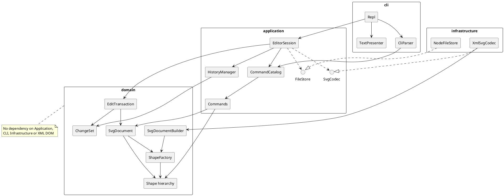

# SVG 编辑器 Phase 1 实现规范
**需求决策、架构与接口**

- **适用对象**：Codex、Qoder 等 AI 编程智能体，以及负责审阅实现的人。
- **适用范围**：Lab1 Phase 1，TypeScript 命令行 SVG 编辑器。
- **架构基线**：本次会话确认的 v0.2 架构，以及随后完成的关键接口与执行协议定稿。
- **文档版本**：1.0。
- **整理日期**：2026-10-25。
- **文档性质**：实现契约。本文描述应实现的行为、职责、接口和状态转移，不代表代码已经完成或已经通过验证。
- **范围排除**：测试设计、测试用例、测试工具选型、覆盖率目标、故障注入方案、分阶段实施计划和里程碑均由其他文档说明。

> 编程智能体应先读第 1—4 节，再结合第 5—12 节实现具体职责。不得仅根据某个代码片段推断整体语义。接口片段是签名级规范；方法体、导入声明和语言层面的辅助封装需要在实现中补齐，但必须遵守本文的状态和权限契约。

## 目录

1. [范围、来源与约束优先级](#sec-01)
2. [需求决策 D01—D10](#sec-02)
3. [命令行为与用户可观察语义](#sec-03)
4. [总体架构与依赖方向](#sec-04)
5. [领域模型、身份与不变量](#sec-05)
6. [应用协议与辅助类型](#sec-06)
7. [六个核心接口](#sec-07)
8. [统一修改、准备与发布协议](#sec-08)
9. [结构编辑算法](#sec-09)
10. [SVG 格式与 Codec 契约](#sec-10)
11. [文档操作、文件 IO 与预览](#sec-11)
12. [错误、输出与故障状态](#sec-12)
13. [性能、资源与扩展边界](#sec-13)
14. [P1—P6 执行契约示例](#sec-14)
15. [编程智能体必须保持的实现约束](#sec-15)
16. [实现配置边界与来源索引](#sec-16)
17. [附录：完整 CLI、错误文本与来源映射](#appendix-source)

<a id="sec-01"></a>
## 1. 范围、来源与约束优先级

### 1.1 项目目标

实现一个具有清晰模块边界的命令行 SVG 编辑器。用户通过 ID 定位图形，完成图形创建、属性修改、移动、缩放、分组、重新归属、层序调整、删除、撤销重做，以及 SVG 文件读写。

当前内置六种图形：`rect`、`circle`、`ellipse`、`line`、`text`、`g`。根 `svg` 是文档画布，不是可以用普通图形命令任意移动、删除或重新归属的第七种 Shape。

图形行为由图形类承担；结构一致性由文档承担；命令通过统一应用入口执行；撤销重做回放实际变更；文件系统和 XML 解析被隔离在基础设施层。

### 1.2 来源标识

| 标识 | 来源 | 支持范围 |
| --- | --- | --- |
| [S1] | 用户提供的 `phase_cli_1.md` | 实验范围、范式、CLI 语法、图形种类、错误文本、显示格式、交付要求 |
| [S2] | 需求分析中已确认的 D01—D10 | 原文歧义的解决方案，以及用户已接受的行为决定 |
| [S3] | 本会话提供的 v0.2 架构 | 分层、富领域模型、两类可逆变更、事务、状态身份、严格 SVG 子集、IO 和扩展边界 |
| [S4] | 本会话“关键接口设计与执行流程验证”定稿 | 六个核心接口、EditLease、准备后统一发布、不可变历史、保存三态、P1—P6 状态推演 |
| [R1]—[R5] | 文末列出的官方技术资料 | TypeScript 私有字段、SVG 绘制与继承、XML 字符规则、文件系统提交边界等事实依据 |

D01—D10 及 v0.2 不存在于原始实验文件中，不能把它们全部表述为“实验原文明文要求”。本文把 [S1] 的要求与 [S2]—[S4] 已确认的细化合并为一个实现契约。

### 1.3 解释和修订规则

1. 保留 [S1] 的硬性要求，尤其是 TypeScript 面向对象、Command、Composite、规定命令和错误文本。
2. 对已经讨论并明确细化的行为，使用 [S2]—[S4] 的最终规则。例如成功空编辑保留 Redo，以及 save 复用最近成功路径。
3. 背景知识和未来阶段示例不能自动扩大 Phase 1 范围。
4. 本文在辅助类型和内部调用关系上所作的展开，是现有契约的实现表达，不表示增加用户功能。
5. 若实现发现实质矛盾，应明确记录矛盾及所影响的规则；不得为了让代码方便而静默改变命令语义、历史边界或支持范围。
6. 未被确认的资源数值、库版本和边缘词法细节集中见第 16 节，不能分散成互不一致的隐含规则。

### 1.4 硬性工程约束

- TypeScript + 面向对象，采用类层次、多态、字段封装。
- 一类一文件，文件名与类名一致。纯类型定义可以按契约分组，不需要为每个 interface 建一个无意义的类。
- 必须落地 Command 模式。
- 叶子和容器统一响应 `move/scale/set/delete`，体现 Composite。
- 不使用公共可变数据袋加外部分派函数来代替图形行为。
- 命令名到实现的分派只集中在 CommandCatalog；图形类型名到类的分派只集中在 ShapeFactory。
- 将这两处集中分派标为后续注册机制演化的变化点/待重构点，满足 [S1] 的文档要求。
- Node.js API、文件路径、环境变量、终端输出、XML DOM 不进入领域业务实现。
- 保留 Git、远程仓库及最终 `final` tag 的原始交付约束；具体开发阶段不在本文安排。

### 1.5 当前不实现的能力

不实现 `box` 插件、动态插件管理器、GUI、鼠标选择、命中测试、内嵌渲染器、完整 SVG/CSS 支持、通用变换矩阵系统、事件总线、完整遥测系统、任意宏命令批事务、历史持久化或跨进程协同编辑。

应用 API 的 dry-run 属于当前架构能力，但不新增 `dryrun` CLI 命令。预览保留只读接入边界；当前可以使用外部浏览器查看保存的 SVG。

<a id="sec-02"></a>
## 2. 需求决策 D01—D10

下表来自已确认的需求讨论 [S2]，并合并 [S3][S4] 的后续细化。

| 决策 | 最终规则 | 实现含义 |
| --- | --- | --- |
| D01 缩放 | 直接把位置和尺寸乘以正的有限因子，以文档原点为中心；容器递归作用于子孙 | 不生成 transform；不自动缩放 stroke-width 和 font-size |
| D02 跨父分组 | 允许选取来自不同父容器的图形；新组挂在最近公共父容器 | 先产生 GroupPlan，再在单一事务执行；拒绝重复目标、祖先与后代同时选中 |
| D03 分组层序 | 所选节点按原文档顺序收入新组；新组位于最靠后所选第一层分支对应的层级位置 | 最终算法为先在最后分支的 j+1 处插入空组，再顺序移入所选节点 |
| D04 样式 | 遵循 SVG 的显式属性和继承规则 | Group.set 修改自身属性；重挂不自动物化继承样式；缺失属性与显式默认值不同 |
| D05 IO 历史屏障 | init/read/save 成功及 canvas 实际改尺寸后，清空历史并设置屏障 | 禁止历史跨过文档类提交；下一次成功编辑解除屏障 |
| D06 空操作 | 无实际内容变化的编辑不入历史 | 不清空 Redo；可以解除屏障；失败和 dry-run 不解除屏障 |
| D07 SVG 支持范围 | 采用明确的严格子集，拒绝未支持或危险内容 | 不忽略 transform、CSS、外部引用；不承诺任意 SVG 导入或字节级保真 |
| D08 ID | 显式 ID 保留；缺失 ID 按标签名加序号确定性补全 | 全文预留显式 ID，再按文档顺序补 ID；只在成功导入后返回警告 |
| D09 当前路径 | 无参数 save 使用最近成功 read/save 确立的路径 | init 清空路径；失败读写不改路径；尚无路径时报告错误 |
| D10 画布 | canvas 改尺寸不缩放子图形 | 根尺寸与规范 viewBox 一起更新；内容改变但不形成 Undo 条目 |

### 2.1 必须保留的细化

- 成功空编辑可以解除历史屏障，不创建 HistoryEntry，也不清空 Redo。
- `canvas` 设置成原尺寸时不产生新屏障、不清历史。
- `save` 即使内容原本已保存，成功后仍按文档命令设置屏障。
- `read` 自动补 ID 后，内存内容相对原文件已有语义修复，应标记为待保存。
- `help` 无需当前文档；它与启动提示允许用户查询帮助的行为一致。
- 同名 SVG ID 的新旧对象可以先后存在于不同历史状态，历史必须使用节点对象身份。
- 保存结果区分确认已提交、确认未提交和结果不确定。
- 内部不变量损坏采用独立的 poisoned 故障状态，不能冒称普通失败已完整恢复。

### 2.2 分组与重新归属的外观边界

结构编辑保持节点自身几何和显式属性。新父链可能改变继承得到的颜色、字体展示等效果。编辑器不自动补写 computed style。

分组保持的是所选节点之间的相对顺序。把不连续图形收入一个连续子树，可能改变它们与未选节点的遮挡关系；不能承诺全部全局遮挡关系保持不变。

这些影响是树结构与 SVG 继承语义的直接结果，必须在实现说明中保留。[S2][S4][R2]

<a id="sec-03"></a>
## 3. 命令行为与用户可观察语义

完整语法、参数表、set 白名单和原文规定的错误文本见附录。本节规定所有命令共享的行为。

### 3.1 REPL 与参数

- 提示符为 `svg>`；逐行读取输入。
- 以 `#` 开头的注释行不执行命令。不要把命令参数中的 `#4a90d9` 当作行内注释。
- 带空格参数使用双引号。词法分析保留参数边界，不能用简单的空格 split 替代。
- CLI 只负责词法/语法适配、调用应用入口和呈现结果。
- 数字必须完整解析且有限，拒绝 `10oops`、`NaN`、`Infinity` 和计算溢出。
- CLI create/group 的 ID 由用户显式提供；自动命名仅用于外部 SVG 导入。
- 空输入、注释行不构成编辑，不改变历史屏障或版本。
- 除帮助外，需要文档的命令在执行前统一检查是否已 init/read。
- 错误一行一条，以 `error:` 开头。成功编辑输出摘要；查询输出所请求内容。

### 3.2 命令分类

| 类别 | 命令 | 是否使用领域事务 | 是否进入编辑历史 |
| --- | --- | --- | --- |
| 编辑 | create/delete/move/scale/set/group/ungroup/addto/front/back | 是 | 有实际变化时一个命令一个条目 |
| 历史 | undo/redo | 是，用于受控回放及补偿 | 移动原条目，不创建新用户历史 |
| 文档替换 | init/read | 构建独立候选后发布 | 否，成功设置屏障 |
| 保存 | save | 不开启内存编辑事务 | 否，确认成功设置屏障 |
| 画布修改 | canvas 带尺寸且实际变化 | 是，修改 CanvasRoot 状态 | 否，成功设置屏障 |
| 查询 | tree/show/help/canvas 无尺寸 | 否 | 否 |

所有类别的请求都由同一个 Session 队列串行执行。查询不能通过旁路读取正在修改的领域对象。

### 3.3 创建和属性

- create 默认挂在根画布末尾；有 `in` 时挂在指定现有 Group 末尾。
- `line` 的可选创建样式是 stroke；rect/circle/ellipse 是 fill。
- text 的内容属于 XML 子文本，不是 text 属性。
- text/g 的创建语法不额外接受未规定的可选 fill；样式可通过后续 set 修改。
- 省略 fill/stroke 时不写入这些属性。
- set 修改单个属性；属性是否存在属于状态的一部分。
- Group.set 只写 Group 自身，后代通过继承受到影响。
- ID 在 Phase 1 不可通过 set 修改。

### 3.4 几何与结构

- move 的 dx/dy 是增量。
- scale 同乘全部本类型几何属性；Group 递归处理子孙。
- 对空组也要先验证参数，不能把非法 scale 当作成功空操作。
- delete Group 摘除整棵子树，并注销全部活动 ID。
- addto 追加到目标容器末尾，同父同末尾时为空操作。
- front 把图形移到同级末尾，表示视觉最前；back 移到索引 0。
- ungroup 将子节点按原顺序提升至组原位置，最后删除组。
- 根 svg 的直接子 Group 禁止 ungroup；这是实验的明确限制。
- 原子性覆盖整条命令。例如容器递归移动及 group 多步操作都只有一个 Undo 单元。

### 3.5 查询与计数

- tree 输出层级及关键几何/样式摘要，不能只显示节点名。
- tree id 输出以该图形为根的子树。
- show 输出类型、ID、父容器与属性明细。
- 图形总数包括 g，不包括根 svg。
- 输出描述来自不可变值 DTO，不能把内部 Shape 或 children 数组交给呈现层。
- 渲染预览不属于查询命令的隐含副作用。

<a id="sec-04"></a>
## 4. 总体架构与依赖方向

### 4.1 模块职责

| 模块 | 主要内容 | 职责 |
| --- | --- | --- |
| cli | Repl、CliParser、TextPresenter | 输入输出适配；不实现编辑、历史、文件提交规则 |
| application | EditorSession、CommandCatalog、命令类、HistoryManager、端口契约 | 执行业务协调、队列、状态发布、历史转移、错误结果 |
| domain | SvgDocument、Shape 体系、Factory、Builder、事务、ChangeSet、值验证器 | 几何行为、结构不变量、身份、受控修改、可逆变化 |
| infrastructure | XmlSvgCodec、NodeFileStore | XML 处理与文件系统能力；实现应用端口 |
| composition | main.ts 及启动装配 | 注册内置类型和命令、注入端口与配置、启动 REPL |

建议目录是职责映射，具体子目录可调整，但依赖规则不能改变：

| 路径 | 内容 |
| --- | --- |
| `src/cli/` | 三个 CLI 类及仅属于终端的辅助实现 |
| `src/application/` | EditorSession、CommandCatalog、HistoryManager |
| `src/application/commands/` | 各命令类及命令类别基类 |
| `src/application/contracts/` | 请求、结果外壳、会话状态与应用操作协议 |
| `src/application/ports/` | SvgCodec、FileStore 等接口 |
| `src/domain/` | 文档、图形抽象、Factory、Builder |
| `src/domain/shapes/` | 六种具体 Shape 类 |
| `src/domain/contracts/` | 领域创建/描述值、容器与状态快照契约 |
| `src/domain/changes/` | Change、NodeStateChange、PlacementChange、ChangeSet |
| `src/domain/transactions/` | EditTransaction 与内部权限实现 |
| `src/domain/values/` | 几何、颜色、文本、属性状态、限制等值契约 |
| `src/infrastructure/` | XmlSvgCodec、NodeFileStore |
| `src/main.ts` | 唯一装配入口 |

### 4.2 允许的依赖

| 来源 | 可依赖 | 不可依赖 |
| --- | --- | --- |
| CLI | Application 的公开入口、纯值契约及语法元数据 | 领域可变对象、基础设施实现 |
| Application | Domain、应用端口、应用契约 | CLI、具体 NodeFileStore/XmlSvgCodec |
| Domain | 自身值与协议、语言基础能力 | Application、CLI、Infrastructure、XML DOM、Node IO |
| Infrastructure | Application 端口、Domain 构建/描述契约 | CLI 呈现和 Session 内部可变状态 |
| main.ts | 所有装配所需模块 | 不承载图形编辑算法 |

不以“共用工具文件”为由建立一个能够读取 Session、DOM、文件系统的全能 utils 模块。领域通用校验也应有明确所属类/值对象，不成为另一套过程式业务内核。

**类型归属与依赖同样受约束。** ShapeCreation、ShapeDescription、TreeNodeDescription、DocumentDescription、OwnStateDescription、ChangeDescription/ChangePreview、领域属性描述、ContainerRef、StateTarget、NodeMemento 等由 Domain 使用的纯值/内部契约归 Domain。Application 拥有 CommandRequest、ExecutionResult、ResultData、SessionStatus、EditFacts、HistoryEntry 和 StateId 等应用协议，并引用领域契约。领域错误先以领域错误值表达，再由 Application 映射为 EditorError/Diagnostic。CLI 可经 Application 公开类型重导出取得只读领域描述，不因此获得 live 领域对象。不得让 Domain 为返回一个描述值而反向导入 application/contracts。

### 4.3 PlantUML 包图

下图可作为最终实验报告架构图的基础。实验报告仍需结合实际实现如实更新。[S1]



图中箭头表达源码依赖或职责调用关系，不表示可以绕过 Session 暴露底层修改。main.ts 的装配依赖省略。

### 4.4 设计模式的具体落点

| 模式/做法 | 落点 | 要解决的问题 |
| --- | --- | --- |
| Command | 每个命令类封装参数与操作，Catalog 统一构造 | 解析与执行分离，新增命令不污染 REPL |
| Composite | Shape 与 GroupShape 统一行为 | 叶子/容器递归操作不需要到处判断类型 |
| Factory | ShapeFactory 注册内置类型构造与参数定义 | CLI 创建和 SVG 导入共享类型入口 |
| Memento 思路 | 绑定节点的不可变自身状态 | 精确恢复值和属性存在性 |
| 可逆变更日志 | 两类 Change 组成 ChangeSet | 业务命令与撤销恢复算法解耦 |
| Builder | 未发布文档的独占构建 | 高效导入，不绕过已发布文档权限 |
| Port/Adapter | SvgCodec/FileStore 与基础设施实现 | 核心不依赖 XML 库或 Node 文件 API |

不引入额外通用插件框架、事件溯源系统或依赖注入容器。main.ts 的显式构造注入已经足够。

### 4.5 两处名称分派

CommandCatalog 的同一份定义表提供命令语法、帮助描述和请求绑定；CliParser 不维护第二套 command-name switch。

ShapeFactory 的同一份类型定义提供创建参数 schema 和领域对象构造；Codec、Presenter 和 MoveCommand 不维护第二套 shape-type switch。

允许针对执行模式、事务阶段、错误类别等有限控制状态做分支。禁止把几何或属性业务重新集中成“按图形 tag 分派”的第三处内核。

<a id="sec-05"></a>
## 5. 领域模型、身份与不变量

### 5.1 四种身份

| 名称 | 表示 | 生命周期与用途 |
| --- | --- | --- |
| SvgId | 大小写敏感字符串 | 用户寻址及文件属性；Phase 1 不可重命名 |
| 节点身份 | 实际 Shape 对象/稳定内部引用 | 删除后由历史继续持有；新同名对象与旧对象不同 |
| DocumentId | 不透明文档身份 token | 每个新文档独立；防止节点、事务、历史跨文档使用 |
| StateId | 不透明内容状态 token | 有变化提交产生新身份；Undo/Redo 恢复历史身份 |

这些内部 token 不需要写入 SVG 或对外 JSON。分配一个候选 token 不应修改影响未来图形命名的全局计数器。自动 SVG ID 的编号器属于一次候选导入。

### 5.2 根、容器与节点

根由专门的 CanvasRoot/RootContainerRef 表示。使用 `doc.root`，不要把字符串 `svg` 或任意用户 ID 用作根哨兵。

容器能力应提供受控读取：

```ts
interface ContainerRef {
  readonly ownerDocumentId: DocumentId;
  readonly childCount: number;
  childAt(index: number): Shape;
  childrenSnapshot(): readonly Shape[];
}

interface Placement {
  readonly parent: ContainerRef;
  readonly index: number;
}
```

RootContainerRef 是根的专门能力引用；Group 的容器能力来自 asContainer()。这些引用仅供核心内部使用，不是跨 Session 公共 API 的 DTO。

### 5.3 树与活动索引

必须始终成立：

1. 根唯一且无父节点；叶子无子节点。
2. 每个活动图形恰有一个父容器；父指针与子序列一致。
3. 树无环；兄弟顺序定义文档顺序。
4. idIndex 恰好包含从根可达的全部 Shape，且映射到相应的稳定对象。
5. 活动图形 ID 唯一；不可用两个对象占据同一个活动 ID。
6. 节点的 ownerDocumentId 从创建起不变。
7. 所有写入只能由有效事务或未发布 Builder 的独占构建权限执行。
8. 几何、文本、属性及最终结构满足对应值约束和资源限制。

删除 Group 时，Group 根的 parent 变为 null，内部孩子仍然属于该分离 Group。因此 `parent != null` 不能判断一个节点是否活动。活动成员关系用 isAttached() 或 idIndex 的对象身份检查。

Document 不维护一个永久强引用所有创建过节点的全节点注册表。活动节点由树和索引持有，删除节点由历史/事务持有。dry-run 创建节点回滚后，若无历史引用即可自然释放。

### 5.4 节点自身状态

自身状态包含本类型几何、文本、显式样式、支持的只读展示属性及元数据。父子关系不在其中。

- 状态值不可变；历史不能引用随后会被原地修改的属性对象。
- 缺失属性与显式写入值不同，包括缺失 fill 与显式 fill=black。
- 不建立与 Shape 字段并行且可修改的 XML 属性表。
- 每个属性只有一份权威状态；序列化属性是派生描述。
- 计算几何变换时保留不需要改变的显式存在性；不能因 move 0 0 而随意补齐缺省属性。
- set 显式写入原先缺失的属性可以构成变化，即使当前外观相同。

NodeMemento 是绑定具体状态持有者的不可变快照。几何解释由具体 Shape 负责，事务和 ChangeSet 不理解 x、r、width 等图形字段。

### 5.5 只读描述

ShapeDescription/DocumentDescription 是独立值描述，不能是可经类型断言修改原对象的 live view。数组、属性集合和文本值不能共享可变引用。

- 普通命令只构造所需的局部结果。
- tree/encode 可按请求构造完整描述。
- 不为每次简单编辑深拷贝整份文档。
- 领域对象本身使用运行期封装；TypeScript readonly/普通 private 不等同于完整运行期保护。[R1]

### 5.6 CanvasRoot

CanvasRoot 保存画布尺寸和允许的根级保留属性，实现与 Shape 相同的内部状态持有者能力，但无需继承 Shape。

canvas 修改通过根状态的 NodeStateChange 进行；规范 viewBox 从当前尺寸生成，不保存另一份可能与尺寸矛盾的可变 viewBox。

<a id="sec-06"></a>
## 6. 应用协议与辅助类型

本节集中定义后续签名引用的类型，避免编程智能体为同一概念建立多份不兼容表示。

### 6.1 基本值和注入依赖

```ts
interface CanvasSize {
  readonly width: number;
  readonly height: number;
}

interface ResourceLimits {
  readonly maxSvgBytes: number;
  readonly maxNodeCount: number;
  readonly maxTreeDepth: number;
  readonly maxTextLength: number;
  readonly maxAttributeLength: number;
}

interface SessionDependencies {
  readonly commands: CommandCatalog;
  readonly codec: SvgCodec;
  readonly files: FileStore;
  readonly limits: ResourceLimits;
}

type ScalarValue = string | number | boolean | null;
type ResultValue =
  | ScalarValue
  | readonly ResultValue[]
  | { readonly [key: string]: ResultValue };
```

CanvasSize 的数值必须通过统一值校验，不把合法性寄托在 TypeScript 的 number 类型上。ResourceLimits 在一个会话生命周期内固定，不在历史回放过程中重新读取环境变量或变化中的配置。

DocumentId、StateId、NodeMemento、MutationAuthority 都是不透明内部类型。它们不是 ResultValue，不进入对外 DTO。FilePath 是经过 FileStore.resolve 解析的稳定路径值；Application 不直接调用 path/fs 或读取 cwd。

### 6.2 ShapeCreation

使用受 schema 约束的创建描述。以下 union 展示当前六种内置类型；具体注册定义负责验证和构造，不通过 union 在各模块重复 switch：

```ts
type ShapeCreation =
  | {
      readonly type: 'rect'; readonly id: string;
      readonly x: number; readonly y: number;
      readonly width: number; readonly height: number;
      readonly fill?: string;
    }
  | {
      readonly type: 'circle'; readonly id: string;
      readonly cx: number; readonly cy: number; readonly r: number;
      readonly fill?: string;
    }
  | {
      readonly type: 'ellipse'; readonly id: string;
      readonly cx: number; readonly cy: number;
      readonly rx: number; readonly ry: number;
      readonly fill?: string;
    }
  | {
      readonly type: 'line'; readonly id: string;
      readonly x1: number; readonly y1: number;
      readonly x2: number; readonly y2: number;
      readonly stroke?: string;
    }
  | {
      readonly type: 'text'; readonly id: string;
      readonly x: number; readonly y: number;
      readonly text: string;
    }
  | {
      readonly type: 'g'; readonly id: string;
    };
```

这是当前支持范围的值类型，不是任意 XML 属性字典。运行期仍要识别并报告未知类型，不能因 TypeScript union 就忽略不可信或非 TS 调用方传入的值。

未来新增图形需要同步调整相应类型契约或提供者机制；本阶段不声称此 union 已经支持任意动态插件。

### 6.3 结构化请求

```ts
type EditRequest =
  | { readonly command: 'create'; readonly shape: ShapeCreation;
      readonly parentId?: string }
  | { readonly command: 'delete' | 'front' | 'back'; readonly id: string }
  | { readonly command: 'move'; readonly id: string;
      readonly dx: number; readonly dy: number }
  | { readonly command: 'scale'; readonly id: string; readonly factor: number }
  | { readonly command: 'set'; readonly id: string;
      readonly attribute: string; readonly value: string | number }
  | { readonly command: 'group'; readonly newId: string;
      readonly ids: readonly string[] }
  | { readonly command: 'ungroup'; readonly id: string }
  | { readonly command: 'addto'; readonly containerId: string;
      readonly id: string };

type CommandRequest =
  | EditRequest
  | { readonly command: 'init'; readonly size?: CanvasSize }
  | { readonly command: 'read'; readonly path: string }
  | { readonly command: 'save'; readonly path?: string }
  | { readonly command: 'canvas'; readonly size?: CanvasSize }
  | { readonly command: 'tree'; readonly id?: string }
  | { readonly command: 'show'; readonly id: string }
  | { readonly command: 'help' }
  | { readonly command: 'undo' | 'redo' };

interface ExecuteOptions {
  readonly mode?: 'commit' | 'dry-run';
}
```

API 请求在入队时复制并冻结；不能在排队期间继续引用调用方可修改的数组。节点 ID 在任务实际执行时解析，不能在入队时捕获可能过时的 Shape。

mode 缺省为 commit。dry-run 只适用于 EditRequest，其他请求拒绝该模式且状态不变。

### 6.4 描述、结果与诊断

| 类型 | 字段与约束 |
| --- | --- |
| AttributeDescription | 属性名及规范化值；只包含对应 schema 允许的属性 |
| DisplayField | 字段标签、独立标量值、必要的展示提示；用于通用 tree/show 呈现 |
| ShapeDescription | type、id、自身属性列表、可选文本、展示字段；不含 live Shape，不包含动态父指针 |
| TreeNodeDescription | 一个 ShapeDescription 和按顺序排列的子描述；叶子的 children 为空 |
| DocumentDescription | 根尺寸/允许的根属性和有序描述树；无路径、历史、选择或 XML DOM |
| ParentDescription | 根标识，或父 Group 的公开 ID；用于 show 和位置变化摘要 |
| EditFacts | 操作名、目标/受影响 ID、操作完成后的局部描述、必要增量或属性事实；无输出副作用 |
| OperationDescription | 用于历史展示的操作名、目标 ID 和必要摘要；不用于重执行 |
| ChangeDescription | 某条变化的独立 before/after 描述或位置描述，不暴露节点引用 |
| ChangePreview | 有序变化描述及必要的受影响图形摘要；不共享可变数组 |
| ResultData | 查询数据、EditFacts、文档操作收据或历史操作描述的带类别 union |
| Diagnostic | code、结构化参数、必要的对象/输入位置；不带已经写往终端的文本 |
| EditorError | 稳定错误 code、结构化细节、必要内部原因；对外通过 ExecutionResult 分类 |
| FileError | 文件操作、路径、失败阶段、平台原因；能区分临时文件阶段和目标替换阶段 |
| PreparedPublication | Application 私有值，持有 nextHead、完整结果与事务控制端；不能暴露给 Command 或调用者 |

ResultData 至少覆盖以下类别：

| 类别 | 必要数据 |
| --- | --- |
| edit | 操作事实、受影响图形摘要 |
| tree | 请求子树或全文档的描述 |
| show | 自身描述与父容器描述 |
| canvas | 当前尺寸 |
| document | init/read/save 操作、路径、尺寸和图形数中所需字段 |
| history | undo/redo 方向、原条目摘要、实际回放结果描述 |
| help | Catalog 提供的命令语法与说明 |

这些 DTO 允许使用简单字段记录，不能据此将领域 Shape 改成公共可变数据袋。

### 6.5 会话状态与执行结果

```ts
interface HistoryStatus {
  readonly undoCount: number;
  readonly redoCount: number;
  readonly barrier: BarrierReason | null;
}

interface SessionStatus {
  readonly state: 'empty' | 'ready' | 'poisoned';
  readonly revision: number;
  readonly currentPath: string | null;
  readonly dirty: boolean | null;
  readonly history: HistoryStatus;
}

type ExecutionResult =
  | {
      readonly ok: true;
      readonly mode: 'commit';
      readonly contentChanged: boolean;
      readonly sessionChanged: boolean;
      readonly data: ResultData;
      readonly warnings: readonly Diagnostic[];
      readonly status: SessionStatus;
    }
  | {
      readonly ok: true;
      readonly mode: 'dry-run';
      readonly wouldChange: boolean;
      readonly preview: ChangePreview;
      readonly warnings: readonly Diagnostic[];
      readonly status: SessionStatus;
    }
  | {
      readonly ok: false;
      readonly error: EditorError;
      readonly effect: 'unchanged' | 'external-unknown' | 'untrusted';
      readonly status: SessionStatus;
    };
```

- 无文档时 state=empty，dirty=false。
- 正常文档为 ready，dirty 由内容身份计算。
- poisoned 时 dirty=null，明确当前内容不可信，不把旧状态身份冒充当前可靠内容。
- 成功查询的 contentChanged/sessionChanged 均为 false。
- 成功空编辑可能 contentChanged=false、sessionChanged=true，例如解除屏障。
- mode=commit 表示实际执行模式，不表示该请求一定改变内容。
- 预期的语法、领域和 IO 错误通过结果返回；终端输出错误由 CLI 处理，不转成另一次领域失败。

### 6.6 CommandCatalog 与命令执行

CommandCatalog 拥有命令名到命令定义的唯一映射：

```ts
interface CommandDefinition {
  readonly name: string;
  readonly syntax: CommandSyntax;
  readonly help: CommandHelp;

  parse(arguments_: readonly InputToken[]): CommandRequest;
  bind(request: CommandRequest): BoundCommand;
}

interface BoundCommand {
  dispatch(
    coordinator: CommandCoordinator,
    mode: 'commit' | 'dry-run'
  ): ExecutionResult | Promise<ExecutionResult>;
}

declare class CommandCatalog {
  parse(tokens: readonly InputToken[]): CommandRequest;
  bind(request: CommandRequest): BoundCommand;
  describe(): readonly CommandHelp[];
}
```

InputToken 是与终端实现无关的词法值，包含已解析文本及必要的来源位置/引号信息。CliParser 生成 token 后使用 Catalog 的 schema；Application 不反向导入 CLI 类。

CommandDefinition 的 bind 负责结构化请求校验与命令实例构造。按命令名称定位定义只在 Catalog 中实现；允许同一注册表被 parse 和 bind 多次查询。

命令类别通过多态进入不同协调流程：

| 命令类别 | Command 自身承担 | Session 协调器承担 |
| --- | --- | --- |
| EditCommand | run(doc, tx) 定位目标、调用领域行为、返回 EditFacts | 开事务、准备、回滚、历史、发布 |
| QueryCommand | 构造查询值 | 串行执行、文档检查、返回状态 |
| 文档命令 | 保存已校验参数，选择对应文档操作 | 候选发布、文件提交、路径与屏障 |
| 历史命令 | 表达 undo 或 redo 意图 | 栈顶校验、原子回放、状态恢复与发布 |

EditorSession 通过 BoundCommand.dispatch 调用绑定后的命令。CommandCoordinator 是仅供内部命令调用的协调能力，提供编辑、查询、init/read/save/canvas、undo/redo 对应的内部操作；各命令多态地进入对应操作。EditCommand.run(doc, tx) 必须同步。协调器不外泄，不成为新的公共编辑 API；EditorSession 不再按每一个 command 名称写一套 switch。

CommandSyntax 描述位置参数、可选参数、参数类型及数量规则；CommandHelp 至少包含名称、用法和说明。二者由同一个 CommandDefinition 提供，避免帮助文本与实际绑定规则分离。

### 6.7 ShapeFactory 与 Builder 的连接

ShapeFactory 的唯一类型表提供：

- 创建参数 schema；
- SVG 属性 schema；
- 内容模型：空内容、纯文本或容器；
- 对应图形类的创建与导入构造能力。

CreateCommand 和 XmlSvgCodec 都使用这份定义；前者绑定创建参数，后者提交无 DOM 引用的规范化输入值。SvgDocumentBuilder 负责挂接构造结果和维护候选索引。

Root svg 的识别属于文档结构解析；对六种图形的业务解释仍经过 Factory。所有输入路径调用同一套领域值验证规则。

<a id="sec-07"></a>
## 7. 六个核心接口

以下签名不要求按单个文件整体复制。class 各自落入独立源文件，契约中引用的辅助类型见第 5—6 节。

### 7.1 EditorSession

```ts
declare class EditorSession {
  constructor(dependencies: SessionDependencies);

  execute(
    request: CommandRequest,
    options?: ExecuteOptions
  ): Promise<ExecutionResult>;
}

interface SessionHead {
  readonly document: SvgDocument | null;
  readonly currentStateId: StateId | null;
  readonly savedStateId: StateId | null;
  readonly currentPath: FilePath | null;
  readonly revision: number;
  readonly history: HistoryManager;
  readonly health: 'ready' | 'poisoned';
}
```

**职责**

- 持有唯一私有状态头和串行队列。
- 对外只暴露结构化 execute。
- 协调事务、历史、文档替换和文件提交。
- 在准备完整后统一发布 nextHead 和结果。

**约束**

- 不提供返回 live Document/Shape 的公开 getter。
- 查询也排队；不得从旁路观察编辑中间态。
- read/save 的异步等待期间不启动后续请求。
- 一次队列任务失败后，队列尾部仍能处理后续任务。
- CLI 格式化和 stdout/stderr 不在 Session 事务中执行。
- 成功发布只包含同步、内部、无外部回调的短操作。
- 预期失败不提前改路径、保存检查点、历史或 revision。

### 7.2 SvgDocument

```ts
declare class SvgDocument {
  readonly documentId: DocumentId;
  readonly root: RootContainerRef;
  readonly nodeCount: number;

  find(id: string): Shape | undefined;
  require(id: string): Shape;
  requireContainer(id: string): ContainerRef;

  isAttached(node: Shape): boolean;
  placementOf(node: Shape): Placement | null;
  beginEdit(): EditLease;

  create(
    tx: EditTransaction,
    creation: ShapeCreation,
    parent: ContainerRef
  ): Shape;

  planGroup(newId: string, selected: readonly Shape[]): GroupPlan;
  group(tx: EditTransaction, plan: GroupPlan): GroupShape;
  ungroup(tx: EditTransaction, group: GroupShape): void;
  addTo(tx: EditTransaction, node: Shape, parent: ContainerRef): void;
  bringToFront(tx: EditTransaction, node: Shape): void;
  sendToBack(tx: EditTransaction, node: Shape): void;

  resizeCanvas(tx: EditTransaction, size: CanvasSize): void;
  describe(): DocumentDescription;
  assertInvariants(): void;
}
```

**前置条件**

- 公共用户寻址只查活动索引。
- 新增业务写操作必须持有属于本 Document 且仍 active 的事务。prepared 阶段只能由 EditLease 控制端凭内部恢复权限执行回滚，不能通过普通编辑端追加变化；恢复原语不能误用仅允许 active 的业务断言。
- beginEdit 拒绝同文档嵌套事务。
- GroupPlan 必须绑定本 Document，在同一串行执行窗口中立即使用。

**成功效果**

局部修改同时维护结构、父指针、活动 ID、节点计数和资源约束。describe 返回独立只读描述。

**失败效果**

正常的来源、目标、循环、ID、数值或资源验证在修改前完成；已有其他原语通过事务恢复。

assertInvariants 用于候选构建结束后的完整检查和诊断。普通编辑依靠局部原语维持不变量，不强制每次全树扫描。

### 7.3 Shape

```ts
declare abstract class Shape {
  readonly id: string;
  readonly ownerDocumentId: DocumentId;

  abstract move(tx: EditTransaction, dx: number, dy: number): void;
  abstract scale(tx: EditTransaction, factor: number): void;
  abstract set(
    tx: EditTransaction,
    attribute: string,
    value: string | number
  ): void;

  delete(tx: EditTransaction): void;
  asContainer(): ContainerRef | null;
  abstract describe(): ShapeDescription;
}
```

叶子类计算自身几何结果。Group.move/scale 验证共同参数后，对直接孩子调用同名方法，从而递归访问子孙。

Group.set 修改组自身公共属性，不向后代逐个写入。delete 统一委托文档结构原语摘除节点，Group 的子树索引也随之退出。

Shape 不直接拼 XML 字符串、不创建 DOM Element、不输出终端文本、不操作历史栈、不读取文件或配置。

#### 内部状态安装协议

仅有 capture/equality 还不足以执行回放，因此领域内部必须存在如下能力：

```ts
interface StateTarget {
  readonly ownerDocumentId: DocumentId;

  captureState(): NodeMemento;
  stateEquals(left: NodeMemento, right: NodeMemento): boolean;
  describeState(state: NodeMemento): OwnStateDescription;
}

interface InternalStateWriter {
  installState(
    authority: MutationAuthority,
    target: StateTarget,
    next: NodeMemento
  ): void;
}
```

InternalStateWriter 只存在于领域内部；MutationAuthority 由事务内部持有，绑定活动事务并在终结后失效。Command 拿到的 EditTransaction **不等于**原始写入 authority。

可以用内部 symbol 方法、闭包或私有写入机制实现，但不能提供仅凭 Command 已持有的 tx 就能绕过日志的原始 setter。原始 placement 安装遵守相同权限规则。

describeState 解释给定快照，用于稳定生成历史 before/after 描述；不能用节点当前状态替代过去快照的内容。OwnStateDescription 只包含自身状态，不查询动态父链。

### 7.4 EditTransaction 与 EditLease

```ts
type TransactionPhase =
  | 'active'
  | 'prepared'
  | 'committed'
  | 'rolled-back'
  | 'poisoned';

declare class EditTransaction {
  readonly documentId: DocumentId;
  readonly phase: TransactionPhase;

  changeState(target: StateTarget, next: NodeMemento): void;
  place(node: Shape, destination: Placement | null): void;

  // 领域内部回放入口。
  applyRecorded(change: Change, direction: Direction): void;
}

interface EditLease {
  readonly tx: EditTransaction;
  prepare(): ChangeSet;
  rollback(): void;
  commitPrepared(): void;
}
```

Session 获得 EditLease，只把 lease.tx 交给 Command。控制端不泄露。两者共享同一个内部事务状态。

| 阶段 | 允许的操作 |
| --- | --- |
| active | 追加受控变更、prepare、rollback |
| prepared | commitPrepared 或 rollback；禁止继续业务编辑 |
| committed | 全部写权限失效 |
| rolled-back | 全部写权限失效 |
| poisoned | 不再承诺恢复；触发会话故障处理 |

prepare 冻结实际变化，但保留回滚能力。commitPrepared 只终结事务、撤销权限、释放活动事务标记，不再做业务验证、ID 生成、结果构造或 IO。

每条原语必须在原始写入前完成前置检查、所需数据准备和日志位置预留；完成原语后只标记已应用。部分写入是否发生无法确认时，不能把它当作尚未执行的原语忽略。

### 7.5 ChangeSet 与两类 Change

```ts
type Direction = 'forward' | 'backward';

declare abstract class Change {
  // 领域内部多态钩子；ReplayWriter 不对外暴露。
  abstract replayUsing(writer: ReplayWriter, direction: Direction): void;
  abstract describe(direction: Direction): ChangeDescription;
}

declare class NodeStateChange extends Change {
  readonly target: StateTarget;
  readonly before: NodeMemento;
  readonly after: NodeMemento;
  replayUsing(writer: ReplayWriter, direction: Direction): void;
  describe(direction: Direction): ChangeDescription;
}

declare class PlacementChange extends Change {
  readonly node: Shape;
  readonly from: Placement | null;
  readonly to: Placement | null;
  replayUsing(writer: ReplayWriter, direction: Direction): void;
  describe(direction: Direction): ChangeDescription;
}

declare class ChangeSet {
  readonly documentId: DocumentId;
  readonly size: number;
  readonly isEmpty: boolean;

  replay(tx: EditTransaction, direction: Direction): void;
  describe(direction: Direction): ChangePreview;
}

interface ReplayWriter {
  state(
    target: StateTarget,
    expected: NodeMemento,
    next: NodeMemento
  ): void;

  placement(
    node: Shape,
    expected: Placement | null,
    next: Placement | null
  ): void;
}
```

ReplayWriter 使用统一验证和私有 authority，不形成绕过事务的另一条写入口。

- 正常编辑：tx.changeState/tx.place 构造实际 Change，再走 applyRecorded(change, forward)。
- 历史回放：ChangeSet 按顺序调用 applyRecorded，复用已有 Change。
- NodeStateChange 按方向选择 expected/next，交给 writer.state。
- PlacementChange 按方向选择来源/目标，交给 writer.placement。
- applyRecorded 预留补偿日志，并仅在原语完整完成后标记成功。
- rollback 逆序补偿已经完成的 Change 与实际应用方向，不递归产生新的补偿日志。

NodeStateChange 不含 parent/children；PlacementChange 不重算几何。两类记录只持有稳定节点/容器身份，不根据 SVG ID 重新查找。

回放时逐步验证当前中间状态，不能把所有 Change 对最初状态一次性验证。例如创建组和后续移入孩子的前置条件依赖之前步骤。

prepare 封存本事务实际执行的变化。若历史回放的逆向操作需表示为临时 ChangeSet，应按实际方向交换 before/after 或 from/to，保持“正向表示本事务实际修改”的含义；该临时结果只服务于提交准备和补偿，绝不生成新的用户历史条目。

### 7.6 HistoryManager

```ts
type BarrierReason = 'init' | 'read' | 'save' | 'canvas';

interface HistoryEntry {
  readonly documentId: DocumentId;
  readonly beforeStateId: StateId;
  readonly afterStateId: StateId;
  readonly changes: ChangeSet;
  readonly description: OperationDescription;
}

declare class HistoryManager {
  static empty(): HistoryManager;
  inspect(): HistoryStatus;

  peekUndo(documentId: DocumentId, currentStateId: StateId): HistoryEntry;
  peekRedo(documentId: DocumentId, currentStateId: StateId): HistoryEntry;

  afterEdit(entry: HistoryEntry | null): HistoryManager;
  afterUndo(entry: HistoryEntry): HistoryManager;
  afterRedo(entry: HistoryEntry): HistoryManager;
  afterBarrier(reason: BarrierReason): HistoryManager;
}
```

HistoryManager 是不可变历史值。after 方法返回下一份值，不原地修改旧对象。内部两条不可变链式栈即可实现共享：push 新建一个栈节点，pop 移动栈头，清空栈设头为空，不复制整段历史数组。

**检查规则**

- Session 先确认存在可信文档；peek 不移动栈，由 HistoryManager 检查屏障、栈是否为空、传入文档身份及预期内容状态。
- Undo 要求当前 StateId 等于栈顶 afterStateId；Redo 要求等于 beforeStateId。
- HistoryEntry.documentId 必须等于 ChangeSet.documentId。
- afterUndo/afterRedo 的 entry 必须是对应栈顶的同一个条目对象。
- afterEdit(null) 表示成功空编辑，只解除屏障，保留 Undo/Redo。
- 有变化的新编辑追加 Undo 并清空 Redo。
- afterBarrier 清空两栈并设置原因。

历史或节点状态不匹配是内部不变量错误，不能转成普通 SHAPE_NOT_FOUND 或 DUPLICATE_ID 后继续编辑。

### 7.7 Builder 及私有能力的生命周期

Builder 的写权限仅针对自身尚未发布的候选；成功 build 后失效。事务 authority 仅针对绑定文档的活动事务；prepare 后只允许控制端的回滚/提交动作；提交/回滚后全部失效。

这些能力不出现在公共 barrel exports 或 Session DTO 中。运行期封装保护核心修改边界；Phase 1 不提供同进程任意插件代码的沙箱。

<a id="sec-08"></a>
## 8. 统一修改、准备与发布协议

### 8.1 会话提交不是简单的 tx.commit 后 push 历史

以下次序不允许：

```ts
tx.commit();
history.push(entry);
const result = makeResult();
```

后两步可能在文档已提交后失败。正确顺序是先准备全部下一状态与结果，再同步发布。

SessionHead 的不可变仅表示元数据发布单位。文档仍在事务中原地修改；由于所有请求串行、内部对象不泄露，外部无法观察中间状态。

### 8.2 正常编辑流程

```text
取得当前 SessionHead
绑定命令并验证通用参数
开始 EditLease
Command.run(document, lease.tx)
lease.prepare()
构造下一内容身份、历史条目、HistoryManager、SessionHead、结果 DTO
同步终结事务并替换 SessionHead
返回预先构造的结果
由 CLI 单独呈现
```

伪代码：

```ts
runEdit(command, mode) {
  const before = this.#head;
  const lease = before.document.beginEdit();
  let publication;

  try {
    const facts = command.run(before.document, lease.tx);
    const changes = lease.prepare();

    if (mode === 'dry-run') {
      const result = buildPreviewResult(before, changes, facts);
      lease.rollback();
      return result;
    }

    publication = preparePublication(before, lease, changes, facts);
  } catch (error) {
    return rollbackOrPoison(before, lease, error);
  }

  return publication.publish();
}
```

PreparedPublication 在发布前已经持有完整 nextHead 和成功 DTO，并已检查发布前置条件。publish 只调用 commitPrepared、替换私有头引用、返回结果；不分配新的历史、序列化、格式化用户文案、await 或调用外部代码。

这里对可恢复错误提供原子性，不承诺抵抗进程突然终止、不可恢复内存耗尽等系统故障。

### 8.3 回滚

事务内部日志保存“Change + 实际应用方向 + 是否完整完成”。

- 在写入前失败的当前原语不需要撤销。
- 已完整应用的原语按逆序、相反方向恢复。
- 恢复包括自身状态、父子关系、顺序、索引、活动计数和其他会影响后续编辑的内部状态。
- 活动事务标记最终必须释放。
- 回滚不调用原始业务命令，不再次推送用户历史，不发布中间通知。
- 回滚后才能返回 ordinary failure 或 dry-run success。
- 如果原语可能部分执行或补偿不完整，则进入 poisoned，不假装 S_after=S_before。

### 8.4 Dry-run

dry-run 使用与正式编辑相同的验证和业务执行：

1. 开事务，完成实际领域修改。
2. 冻结变化并构造独立预计结果。
3. 完整回滚。
4. 返回 wouldChange 和 preview，status 反映原会话。

不得分配可观察的未来 SVG 编号，不发布新 StateId、历史、保存检查点或 revision，不解除屏障。新建临时节点不泄露引用；返回的预计描述在回滚后仍然有效。

Phase 1 不建立需要在 dry-run 中污染再恢复的全局几何缓存。未来缓存要按已提交版本管理或局限在事务内部。

### 8.5 空编辑

状态原语先比较完整自身状态，结构原语先判断相同位置。相等时不生成记录，但共同参数、目标存在性和操作合法性必须先验证。

对当前命令集合，过滤后的 changes.isEmpty 可以判断无变化：

| 命令 | 无需通用日志抵消算法的原因 |
| --- | --- |
| move/scale | 每个受影响叶子只写一次 |
| set | 只修改目标自身一次 |
| addto/front/back | 只有一次结构移动 |
| create/delete/group/ungroup | 必然改变活动节点集合 |

未来若引入任意批处理或宏命令，不能自动沿用这个结论；当前不实现这些扩展。

成功空编辑执行 history.afterEdit(null)。若只解除屏障，sessionChanged=true、contentChanged=false；屏障原本已解除时，两者都为 false。Redo 必须保留。

### 8.6 Undo/Redo

```text
peek 并验证文档身份及当前 StateId
开启回放事务
按照历史 ChangeSet 原子回放
prepare，构造下一历史、恢复的内容身份、下一 Head 和结果
同步发布
```

Undo 使用 beforeStateId，Redo 使用 afterStateId。回放不重新计算浮点变换、不重新生成图形，不重新执行 MoveCommand/GroupCommand。

发生受控中止时，对已执行回放进行补偿，完成后旧历史仍然有效。若发现记录与文档不匹配，则按内部故障处理。

### 8.7 内容身份、保存状态与 revision

正常文档：

```text
dirty = (savedStateId == null)
     or (currentStateId != savedStateId)
```

StateId 是历史内容身份，不是文件全文 hash。两次独立编辑偶然得到相同内容，仍可能拥有不同 StateId；Phase 1 不为检测这种相等而每次序列化全文。

| 操作 | 内容身份 | 历史 | 保存检查点 | revision |
| --- | --- | --- | --- | --- |
| init 成功 | 新文档、新身份 | 清空，屏障 init | null，路径清空 | +1 |
| read 成功 | 新文档、新身份 | 清空，屏障 read | 无修复时等于当前；补 ID 时 null | +1 |
| save 确认成功 | 不变 | 清空，屏障 save | 等于当前，更新路径 | +1 |
| canvas 实际修改 | 新身份 | 清空，屏障 canvas | 原值 | +1 |
| 编辑有变化 | 新身份 | 追加 Undo，清 Redo，解屏障 | 原值 | +1 |
| Undo/Redo 成功 | 恢复记录身份 | 移动原条目 | 原值 | +1 |
| 空编辑解除屏障 | 不变 | 两栈不变，解屏障 | 原值 | +1 |
| 空编辑且无会话变化 | 不变 | 不变 | 原值 | 不变 |
| 查询/dry-run/普通失败 | 不变 | 不变 | 原值 | 不变 |

单调 revision 标记会话已发布变化，与可回到旧值的 StateId 分离。内部不可信转移是独立故障状态变化；旧内容身份只能作为最后确认状态的诊断信息。

<a id="sec-09"></a>
## 9. 结构编辑算法

### 9.1 Placement 的统一索引语义

- from.index：节点摘除前在源容器中的位置。
- to.index：节点摘除后，在目标容器中的插入位置。
- null：该节点作为分离子树根没有父节点。
- 逆向回放交换 from/to，使用相同原语。

例如 `[A,B,C,D]` 中把 B 置顶，记录 `(root,1) → (root,3)`，结果为 `[A,C,D,B]`。

每条记录保存其执行时的中间状态索引。命令完成后即使节点最终索引变化，也不能改写旧记录。

### 9.2 Placement 原语

写入前验证：

1. 节点当前身份、父容器、位置与 expected 一致。
2. 节点及目标容器属于同一文档。
3. 目标是允许承接孩子的活动容器。
4. 目标不是自身或后代，不产生包含环。
5. 目标索引位于摘除后的合法范围。
6. 挂接分离子树时，整棵子树的 ID 均不冲突。
7. 最终节点数量、深度等资源约束成立。
8. 所有检查与记录准备均在数组/指针实际修改之前完成。

| 移动类别 | 索引变化 |
| --- | --- |
| 活动容器到活动容器 | 不注销、不重新分配 ID |
| 活动容器到 null | 注销整棵子树 |
| null 到活动容器 | 完整检查后注册整棵子树 |
| 同父重排 | 不改变索引成员 |

普通命令通过活动索引定位目标。历史使用稳定对象；分离子树内部的 parent 关系不能被误认成活动成员资格。

### 9.3 GroupPlan

```ts
interface GroupPlan {
  readonly documentId: DocumentId;
  readonly newId: string;
  readonly parent: ContainerRef;
  readonly initialInsertionIndex: number;
  readonly selectedInDocumentOrder: readonly Shape[];
}
```

算法：

1. 验证新组 ID、目标数量/合法性、重复目标及资源限制。
2. 拒绝祖先与后代同时选中。
3. 在修改前，确定所选节点的原文档顺序。
4. 求最近公共父容器 C。
5. 找出每个所选节点所属的 C 的第一层分支。
6. 取这些分支的最大原索引 j。
7. 先将空组 G 插到 C 的 j+1 处。
8. 按原文档顺序逐个将所选节点追加到 G。
9. 每条 PlacementChange 现场捕获实际 from/to 索引。

最后所选分支被移走时，G 自然左移到该分支原层级位置；最后分支仍保留时，G 仍紧跟其后。不要边移动边重算 LCA 或文档顺序。

同父例：`[A,B,C,D]` 组合 B、D 后为 `[A,C,G]`，G 内为 `[B,D]`。

跨父例：`root=[A,P,D,Z]，P=[B,C]`，组合 B、D 后为 `root=[A,P,G,Z]，P=[C]，G=[B,D]`。

GroupPlan 不持久化、不跨 await、不跨后续命令复用；它不是用户可以提交给任意文档的编辑 API。

### 9.4 Ungroup

前置条件：目标为当前可解散的 Group，且不是根 svg 的直接子节点。未来复合图形需要额外结构所有权规则，Phase 1 不加载这类类型。

对 `P=[L,G,R]，G=[u,v]`：

| 顺序 | 记录 | 中间结果 |
| --- | --- | --- |
| 1 | `u: (G,0) → (P,1)` | `P=[L,u,G,R]，G=[v]` |
| 2 | `v: (G,0) → (P,2)` | `P=[L,u,v,G,R]，G=[]` |
| 3 | `G: (P,3) → null` | `P=[L,u,v,R]` |

每次把首个孩子插到 G 当前位置之前，最后摘除空 G。逆序回放自然恢复原顺序。空组解散仍会删除 G，不属于空操作。

### 9.5 AddTo、Front、Back 和 Delete

- AddTo：目标位置为摘除后的目标孩子数；同父且已最后时无变化。
- Front：目标为摘除后的原父容器末尾。
- Back：目标为原父容器索引 0。
- Delete：从当前 placement 变为 null；Group 用一条根摘除记录表达整棵子树退出活动文档。

这些操作不得另写与 Placement 原语并行的恢复算法。Delete 虽可只有一条变化记录，仍需要维护整棵子树索引，并可能由历史保留整棵子树内存。

<a id="sec-10"></a>
## 10. SVG 格式与 Codec 契约

### 10.1 支持范围

| 特性 | Phase 1 规则 |
| --- | --- |
| 根元素 | 一个 SVG namespace 的 svg，画布尺寸必须能按支持规则确定 |
| 图形 | rect、circle、ellipse、line、text、g |
| 几何 | 有限数值，统一文档坐标、px 语义 |
| transform | 拒绝，包括 Group 上的变换 |
| 嵌套 svg | 拒绝 |
| viewBox | 缺省，或与画布相同的 `0 0 width height` |
| 百分比、em 等相对单位 | 不支持 |
| 可编辑样式 | fill、stroke、stroke-width |
| 文字展示属性 | 受约束的简单 font-size、text-anchor，导入保留，CLI set 不开放 |
| 安全元数据 | 当前确认保留受约束的 data-kind；不触发插件，不自动接受任意 data-* |
| CSS、style、复杂 paint、滤镜、外部引用 | 拒绝，不做未验证透传 |
| 其他元素、属性或不支持的内容模型 | 明确拒绝，不能接受后静默丢弃其效果 |

[S1] 第 0.1 节中的 transform 是 SVG 背景示例；[S2][S3] 已明确收紧当前编辑器支持范围。不能为了读入该背景示例而擅自把旋转矩形等烘焙到无法无损表达的简化模型。

### 10.2 三类属性状态

| 类别 | 建模与输出 | CLI set |
| --- | --- | --- |
| 可编辑属性 | 几何、文本、fill/stroke/stroke-width；记录显式存在性 | 按对应图形白名单允许 |
| 已知只读展示属性 | 验证后保留并输出，如 font-size、text-anchor | 拒绝 |
| 安全元数据 | 当前为受约束 schema 内的 data-kind | 拒绝 |

根级允许的展示属性保存在 CanvasRoot，不因根不属于六种 Shape 而丢失。Group 和图形上支持的只读展示属性也按同一明确 schema 处理，不能只保留 text 上的属性却忽略祖先继承。

对未进入白名单的根属性，同样拒绝，不采用“先读入再不输出”的静默丢失策略。

`<g data-kind="box">` 在本阶段只表示带保留标记的普通 Group。它不自动拥有未来 box 的属性传播、内部部件保护或专用显示语义。

### 10.3 统一值验证

- read/create/set 共享领域值校验。
- 数值完整解析；不接受尾随垃圾；运算结果仍检查有限性及对应几何合法性。
- 画布、几何尺寸、半径、笔画宽度按各自值约束检查，不把负数、溢出或不可表示结果留到保存时处理。
- 颜色使用统一的 Paint/Color 值验证：标准命名颜色、约定的常用十六进制形式和 none。
- 不因 fill/stroke 在属性白名单就接受任意字符串；url(...)、CSS 变量、外部资源 paint 表达式拒绝。
- 字体展示属性保留简单、有限且受 schema 限制的值，不接受任意 CSS 表达式。
- text 内容必须能编码为合法 XML 字符串；拒绝 XML 不允许的字符及未配对代理项。
- ID 的大小写敏感性和唯一性在全部入口一致。
- 未在会话冻结的具体词法边界集中见第 16 节，不能在多个入口各自猜测。

### 10.4 安全解析与输入描述

```text
UTF-8 文本
→ 安全 XML Parser
→ 无 DOM 引用的规范化输入描述
→ ShapeFactory / SvgDocumentBuilder
→ 完成验证的候选 SvgDocument
```

XmlSvgCodec 负责：

- 按 namespace URI 与 local name 识别元素，不按前缀拼写判断类型。
- 禁止 DTD、外部实体、外部资源访问和不受控实体扩展。
- XML 声明可接受；xml-stylesheet 等额外处理指令拒绝。
- 拒绝不支持的元素/属性命名空间与复杂文本子结构。
- 读取孩子时保留原顺序。
- 在解析/构建过程中执行字节、节点、深度、文本、属性等限制。
- 不将 tspan/textPath 等压平成普通 text。
- XML parser 的对象、回调或 DOM Node 不进入已发布领域对象。

纯文本的内容按 XML 解码后保留，不 trim。容器之间用于排版的空白与 text 的实际内容必须按内容模型区分，不能用全局 trim 简化。

### 10.5 自动补 ID

确定算法：

1. 先收集并验证全文档已显式给出的图形 ID。
2. 发现显式重复 ID 则导入失败。
3. 按文档顺序遍历缺失 ID 的图形。
4. 按标签名维护本次导入的序号，从可用编号开始逐一选择。
5. 跳过全部显式 ID 和此前自动分配的 ID。
6. 记录警告，但不输出。
7. 整份文档成功发布后，统一交付警告。

例如文件后部已有 `rect1`，前部匿名 rect 不能先抢占 rect1。相同输入在相同支持规则下得到相同自动 ID。

空字符串或非法的显式 ID 不得随意当作“缺失”覆盖原值；对应值规则由统一 ID 校验负责。

编号器与警告属于候选 Builder/DecodeResult。导入失败时一起丢弃，不影响下一次读入。

### 10.6 编码与规范化

```text
SvgDocument 的只读描述
→ XmlSvgCodec.encode
→ 规范化 SVG 字符串
```

编码器不根据图形类型重复实现几何；它按描述输出已验证的标签、属性、文本和子顺序。

- 不输出缺失的 fill/stroke 默认属性。
- 属性顺序、引号、缩进、CDATA 写法可以规范化。
- 注释可以按规范化策略省略。
- 不在 text 内部插入漂亮打印空白。
- 文本正确转义一次，不能二次转义。
- 不使用固定小数位截断合法数值。
- 统一生成规范 viewBox。
- 明确区分文本和属性的转义规则。

XML 会规范化字面 CR/CRLF 和属性空白。若领域状态允许真实 CR，应编码为字符引用 `&#xD;`；属性中允许的特殊空白同样需要正确字符引用或由值规则明确拒绝。[R3]

### 10.7 往返性质

对属于支持子集的领域文档 D，在编码结果也满足解码资源限制的前提下：

```text
decode(encode(D)) ≡ D
```

等价包含图形类型、公开 ID、层级、兄弟顺序、几何、文字、显式属性存在性、受支持的只读属性与元数据。

等价不要求新读入文档沿用旧 DocumentId、StateId、对象身份、历史或当前路径，也不要求 XML 字节相同。

合法内存编辑可能生成超过 maxSvgBytes 的输出；资源超限应明确报错，不通过裁剪内容来实现往返。此处的领域等价与资源准入是两个约束，不要求每次编辑都重新编码全文计算字节数。

设 N = encode ∘ decode，则：

```text
N(N(X)) = N(X)
```

第一次规范化之后，再读写应保持规范化输出稳定。缺省 viewBox 和等价规范 viewBox 可以统一表示；不能把对格式的规范化扩张为对有效图形语义的静默修改。

### 10.8 SvgCodec 端口

```ts
interface DecodeResult {
  readonly document: SvgDocument;
  readonly warnings: readonly Diagnostic[];
  readonly semanticRepair: boolean;
}

interface SvgCodec {
  decode(source: string, limits: ResourceLimits): DecodeResult;
  encode(description: DocumentDescription): string;
}
```

decode 不做文件 IO、不输出、不访问 Session。encode 不保存文件、不改变路径和检查点。

Phase 1 已确认的语义修复只有缺失 ID 的自动补全，由 semanticRepair 标记。非法显式 ID、负的非法尺寸、非法颜色和不支持的结构仍按原规则拒绝，不授权额外自动修复。缩进、引号和注释规范化不等于语义修复。DecodeResult 只有在构建、资源检查和文档不变量验证全部成功后返回。

<a id="sec-11"></a>
## 11. 文档操作、文件 IO 与预览

### 11.1 FileStore 端口

```ts
type WriteOutcome =
  | { readonly status: 'committed' }
  | { readonly status: 'not-committed'; readonly error: FileError }
  | { readonly status: 'indeterminate'; readonly error: FileError };

interface FileStore {
  resolve(path: string): FilePath;
  readUtf8(path: FilePath, maxBytes: number): Promise<string>;
  replaceUtf8(path: FilePath, source: string): Promise<WriteOutcome>;
}
```

FilePath 在适配器内解析，Application 只持有稳定值。FileError 需要保留操作阶段，不能把所有异常都压成一个无阶段 Error。

readUtf8 必须严格解码：非法 UTF-8 字节报错，不静默替换为 U+FFFD 后继续 XML 解析。

预期的保存 IO 结果必须通过三态表达。若适配器异常没有足够信息证明替换未发生，不能擅自解释为 not-committed。

### 11.2 Init

1. 校验尺寸；无参数使用 800×600。
2. 构建独立空文档。
3. 准备新文档身份、内容状态、空历史与 init 屏障。
4. currentPath=null，savedStateId=null。
5. 一次发布，revision+1。

失败保留旧会话；成功替换旧文档和旧历史。旧对象不进入新文档索引。

### 11.3 Read

1. 解析目标路径。
2. 在字节限制内读取 UTF-8 文本。
3. decode 并构建独立候选。
4. 校验支持范围、值、补 ID、资源和全部不变量。
5. 准备完整新 Head、read 屏障、结果与警告。
6. 一次发布候选，并解除可能存在的 poisoned 状态。
7. 返回结果，CLI 再呈现。

普通成功导入以新 currentStateId 作为 savedStateId。若 semanticRepair=true，savedStateId=null。

所有步骤成功之前，不修改旧 document、currentPath、history、保存检查点或 revision。失败不输出部分补 ID 警告。

### 11.4 Canvas

- 无尺寸：排队查询，不改状态。
- 尺寸与原值相同：返回无变化结果，不清历史、不解除或新增屏障。
- 实际变化：通过事务修改 CanvasRoot 自身状态，准备新 StateId 和 canvas 屏障，再统一发布。
- 此 ChangeSet 不加入 Undo 历史。
- 子图形坐标、尺寸和样式不变，规范 viewBox 跟随根尺寸。

canvas 的空操作不得误用普通编辑的 afterEdit(null)，否则会错误解除已有屏障。

### 11.5 Save 的准备与外部提交点

在会话队列内：

1. 显式路径优先；省略时使用最近成功 read/save 的 currentPath。
2. 没有目标路径则失败，不猜文件名。
3. 对当前可信、已提交文档构造描述并 encode。
4. **在 IO 前**构造完整的保存后 Head 和成功结果：新路径、savedStateId=currentStateId、空历史、save 屏障、revision+1。
5. 调用 replaceUtf8 并等待明确结果。
6. committed：同步发布已准备状态。
7. not-committed：丢弃预备状态，返回普通文件失败。
8. indeterminate：丢弃预备状态，返回 SAVE_OUTCOME_UNKNOWN；内存内容和元数据保持原值，不自动重试。

FileStore 的目标替换成功是外部提交点，成功结果呈现不是外部提交点。

savedStateId 只表示最近一次确认成功保存的内容身份，不是文件实时监视器。外部程序另行修改文件不由 Phase 1 会话自动发现或协调。

### 11.6 NodeFileStore 的行为边界

- 在目标同目录独占创建临时文件。
- 完整写入并关闭后尝试替换目标。
- 不先删除目标，再重新创建。
- 替换前的失败尽力清理临时文件；清理失败不能误删原目标或掩盖主要错误。
- 确认替换成功后，不因后续输出、清理或诊断失败返回 not-committed。
- 不能把所有 rename 错误解释为“目标绝对没变”。POSIX 的相应失败保证排除了 EIO，因此需要 indeterminate 表达不能确认的情况。[R5]
- 不使用 Promise.race 超时后就放行队列。Node 写入取消仅为尽力而为，不能据此断言底层操作已停止。[R4]
- 当前不提供 save 取消/超时抢跑，不实现跨进程覆盖冲突检测、远程文件事务或任意平台突然断电后的完整持久性保证。

内存 Head 与文件系统不是一个可抗进程崩溃的跨资源事务。当前保证是在会话正常存活和受支持适配器契约成立的情况下，准确区分提交阶段。

### 11.7 输出失败

execute 返回后，CLI 才格式化并输出。

如果 save 已 committed，而 stdout 失败：

- 文件提交仍成立。
- currentPath、savedStateId、history barrier、revision 保持已提交值。
- 不调用业务回滚。
- 不伪造 `cannot write file`。
- 由 CLI 处理呈现错误及进程是否能够继续。

其他编辑的提交后呈现失败同样不能撤销已经发布的业务结果。

### 11.8 预览

未来预览从已提交文档生成只读描述，直接调用 Codec.encode，把结果交给独立适配器。

不通过 `save temp.svg` 实现自动预览，否则会设置历史屏障并污染当前路径/保存状态。预览不得改变选择、历史、dirty、StateId 或 revision。

当前 Phase 1 使用外部浏览器查看文件即可，不实现内嵌渲染器。

<a id="sec-12"></a>
## 12. 错误、输出与故障状态

### 12.1 内部错误协议

至少区分以下语义类别；具体枚举可细分，但不能破坏已规定的对外文本：

| 类别 | 含义 |
| --- | --- |
| SYNTAX_ERROR | 命令缺参、多参、非法语法、引号未闭合 |
| INVALID_VALUE | 数字、尺寸、颜色、文本等值不合法 |
| SHAPE_NOT_FOUND | 活动索引中没有目标图形 |
| DUPLICATE_ID | 活动图形 ID 冲突 |
| INVALID_HIERARCHY | 循环、非法祖先/后代组合、禁止的结构操作 |
| UNSUPPORTED_SVG | 未支持的元素、属性、单位、变换或引用 |
| HISTORY_BLOCKED | 文档命令形成的历史屏障 |
| FILE_IO_ERROR | 确认未完成所请求读写的 IO 错误 |
| SAVE_OUTCOME_UNKNOWN | 无法确认目标替换结果 |
| INTERNAL_INVARIANT_ERROR | 文档、历史或事务内部约束不成立 |

尚无文档、空历史、不支持的执行模式和资源超限也应有稳定的结构化区分，不通过匹配英语错误字符串做程序分派。

### 12.2 三类失败效果

| effect | 意义 | 后续 |
| --- | --- | --- |
| unchanged | 普通失败，完整恢复或尚未修改 | 可继续处理队列 |
| external-unknown | 内存会话未变，外部文件提交结果无法确定 | 明确报告，不自动重试 |
| untrusted | 当前文档完整性无法保证 | 进入 poisoned，限制后续操作 |

若 readonly DTO 或结果准备失败但仍能完整回滚，属于 unchanged。若原始写入可能部分发生或恢复失败，不能继续报告 unchanged。

### 12.3 Poisoned

poisoned 是独立会话故障状态：

- 禁止编辑、Undo/Redo、保存不可信内容。
- 允许 help 和不读取不可信文档内容的状态诊断。
- 允许 init/read 创建并成功发布全新可信文档。
- 恢复操作失败时保留故障状态。
- 不允许仅清空一个错误标志就继续使用旧文档。
- 对外 dirty=null，并明确 state=poisoned；旧 StateId 仅可理解为最后确认内容身份。
- 这一故障转移不纳入普通错误“状态完全不变”的承诺。

### 12.4 CLI 文案

附录列出的原文错误文本必须保留，包括未知类型的 `(is the plugin loaded?)` 后缀。内部错误码不应改变这些约定。

- 终端中的 ID、路径、文本摘要需要转义换行及控制字符，保证错误一行一条。
- 不把原始 XML、文件系统堆栈或终端控制字符直接透传到成功摘要。
- 用户错误正常返回 REPL；不以一次命令失败破坏整个命令队列。
- 单条 REPL 命令的失败通过结果表达，不能把它与进程退出码混为同一概念。
- 完整 JSONL 输出、遥测和日志系统是未来能力；当前通过结构化 API 预留边界。

<a id="sec-13"></a>
## 13. 性能、资源与扩展边界

### 13.1 基础数据结构

使用有序 children 数组和活动 ID Map。保留简单、明确、可逆的结构，不提前换成链表、平衡顺序树或通用持久化文档。

普通编辑不深拷贝整份文档，不每次重新序列化，不每次计算全文 hash。自身不可变状态可以共享未变的不可变字段；历史保存实际变化所需的快照和节点身份。

### 13.2 复杂度

设 n 为活动节点数，k 为涉及节点数，s 为相关父容器同级长度，B 为 SVG 文本/属性规模。

| 操作 | 主要成本 |
| --- | --- |
| 按 ID 查找 | 平均 O(1) |
| 单节点固定几何属性修改 | 通常 O(1)，另计长文本/值校验 |
| Group move/scale | O(k) |
| 删除子树 | 索引维护 O(k)，另计同级数组移动 |
| 同级重排或单次重挂 | 最坏 O(s)，另计深度/子树检查 |
| 分组 | 原顺序计算可单次遍历；逐节点数组摘插最坏 O(ks)，另计 LCA/深度等检查 |
| Undo/Redo | 与回放变化、子树索引和数组移动成本相同量级 |
| SVG 编码/解码 | O(B+n) 量级，受值校验及限制检查影响 |
| 历史栈 push/pop | 不可变栈头操作 O(1)，不复制全部历史 |

不能把所有结构操作统称为 O(k)。当 k 和 s 接近 n，朴素分组可接近平方级。先避免重复全文遍历等明显浪费；更复杂的批量结构机制不属于当前已确定架构。

### 13.3 资源限制

统一注入 ResourceLimits，作用于导入和编辑：

- maxSvgBytes：输入字节数；读取时实际限制，不能只依赖可能过时的文件大小信息。
- maxNodeCount：最终活动节点规模。
- maxTreeDepth：最终树深度；create/group/addto 都需要考虑。
- maxTextLength：文字输入和 set 的规模。
- maxAttributeLength：属性和相关输入值的规模。

阈值及长度单位集中配置，不隐藏在不同类中的魔法数字；具体数值在会话中未冻结，见第 16 节。

历史保留分离子树会占用内存。一个 delete 只有一条 PlacementChange，不代表只保留一个小对象。清空历史/丢弃 Redo 后，失去所有引用的节点才能释放。不偷偷截断历史或引入未约定的淘汰策略。

### 13.4 已保留的扩展点

| 未来变化 | 当前边界 |
| --- | --- |
| 新普通图形 | Shape 多态、ShapeFactory 与对应 schema |
| 新 CLI 命令 | CommandCatalog 与命令对象 |
| 更换 XML 库 | SvgCodec |
| 更换文件系统 | FileStore |
| GUI/Agent 入口 | EditorSession.execute 与只读结果 |
| 预览 | DocumentDescription + Codec，独立适配器 |
| 复合图形 | 容器能力、属性描述与未来 ShapeProvider 的结构验证 |

当前只实现边界，不实现空转的动态插件管理器或完整 provider 生命周期。

### 13.5 Box 的未来约束

[S1] 第 4.4 节中的 box 属后续阶段。当前 `create box` 必须报告未知类型。

未来 box 不只是“类型名到构造函数”：

- 具有 rect/text 子部件模板和派生 ID。
- 拥有 label、fill 等特殊传播语义。
- 需要序列化标记和还原校验。
- 可能继续承接嵌套图形。
- 需要决定内部部件能否独立 delete、move 或 addto。
- 不应允许用户任意拆散内部部件，破坏复合图形不变量。

ShapeFactory 本身不足以证明未来复合插件零内核改动。原文的“内核新增代码为 0”是插件化阶段目标，不能写成当前架构已经实现的保证。

<a id="sec-14"></a>
## 14. P1—P6 执行契约示例

本节是架构状态推演，用于解释接口如何协作以及结果含义，不是已经运行的测试，也不安排测试方法。各示例的起点分别给出。

记会话相关状态为：

```text
S = (D, T, I, c, s, p, U, R, b, v)
```

D 为文档身份，T 为画布与节点状态/结构，I 为活动 ID 索引，c 为当前 StateId，s 为保存检查点，p 为路径，U/R 为历史栈，b 为屏障，v 为 revision。

对于普通失败，S_after=S_before。临时对象的创建与销毁不属于已提交状态，但任何影响后续编辑的索引、编号、计数或权限都必须恢复或被隔离丢弃。

### 14.1 P1 正常编辑提交

起点：

```text
root.children = [A,P,D,Z]
P.children    = [B,C]
I0            = {A,P,B,C,D,Z}

document = D1
currentStateId = S0
savedStateId = S0
currentPath = a.svg
Undo = []
Redo = []
barrier = save
revision = 10
dirty = false
```

执行 `group G B D`。LCA 为 root，相关第一层分支为 P 和 D，最大原索引 j=2。

| 步骤 | 记录 | root | P | G |
| --- | --- | --- | --- | --- |
| 初始 | 无 | [A,P,D,Z] | [B,C] | 不存在 |
| 1 | G: null → (root,3) | [A,P,D,G,Z] | [B,C] | [] |
| 2 | B: (P,0) → (G,0) | [A,P,D,G,Z] | [C] | [B] |
| 3 | D: (root,2) → (G,1) | [A,P,G,Z] | [C] | [B,D] |

步骤 1 注册 G；B、D 活动重挂不改变索引成员。I1=I0∪{G}。

prepare 后构造 E1=(D1,S0,S1,ChangeSet)，准备 Head 和结果，再发布：

```text
currentStateId = S1
savedStateId = S0
currentPath = a.svg
Undo = [E1]
Redo = []
barrier = none
revision = 11
dirty = true
```

树、索引和状态元数据在同一可观察提交中成立。发布前没有其他请求能看到图形已变而历史尚未更新的中间态。

### 14.2 P2 编辑中途失败

g 含两个矩形，按顺序为：

```text
a = (x=1,     y=0, width=1, height=1)
b = (x=1e308, y=0, width=1, height=1)
```

执行 `scale g 2`：

| 步骤 | a | b | 完成日志 |
| --- | --- | --- | --- |
| 开始 | (1,0,1,1) | (1e308,0,1,1) | 空 |
| 更新 a | (2,0,2,2) | 原值 | A0→A1 |
| 计算 b | 不变 | 新 x 溢出，写入前拒绝 | 仍只有 a |
| 回滚 | 恢复完整 A0 | 保持原值 | 事务终结 |

回滚使用 before Memento，不以“再除以 2”反算，避免浮点误差和属性存在性损失。

最终文档、索引、两栈、屏障、路径、保存检查点、内容身份和 revision 均等于起点。若起点存在 Redo，也完整保留。

若原语已可能部分写入，或恢复 a 时发现不匹配，则属于 poisoned 路径，不使用本例的普通失败结论。

### 14.3 P3 Dry-run

起点取 P1 的原始树，且当前存在一条可 Redo 的 E1：

```text
root = [A,P,D,Z]
P = [B,C]
currentStateId = S0
Undo = []
Redo = [E1]
```

调用：

```ts
session.execute(
  { command: 'group', newId: 'H', ids: ['B', 'D'] },
  { mode: 'dry-run' }
);
```

执行真实分组逻辑，得到预计：

```text
root = [A,P,H,Z]
P = [C]
H = [B,D]
```

提取独立 DTO 后，逆序恢复 D、B、H。实际文档重新成为起始结构。

| 项目 | 返回后实际状态 |
| --- | --- |
| H | 不在活动索引中，无外泄节点引用 |
| 当前 StateId | S0 |
| Undo | [] |
| Redo | [E1] |
| 路径、保存检查点、屏障 | 与起点相同 |
| revision | 与起点相同 |
| 活动事务 | 已释放 |
| preview | 保留预计结果的独立值 |

不生成新的已提交内容身份，不消耗候选导入的自动 SVG 编号，不保留临时节点注册表。

### 14.4 P4 Undo/Redo

接 P1，Undo 逆序回放：

| 步骤 | 逆变化 | root | P | G |
| --- | --- | --- | --- | --- |
| 起点 | 无 | [A,P,G,Z] | [C] | [B,D] |
| 1 | D: (G,1) → (root,2) | [A,P,D,G,Z] | [C] | [B] |
| 2 | B: (G,0) → (P,0) | [A,P,D,G,Z] | [B,C] | [] |
| 3 | G: (root,3) → null | [A,P,D,Z] | [B,C] | 分离 |

创建 G 时记录的 index=3 不能被其最终 index=2 覆盖。恢复孩子后，G 正好回到 index=3，才能精确撤销创建。

| 操作后 | c | s | Undo | Redo | revision | dirty |
| --- | --- | --- | --- | --- | --- | --- |
| Group | S1 | S0 | [E1] | [] | 11 | true |
| Undo | S0 | S0 | [] | [E1] | 12 | false |
| Redo | S1 | S0 | [E1] | [] | 13 | true |

Redo 复用同一个 G 对象和同一份记录；StateId 恢复 S1，而 revision 继续增加。

如果 Undo 已完成第一步、第二步写入前受控中止，补偿第一步，把 D 从 root 放回 G。栈未发布移动，恢复后仍为原值。历史预期状态不匹配时按内部故障处理，不能伪装普通输入错误。

同名 ID 示例：

| 操作 | 活动索引 r1 |
| --- | --- |
| 初始 | 旧 RectShape1 |
| delete r1 | 不存在 |
| create 新 r1 | 新 RectShape2 |
| Undo create | 不存在 |
| Undo delete | 旧 RectShape1 |

这说明历史引用的是对象身份，不是通过 r1 字符串重新定位。

### 14.5 P5 Read 失败

起点：

```text
document = D1
currentStateId = S8
savedStateId = S5
currentPath = a.svg
Undo = [E6,E7,E8]
Redo = []
barrier = none
revision = 12
```

读取的候选含匿名矩形和半径非法的圆：

| 步骤 | 候选侧 | 当前会话 |
| --- | --- | --- |
| 读入 | 获得文本 | 不变 |
| 解析/显式 ID 检查 | 形成输入描述并预留 ID | 不变 |
| 补 ID | 分配 rect1，暂存警告 | 不变 |
| 领域构建校验 | 圆半径非法，失败 | 不变 |
| 返回 | 丢弃候选、编号器和警告 | 完整保持起点 |

不输出部分成功的 assigned id 警告。下次导入不因本次失败而从 rect2 开始。

成功分支一次发布新文档 D2、新内容身份 T0、read 屏障和新路径，两栈清空，revision=13。无语义修复则 savedStateId=T0；补 ID 则 savedStateId=null。

### 14.6 P6 Save 的提交边界

起点 c=S8、s=S5、p=a.svg、revision=12。请求保存到 b.svg，b.svg 原内容为 OLD。

| 结果 | 目标文件 | 会话 | 对外含义 |
| --- | --- | --- | --- |
| 临时文件写失败 | OLD | 完整不变 | not-committed，普通文件失败 |
| 确认替换未发生 | OLD | 完整不变 | not-committed，普通文件失败 |
| 替换成功 | encode(D1@S8) | 发布保存后 Head | committed |
| 替换结果无法确定 | 不作断言 | 保留旧 Head | indeterminate，external-unknown |

committed 后：

```text
currentStateId = S8
savedStateId = S8
currentPath = b.svg
Undo = []
Redo = []
barrier = save
revision = 13
dirty = false
```

随后终端输出失败不改变这些事实。它属于呈现错误，不再映射为 cannot write file。

临时文件清理失败可能留下基础设施残留，但不能破坏原目标或让会话假装已保存。indeterminate 不声称文件回滚，不自动重试，也不把健康的内存文档标为 poisoned。

<a id="sec-15"></a>
## 15. 编程智能体必须保持的实现约束

| 关注点 | 必须保持的实现性质 |
| --- | --- |
| 公共入口 | CLI、GUI 或 Agent 的编辑请求统一通过 EditorSession.execute |
| 分派 | 命令名称只由 Catalog 绑定；图形类型只由 Factory 绑定 |
| 富模型 | 几何和属性语义由具体 Shape 负责，Group 通过 Composite 递归 |
| 修改权限 | Command 只获得编辑端；原始 setter 需要内部 authority，不能跳过日志 |
| 状态唯一性 | 不维护与 Shape 状态并行的可变 XML 属性副本 |
| 原子性 | 预期错误在原语写入前发生；提交前完整构造历史、Head 和结果 |
| 历史 | 保存稳定节点身份；Redo 回放实际变化；不重执行原始命令 |
| 索引 | 只索引活动节点；删除子树要注销全部后代 |
| 空操作 | 不入历史、不清 Redo；成功空编辑可解屏障 |
| 画布 | 走根状态事务，不进入 Undo；相同尺寸不改屏障 |
| dry-run | 相同编辑路径后完整回滚；结果无 live 引用、编号/缓存副作用 |
| 读入 | 独占候选完整成功后才发布文档与警告 |
| 保存 | IO 前准备会话结果；以目标替换结果区分三态 |
| 输出 | 提交后呈现；输出错误不重新定义业务提交 |
| SVG | 白名单和值校验同时适用于导入和编辑；不静默丢失有效属性 |
| 当前范围 | 不提前实现 box、完整 CSS/transform、GUI、事件总线或动态插件框架 |
| 性能 | 不为每个编辑做全文复制/序列化/hash；结构复杂度如实记录 |
| 来源 | 不把背景/未来示例、参数实现选择或状态推演写成已完成事实 |

实际目录或依赖若偏离本规范，应在最终报告中记录原因与对应修订，而不是让实现与文档各自演化。[S1]

<a id="sec-16"></a>
## 16. 实现配置边界与来源索引

### 16.1 已固定的架构与尚未冻结的参数

职责分层、六个核心接口、修改权限、两类 Change、状态身份、历史规则、提交协议、SVG 子集方向和 P1—P6 的语义已经固定。

以下项目在来源及本次会话中没有形成更细的统一结论，本文不把新的任意取值冒充已确认需求：

| 项目 | 已确定 | 实现时集中记录的位置 |
| --- | --- | --- |
| init/canvas 的单尺寸输入 | 无参 init 默认 800×600；双尺寸形式明确；canvas 无参查询 | CommandSyntax 的参数个数规则，不能两入口采用不同解释 |
| group 的目标个数边界 | 源语法写为 id1、id2…；必须非空、无重复、无祖先/后代同时选中 | Group 命令 schema，若规定至少 2 个需按原语法一致落实 |
| 引号之外的额外转义 | 双引号包裹带空格参数；必须识别未闭合引号 | 统一 tokenizer 词法契约；不默认声称支持任意 shell 语法 |
| ID 完整词法集合 | 大小写敏感、唯一、显式 ID 保留、非法值拒绝 | 统一 ID 值验证器；CLI/read 使用一致规则 |
| 十六进制颜色具体形式 | 标准命名颜色、常用十六进制、none；复杂 paint 拒绝 | 单一 Paint schema；不以宽松字符串判断替代 |
| 具体资源阈值与长度单位 | 统一配置并在读入/编辑中执行；会话内固定 | composition 配置与 ResourceLimits 说明 |
| XML 库、Node/TS 具体版本 | 必须满足端口和安全/封装契约 | 构建依赖配置；不把具体库类型泄露到 Domain |
| 非规定场景的精确英文文案 | 结构化错误与单行输出；原文文本保持 | TextPresenter 的统一错误映射 |

这些是实现配置或外围输入细则，不需要另建一套架构。编程智能体应集中选择、明确记录并保持一致；如果选择会改变已确认的用户行为或支持范围，应作为需求修订提出，不静默混入实现。

### 16.2 来源与本文的主要映射

| 来源 | 本文主要落点 |
| --- | --- |
| [S1] 第 2—4 节的命令与范式 | 第 1、3、4 节，附录 A/B |
| [S1] 第 5 节的显示格式 | 第 3、6、12 节，附录 B |
| [S1] 第 1 节的交付要求 | 第 1、4、15 节，附录 C |
| [S2] D01—D10 | 第 2 节及相关行为章节 |
| [S3] v0.2 | 第 4—13 节的架构、不变量、SVG/IO/扩展边界 |
| [S4] 接口定稿 | 第 6—9、11—12 节的具体契约，第 14 节状态示例 |

最终实验报告仍需要依据实际实现补充过程记录、一致性自查和质量保证事实。本文提供需求、架构和接口依据，不代替尚未完成的实现事实记录。

### 16.3 参考资料

#### 会话与项目来源

- **[S1]** `phase_cli_1.md`，用户提供的 Lab1 Phase 1 实验说明。本文依据该文件的全部相关章节整理；附录 C 给出章节映射。
- **[S2]** 当前 SVG 编辑器项目需求分析中确认的 D01—D10，及后续对空操作和历史屏障的明确化。
- **[S3]** 本会话提供的 v0.2 架构基线，包含两类可逆变更、事务、状态身份、SVG/IO 与未来扩展边界。
- **[S4]** 本会话中“关键接口设计与执行流程验证”的定稿，包括六个核心接口、EditLease、预构造发布状态、不可变历史、保存三态与 P1—P6 推演。

#### 官方技术依据

- **[R1] TypeScript 类与私有字段**：[TypeScript Handbook — Classes](https://www.typescriptlang.org/docs/handbook/2/classes.html)。用于区分类型层面的可见性/readonly 与运行期私有字段保护。
- **[R2] SVG 绘制顺序与继承**：[SVG 2 Rendering Model](https://www.w3.org/TR/SVG2/render.html)、[SVG 2 Painting](https://www.w3.org/TR/SVG2/painting.html)。用于解释文档绘制顺序及 fill/stroke 等继承行为。
- **[R3] XML 字符、行尾与属性规范化**：[XML 1.0 Fifth Edition](https://www.w3.org/TR/xml/)，重点为第 2.2、2.11、3.3.3 节。用于保证合法字符串与往返语义。
- **[R4] Node 文件 IO**：[Node.js File system documentation](https://nodejs.org/api/fs.html)。用于写入等待、取消的尽力而为语义及适配器设计边界。
- **[R5] rename 的失败语义**：[POSIX rename](https://pubs.opengroup.org/onlinepubs/9799919799/functions/rename.html)。用于说明不能把所有替换异常都当作目标确定未改变。

---

<a id="appendix-source"></a>
## 附录 A：来源规定的 CLI 语法与属性清单

本附录对应来源 **[S1] `phase_cli_1.md`**，保留原文的命令、参数和外部输出约定；内部架构以及对原文歧义的已确认细化见正文。这里的方括号与尖括号沿用来源记法，不另外扩展语法。

### A.1 完整命令表

| 类别 | 命令 | 语法 | 来源语义 |
| --- | --- | --- | --- |
| 文档 | init | `init [w] [h]` | 新建当前画布，默认 800×600 |
| 文档 | read | `read <file.svg>` | 读入当前文档，缺失 ID 自动补全并警告 |
| 文档 | save | `save [file.svg]` | 保存当前文档；无参路径的最终规则见正文 |
| 文档/显示 | canvas | `canvas [w] [h]` | 无参数显示画布尺寸；带尺寸参数修改尺寸 |
| 编辑 | create | `create <type> <id> [params…] [in <containerId>]` | 创建图形；省略 `in` 时挂根画布 |
| 编辑 | delete | `delete <id>` | 删除图形；容器连同全部子孙删除 |
| 编辑 | move | `move <id> <dx> <dy>` | 按增量平移；容器整体平移 |
| 编辑 | scale | `scale <id> <factor>` | 因子同乘位置与尺寸；容器递归作用于子孙 |
| 编辑 | set | `set <id> <attr> <value>` | 修改白名单属性 |
| 编辑 | group | `group <newGid> <id1> <id2>…` | 新建容器，收编已有图形，保持相对顺序 |
| 编辑 | ungroup | `ungroup <gid>` | 子节点提升到父级并占据原容器位置 |
| 编辑 | addto | `addto <gid> <id>` | 移入目标容器，作为最后一个子节点 |
| 编辑 | front | `front <id>` | 调整同级绘制层序；具体方向见正文 |
| 编辑 | back | `back <id>` | 调整同级绘制层序；具体方向见正文 |
| 显示 | tree | `tree [id]` | 默认显示全文档；有 ID 时显示指定子树 |
| 显示 | show | `show <id>` | 显示单图形属性明细 |
| 显示 | help | `help` | 显示命令与语法 |
| 历史 | undo | `undo` | 撤销上一次可撤销编辑 |
| 历史 | redo | `redo` | 重做被撤销的编辑 |

### A.2 create 类型参数

| 类型 | 完整基础语法 | 参数说明 |
| --- | --- | --- |
| rect | `create rect <id> <x> <y> <w> <h> [fill]` | `w/h` 对应 SVG 的 `width/height` |
| circle | `create circle <id> <cx> <cy> <r> [fill]` | 圆心与半径 |
| ellipse | `create ellipse <id> <cx> <cy> <rx> <ry> [fill]` | 中心与两个半径 |
| line | `create line <id> <x1> <y1> <x2> <y2> [stroke]` | 两个端点；可选样式是 stroke |
| text | `create text <id> <x> <y> "content"` | 文本写入元素子文本 |
| g | `create g <id>` | 创建空容器 |

所有基础语法都允许追加 `in <containerId>`。目标必须已经存在且是容器。CLI 中 `create` 和 `group` 的 ID 必填；自动补 ID 只适用于外部 SVG 导入。

省略创建语法中的 fill/stroke 时，不写该属性，遵循 SVG 默认值和继承。`text` 与 `g` 的来源创建语法没有可选 fill 参数；需要时使用 `set`。

### A.3 set 白名单

所有六种图形均支持公共属性 `fill`、`stroke`、`stroke-width`。

| 类型 | 额外可设置属性 |
| --- | --- |
| rect | `x`、`y`、`width`、`height` |
| circle | `cx`、`cy`、`r` |
| ellipse | `cx`、`cy`、`rx`、`ry` |
| line | `x1`、`y1`、`x2`、`y2` |
| text | `x`、`y`、`text` |
| g | 无；仅公共属性 |

`id` 不在 set 白名单中。导入时允许保留的只读属性不因此成为可设置属性。

## 附录 B：来源规定的 CLI 文本与显示信息

### B.1 通用输出约定

- 提示符为 `svg>`，REPL 逐行处理输入。
- `#` 开头的行是注释；颜色参数中的 `#` 是参数内容。
- 带空格参数使用双引号包裹。
- 错误统一使用 `error:` 前缀，一行一条。
- 编辑成功输出结果摘要；显示命令直接输出内容。
- ID 区分大小写。

### B.2 来源明确给出的错误文本

以下示例中的 ID、属性名、类型名与路径按实际请求替换。错误的结构化分类及原文未规定的附加错误见正文。

| 情形 | 文本 |
| --- | --- |
| ID 已存在 | `error: id already exists: r1` |
| 图形不存在 | `error: no such shape: r9` |
| `in` 目标不存在 | `error: no such container: node9` |
| `in` 目标不是容器 | `error: not a container: start` |
| 未注册类型 | `error: unknown shape type: hexagon (is the plugin loaded?)` |
| 解散复合图形 | `error: cannot ungroup composite shape: n1` |
| 分组同时选择容器及其子孙 | `error: cannot group a container into its own descendant: g1` |
| 解散根级容器 | `error: cannot ungroup top-level container: scene` |
| 非正缩放因子 | `error: scale factor must be positive` |
| 无法读文件 | `error: cannot read file: a.svg` |
| 无法写文件 | `error: cannot write file: a.svg` |
| 当前没有文档 | `error: no document. use 'init' or 'read' first` |
| set 属性不在白名单 | `error: unknown attribute: <attr>` |
| IO 屏障阻止 Undo | `error: undo not allowed after io command` |

“解散复合图形”文本来自后续 box 插件目标，不要求在 Phase 1 实现 box。

自动补 ID 的原文警告格式：

```text
warning: assigned id rect1 to unnamed <rect>
```

### B.3 成功摘要范例

下列文本依据 [S1] 的典型会话整理，用于说明反馈应携带的信息；ID、参数和数量随实际操作变化：

```text
canvas 800x600 created
rect#r1 created
rect#start created in g#node1
g#markers created with 2 children
circle#c1 moved to (130,100)
circle#c1 moved back to (100,100)
g#node2 moved by (0,100)
text#title updated: text="My Diagram v2"
rect#box deleted
rect#box restored into g#markers
saved to demo.svg (5 elements)
read other.svg (7 elements)
```

数量统计包含 g 和叶子图形，不包含根 svg。[S1] §6.1 的流程图共有 8 个元素：3 个 g（flowchart、node1、node2）与 5 个叶子（两个矩形、两个文本、一条线）。不得将范例数字硬编码到输出中。

### B.4 tree 显示范例

tree 必须展示层级、类型、ID 及内联关键几何属性；不能只列节点名称。以下按表格重排 [S1] §5.1 范例，实际 CLI 按树形文本呈现：

| 层级 | 父节点 | 节点及内联信息 |
| --- | --- | --- |
| 0 | 无 | `svg (800x600)` |
| 1 | svg | `rect#bg x=0 y=0 w=800 h=600 fill=#ffffff` |
| 1 | svg | `text#title (20,40) "My Diagram"` |
| 1 | svg | `g#markers` |
| 2 | g#markers | `circle#c1 cx=100 cy=100 r=20 fill=red` |
| 2 | g#markers | `rect#box x=200 y=80 w=60 h=60 fill=#3366ff` |

`tree <id>` 的输出范围是该 ID 对应节点及其后代。

### B.5 show 显示范例

来源中的实际文本格式：

```text
circle#c1  parent=g#markers
  cx=100 cy=100 r=20
  fill=red
```

至少保留图形类型、ID、父节点信息和相应属性。与编码器一样，显示器应消费描述值；具体的实现约束见正文。

## 附录 C：来源章节映射与交付约束

### C.1 来源章节到需求概念的映射

| [S1] 章节 | 可追溯内容 | 使用边界 |
| --- | --- | --- |
| §0.1 SVG 格式背景 | XML 树、基本元素、文本子内容、样式与 transform 演示 | 背景能力不等于本阶段承诺支持完整 SVG；实际子集见正文 |
| §0.2 预览 | 浏览器直接打开 SVG、编辑器预览扩展 | 支持导出可预览文件；不要求内嵌渲染器 |
| §1.1 代码交付 | Git、远程仓库、过程提交、final tag | 交付约束 |
| §1.2 文档交付 | doc/README.md、架构与过程等报告栏目 | 最终报告结构要求 |
| §2 通用约定 | REPL、ID、补 ID、坐标、引号、错误和成功反馈 | CLI 外部协议 |
| §2.1 实现范式 | TypeScript、面向对象、封装、多态、一类一文件、分派限制 | 实现约束 |
| §3 命令总表 | 文档、编辑、显示、Undo/Redo 命令 | 功能范围 |
| §4.1 create 与 set | 类型参数、可选样式、in 后缀、属性白名单 | 参数与属性规则 |
| §4.2 错误信息 | 规定错误文本 | 外部兼容约束 |
| §4.3 Undo/Redo | 单命令粒度、显示跳过、IO 屏障 | 历史行为基础 |
| §4.4 box | 未来复合图形与插件目标 | 明确不属于 Phase 1 的实现范围 |
| §5.1–5.2 显示格式 | tree 内联几何、show 明细 | 输出信息要求 |
| §6 典型会话 | 普通图形、分组、历史、读写反馈 | 来源示例，不能代替正文的完整语义 |
| §6.1 流程图 | 创建时归属、容器统一操作、未来 box 对照 | Composite 与阶段边界示例 |

### C.2 Git 与最终报告交付要求

来源规定：使用 Git 管理代码并推送至远程仓库（GitHub 或 Gitee）；提交历史体现开发过程，禁止一次性大提交；在提交截止前为最终提交打 `final` tag。来源未给出具体截止日期，不得自行填写。

最终实验报告必须为工程中的 `doc/README.md`，使用 Markdown，包含：

| 报告栏目 | 来源要求 |
| --- | --- |
| 架构方案 | 模块/目录职责；PlantUML 组件图或包图；设计模式及落地方式；依赖方向及理由；未来变化点与保留边界 |
| 过程记录 | 关键讨论、发现的问题、确认与修正过程 |
| 一致性自查 | 实际目录与方案是否一致；依赖方向是否被违反；如有偏差，记录修订 |
| 质量保证手段 | 如实说明功能完整性与代码质量信心的依据 |

本实现契约为需求、架构和接口提供依据；最终报告中的实现事实及质量保证内容应在相应工作完成后据实编写。测试设计与分阶段实施计划在其他文档中说明。


