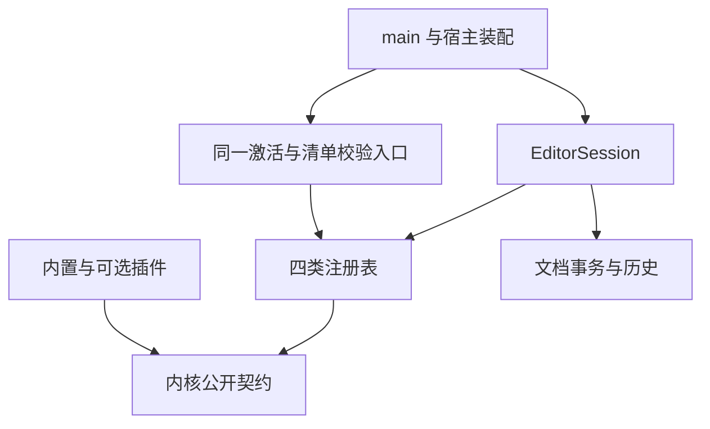

# SVG 编辑器 Phase 2 开发与验收计划

适用仓库为 `JevonsShi1108/svg-editor`。起点为 Phase 1 的 `final`。本计划把课程的六个过程节点展开为可单独验证、可提交、可续跑的工作单元。文中的“建议”是本次为执行而作的设计选择，标为“已核对”的信息来自现有仓库。

## 1. 从这里启动 Goal

**在本机 Windows 的源码仓库启动 Codex，使用能访问本机 VS Code 窗口的会话。** 本次找到的源码、课程材料和本计划是三个不同的入口。

| 用途 | 本机位置或仓库位置 |
|---|---|
| 开发仓库及既有 Git 历史 | `D:\FUDAN_RESOURCES\Software_Design\svg-editor` |
| Phase 2 课程原文与两张示例图 | `D:\FUDAN_RESOURCES\Software_Design\pj1-phase2\phase_cli_2.md` 及同目录下的 `docs\images\` |
| Phase 1 原文、实现规范、测试计划、执行计划 | 仓库的 `doc/spec/`，配合 `AGENTS.md`、`doc/README.md` 和实际代码阅读 |
| 本计划 | 文件名 `SVG_Editor_Phase2_Goal_Plan.md`。可将它附给 Goal，或在执行时放入仓库 `doc/spec/` |

1. 用本机 Codex 打开上述源码目录。若在 Cursor/VS Code 中编辑，也要让执行 Goal 的会话能取得**独立 VS Code 扩展开发宿主窗口**的截图和输入权限。在 Windows 本机开发最容易同时观察 GUI、运行真实文件系统测试。
2. 开始时给该会话授权查看和操作本项目的 VS Code 开发宿主及测试夹具。Codex 应先做一次窗口探测，再将实际可用的启动方式和窗口标题写入进度。本项目的 Git 修改、本机窗口控制和最终远程交付各有自己的执行时机。
3. 在支持 Goals 的 Codex 输入下面这段。计划会随源码一起进入后续执行上下文。若通过附件提供，在第一次提交中归档到 `doc/spec/`。中断后在原会话使用 `/goal resume`，从最近的已验证提交恢复。Goal 的设置与恢复语法见 [OpenAI 官方说明](https://developers.openai.com/cookbook/examples/codex/using_goals_in_codex)。

```text
/goal 在 SVG 编辑器同一仓库中，从 final 开发 phase_cli_2.md 的全部必做内容。读取 SVG_Editor_Phase2_Goal_Plan.md、两阶段课程原文、仓库 AGENTS.md、Phase 1 报告和测试。以本计划的 P2-00 至 P2-15 为路线。沿用 TypeScript strict、OO、事务和历史边界、分层测试、真实进程与小步本地 Git 提交。每完成一个可验证行为就运行相应检查、审查差异并提交，更新进度后自主进入下一步。
先观察原生 Outline，再开发扩展。我将授权你启动、查看、点击和编辑本项目的 VS Code 扩展开发宿主及临时夹具。请自己打开 Explorer 和原生 Outline、点击 rect#start、检查第 3 行、修改未保存的 SVG、制造并修复不完整 XML，自己读取真实窗口截图。遇到偏差就复现、补测试、修复、重载并重做相同动作，直到行为与课程要求相符。留下本次构建的两张验收截图以及更新、异常和恢复证据。首次缺少真实窗口能力时说明具体需要开启的权限，同时继续可独立完成的工作。
完成四个 CLI 扩展点、六种原图形的注册装配、stats、dir、box、两个树标签、双装配、原子加载、旧会话与新会话逐字节验证、零内核改动证据、PlantUML、ADR、自动指标和课程报告。普通技术决策按计划和实际反例解决。最终在干净检出的准确候选 SHA 上复验，提交验收摘要；沿用 Phase 1 的发布顺序，收到本阶段的发布授权后才在同一远程交付分支和 p2，并读回核对。已有标签保持原指向。可恢复的故障自行诊断并继续。
```

**Goal 的完成条件分两步。** 本地候选需同时具备真实 UI 证据、CLI 自动门禁、Git 差异证明和精确 SHA 收据。课程最终交付还需同一远程上的分支和 `p2^{}` 都指向该 SHA。若执行时用户已明确授权最终打标和推送，核对完成后直接执行，无需二次确认。

## 2. Phase 1 的真实基线

以下内容已通过 Git 对象、生产源码、测试和本地交付收据核对。

| 事实 | 对 Phase 2 的影响 |
|---|---|
| `final^{}` 是 `667fa6efcfe074697aec595ed6f4e6a146b616c1`。该提交所在的本地分支为 `codex/phase1`。到 `final` 共 21 个提交。原交付回读的远程是 `origin`。 | 从此提交建立 Phase 2 分支。在此基础上提交的文档、重构、实现和证明可逐个审查。 |
| `f870b1d` 建立事务和可逆变更，`35c9b3d` 完成层级编辑，`b6e2644` 加入历史身份检查，`4cebe7a` 接通真实文件与编译后 CLI。 | 先保住内容、历史、文件边界，再开放扩展插槽。避免第二套历史栈和私有回滚逻辑。 |
| `412641e` 加入独立模型，`bb72126` 修正创建预览的不完整摘要，`662dd4b` 强化逐需求证据，`656a428` 修正 Git 行尾导致的图证据误判，`0cdf2c4` 关闭真实符号链接环境阻塞。 | 发现反例时先留下失败断言。分别核实产品错误、测试预言机错误、Windows 能力和证据脚本错误。保留修复前后记录。 |
| 课程报告列出 19 条命令、6 种图形和 36 个合法 `set` 组合。精确候选及发布收据记录整套 767 项通过，0 失败、0 跳过，另有 8 项性能检查。课程报告列出的行、语句、分支覆盖率分别为 97.18%、95.67%、92.86%。 | 用原套件回归。门槛沿用配置值，历史实测百分比用作对照。不要把“用例总数没变”当作原行为得到保护的依据。 |
| 原候选收据位于 `artifacts/acceptance/<完整SHA>.json`，发布后另有 `artifacts/delivery/final-<完整SHA>.json` 和 `remote-readback.txt`。发布报告只记录已经完成的操作。 | 开发进展与机器日志分开保存，最终被测提交之外生成收据。后续任何已跟踪修复都会形成新候选，需要重新验证。 |

**代码具体如何写。** 生产类一类一文件，类名对应文件名，依赖用构造参数传入，值描述使用 `readonly`、拷贝和必要的冻结。沿用 Node ≥ 24、NodeNext、`import type` 和项目现有的 ESM 导入习惯。TypeScript 开启 `strict`、`noUncheckedIndexedAccess`、`exactOptionalPropertyTypes`、`noImplicitOverride`。Prettier 设置为单引号、尾逗号、100 列。沿用自然的命名、已有错误类型和按层的代码布局。新增类应承载实际职责；只含值契约的文件可组织相关接口。展示扩展使用单独的 VS Code 类型与编译范围，领域构建仍可独立运行。

**每次增量的节奏。** 从实验条款写出可观察断言 → 用最小反例尝试触发 → 实现一个行为 → 运行相关测试及静态检查 → 核对受影响的旧用例和差异 → 用明确路径暂存 → 阅读 `git diff --cached` → 本地提交 → 更新下一步。普通提交沿用 `feat(scope): …`、`fix(scope): …`、`test: …`、`docs: …`、`chore: …`。旧 `AGENTS.md` 中 Phase 1 当时冻结 GUI、box、远程操作的范围在 P2-00 写成分阶段条款；原设计、测试、授权习惯继续有效。

**读源码后确定的改造点。**

| `final` 中实际位置 | 差异与设计任务 |
|---|---|
| `src/main.ts`、`src/application/commands/CommandCatalog.ts` | `main` 创建真实 Session、Codec、FileStore。Catalog 已用 Map，但构造期间显式导入命令，`parseCreate` 还按字段名 `text` 区分字符串。需由已注册命令与 provider 的参数定义共同驱动 CLI 和结构化入口。 |
| `src/domain/shapes/ShapeFactory.ts`、`ShapeSchema.ts`、`src/domain/values/contracts.ts` | Factory 有六种具体类的表，`ShapeCreation` 是封闭联合。保留六种输入的静态校验，为插件建立受 schema 校验的输入边界；合法类型和标签文本不能靠拓宽为 `any` 解决。 |
| `src/domain/document/SvgDocument.ts`、`SvgDocumentBuilder.ts`、`src/infrastructure/svg/XmlSvgDecoder.ts`、`XmlSvgEncoder.ts` | 多处各自构造 ShapeFactory；编码器直接用 `shape.type` 写 XML 标签。组创建、候选文档、读回、写出必须获得同一注册视图。运行时 `box` 与落盘标签 `g` 需要分别表达。 |
| `src/application/commands/{SetCommand,TreeCommand,QueryCommand}.ts`、`src/application/session/EditorSession.ts`、`src/cli/TextPresenter.ts` | `SetCommand.run` 直接调用 `node.set`。`TreeCommand.run` 给出只读树，Presenter 生成行。`#query` 目前同步执行，`dir` 需要在 Session 原有队列中等待异步目录读取。 |
| `src/application/contracts/api.ts`、`src/application/internal/protocols.ts`、`src/application/history/HistoryManager.ts` | 请求、结果和编排类型目前指向既有种类。保留旧公开请求与结果，扩展结果使用通用只读字段。保住请求排队前的参数复制、准备后统一发布、dry-run 回滚和两种变更记录。 |
| `scripts/verify-stage.mjs`、`source-digest.mjs`、`vitest.config.ts`、`scripts/dependency-rules.mjs` | 原阶段脚本只识别 M00–M15；生产摘要和覆盖率主要扫描 `src`。让新目录进入实际构建、静态检查、覆盖率、依赖和候选验证，保留历史门禁可运行。 |

已用现有编译入口输入 `help`、`stats`、`dir`、`tree` 和未启用的 `create box`。其中 `final` 对未知命令打印 `error: unknown command`。Phase 2 §2.3 明确要求带命令名。计划在通用未知命令诊断里使用现有 `command` 参数，独立断言 `error: unknown command: stats` 和 `error: unknown command: dir`，并记录这一项协议细化。不在内核列出插件名。对两个阶段共有的命令及课程基础会话逐字节比对，未注册图形继续使用原有的 `unknown shape type` 文案。

## 3. 要求与证据的总表

| 课程条款 | 可验收结果 | 主要步骤 | 最有说服力的证据 |
|---|---|---|---|
| A.1 | Explorer 仅给 SVG 文件加 `[]` | P2-01、02 | 实际截图、正反夹具、文件名及 SHA-256 前后对照 |
| A.2、A.3 | 原生大纲、源码定位、实时更新、坏 XML 恢复、职责和模式分析 | P2-01、03、04 | 点击截图、宿主测试、同一窗口恢复记录、复用对照 |
| §1 | 四个内核侧接口和默认的六图形/十九命令 | P2-05、06、07、08 | 注册/调用/缺省/违约测试、依赖扫描、扩展点清单 |
| §2 | 独立 `stats`、`dir`，两种装配与目录适配器 | P2-09、10、14 | 替身、临时目录、无文档及历史不变、进程字节对照 |
| §3 | handler 优先、白名单兜底、冲突、故障整体回滚 | P2-07、11、14 | 两个子部件故障探针、已有 redo 的完整状态比较 |
| §4 | box 的创建、保护、读写、降级、零内核改动 | P2-06、07、11、12 | §6.1 B 回放、独立 XML 检查、两条兄弟提交差异 |
| §5 | 两个独立标签能并存，无标签基线一致 | P2-07、13、14 | 标签状态机、同一行双标签、空注册表字节基线 |
| §6 | 代码/配置共用加载路径，配置异常可继续启动 | P2-08、09、10、11、12、14 | 坏模块前后夹有好模块、注册快照、A/B 比对、Git 路径核查 |
| §7 | 同一远程、不可移动的 `p2`、报告、PlantUML、ADR、脚本化指标 | P2-00、08、14、15 | `doc/README.md`、`docs/metrics/`、干净候选收据、远程读回 |

课程给出的额外图形、导出等扩展属于选做。本计划把余量优先留给桌面复验、插件独立性和精确候选检查。

## 4. VS Code 的实现与自主观察

### 4.1 先观察原生大纲，再写 provider

在独立测试目录准备 `example.svg`、`plain.txt`、`session.txt`、普通目录及名为 `folder.svg` 的目录。给临时测试配置启用 Explorer 的 decorations badges。先在未加载本扩展的普通 VS Code 实例中打开一个内建能识别结构的 TypeScript 或 Markdown 文件，观察 Outline 的展开、点击、源码选区、编辑更新。再打开同一份 SVG，记录实际编辑器、语言模式、现有大纲及第三方扩展情况。若 SVG 被当作图像打开，选“重新打开方式 → 文本编辑器”。此次观察存入运行记录，作为设计定位和排除其他 provider 的依据。

验收夹具的行号应固定。下面第 3 行是自闭合矩形，`text` 无 id，`&amp;` 是 XML 实体。

```xml
<svg xmlns="http://www.w3.org/2000/svg" width="800" height="600">
  <g id="flow">
    <rect id="start" x="20" y="20" width="120" height="60"/>
    <g id="nested">
      <text x="30" y="50">Hello &amp; SVG</text>
    </g>
  </g>
</svg>
```

建议扩展包位于 `extensions/svg-tools/`，包含自己的 `package.json`、`engines.vscode`、编译入口、示例和启动配置。让扩展清单的 `main` 指向实际生成的入口，单独确定与所测宿主兼容的模块格式，保留 CLI 的 NodeNext 构建。开发宿主按配置加载刚构建的扩展，运行时由宿主提供 `vscode` 模块。桌面集成测试用锁定的 VS Code 版本和 `@vscode/test-electron`；复用仓库现有 Vitest 测纯逻辑。两种测试负责不同断言。[VS Code 扩展入门](https://code.visualstudio.com/api/get-started/your-first-extension) · [官方测试指南](https://code.visualstudio.com/api/working-with-extensions/testing-extension)

### 4.2 两项功能分别怎样接入

| 功能 | 拟实现方式 | 首批测试 |
|---|---|---|
| 文件标记 | `activate` 通过 `window.registerFileDecorationProvider` 注册，加入 `context.subscriptions`。选择能在只打开普通文本时仍激活的时机，例如 `onStartupFinished`。后缀匹配后用 `workspace.fs.stat(uri)` 区分文件、目录和消失的路径，普通 SVG 文件返回 `FileDecoration('[]')`，关闭向父级传播。 | 启动后只选 `plain.txt`，仍能看到旁边 `example.svg` 的标记。覆盖 `folder.svg`、`x.svg.bak`、普通目录、删除/改名、取消或 stat 失败。建议按作业字面只支持小写 `.svg`，记录大小写规则。 |
| 大纲 | `languages.registerDocumentSymbolProvider` 只匹配目标 SVG 文本文档。选择器要覆盖本机实际使用的 XML 语言模式，可用文件名 pattern 限定。provider 读取 `TextDocument.getText()`，生成有层级的 `DocumentSymbol[]`。展示用 `标签名#id` 或标签名。 | `svg → g#flow → [rect#start, g#nested → text]`，同层同名、无 id、中文及转义内容。普通 XML/TXT 保持其原有 provider 行为。 |
| 源码范围与更新 | `range` 包含从开标签到配对闭标签的完整元素，`selectionRange` 位于其中，建议覆盖开标签。用原始文档的 UTF-16 偏移配合 `document.positionAt`。解析失败可返回空数组，下一次请求从最新缓冲区恢复。 | 第 3 行、人眼行号与 API 零基第 2 行；插入一行后向下移动；自闭合、多行属性、属性引号内的 `>`、CRLF、表情符号、注释。先改未保存内容，再使 XML 残缺，再修复。 |

解析实现先验证现有 `saxes` 的原始偏移语义，尤其是开标签事件触发的位置。若需要额外记录标签起止，用能识别引号和注释的词法位置记录，与 XML 事件栈关联。每个节点保留起止偏移，按文档树一次生成层级。取消或较旧文档版本的结果应丢弃。对暂时错误的输入在 provider 边界收束，防止每次键入都弹错误通知。[FileDecorationProvider 与 DocumentSymbol](https://code.visualstudio.com/api/references/vscode-api) · [Document Selector](https://code.visualstudio.com/api/references/document-selector)

**复用判断写入 A.3 报告。** 现有 `XmlSvgDecoder.decode` 使用 `saxes` 和栈，能提供解析事件及遍历思路；它还验证六类形状、画布尺寸、资源限制，为缺 id 的元素分配 ID，返回编辑文档。`SvgDocument.describeTree` 返回语义树，已丢失源位置。大纲要展示用户此刻键入的标签和真实 id，还要定位第 3 行。因此优先复用解析库和已经验证的解析经验，为扩展写带源位置的轻量扫描器。用缺 id 的 `text`、合法的非 CLI 子集元素和未保存的缓冲区分别证明这一选择。若提取公共函数，记录双方真正共享的输入、输出及测试。

**设计模式说明要画到对象。** Host 管理 Explorer、Outline、编辑器、刷新和导航。扩展注册 provider 实例，Host 按需反向调用。文件装饰的实际调用链是 `Explorer → FileDecorationProvider → FileDecoration → Explorer 渲染`。经典 Decorator 通过同一 Component 接口包裹并委托给对象，这里的 provider 向宿主贡献显示元数据，组合发生在宿主。Outline adapter 将含偏移的 XML 节点转成 VS Code 的 `DocumentSymbol`；与 §6 的目录 adapter 对照，分别说明客户需要的接口、被适配的数据/接口和转换所在的类。

### 4.3 Goal 怎样实际看见结果

本机已找到 `E:\Microsoft VS Code\bin\code.cmd`；执行时先用 `code --version` 记录实际版本。在根仓库提供名为 `Phase 2: SVG Extension` 的 `extensionHost` 调试配置，F5 绑定扩展自己的构建任务及 `--extensionDevelopmentPath`，打开测试夹具。提供同等的命令行路径，方便 Codex 重启后重新定位窗口。下面是待开发脚本 `build:vscode` 接入以后可使用的 PowerShell 示例，`$fixture` 应指向已复制好的临时夹具，临时 profile 只服务本次观测。

```powershell
npm run build:vscode
$extension = (Resolve-Path 'extensions/svg-tools').Path
$fixture = (Resolve-Path 'artifacts/ui/fixtures').Path
$profile = Join-Path $env:TEMP ('svg-p2-ui-' + [Guid]::NewGuid())
code --new-window --user-data-dir $profile --extensions-dir "$profile/extensions" "--extensionDevelopmentPath=$extension" $fixture
```

Codex 通过已授权的本机窗口控制，按标题和夹具路径识别“扩展开发宿主 / Extension Development Host”。读取窗口实际图像及可访问控件，展开 Explorer 与 Outline，点击具体行。记录 VS Code 版本、扩展源码版本或摘要、夹具摘要、语言模式和显示设置。若现会话仅能运行终端，先检验能否用已授权的桌面控制或本机 UI 自动化读取**同一个真实 VS Code 桌面窗口**并执行一次点击。能力缺失时只请求该窗口所需的接入，同时完成纯解析、扩展宿主 API 或后续 CLI 独立工作。桌面复验保留为待办，恢复后从原场景接续。[VS Code 命令行与独立配置](https://code.visualstudio.com/docs/configure/command-line) · [本机应用访问](https://developers.openai.com/training/walkthroughs/using-your-computer-and-browser)

| 场景 | Codex 自己做的动作 | 它必须从窗口或文件读到的结果 |
|---|---|---|
| U0 原生观察 | 未加载本扩展，打开结构化文本，展开原生 Outline 并点一个符号。 | 记录宿主的跳转动作、编辑刷新结果，以及原始 SVG 的表现。 |
| U1 徽标与负对照 | 在开发宿主中选中 `plain.txt`，保持 Explorer 展开；先后检查 SVG、TXT、普通目录及 `folder.svg`。 | 只有 `example.svg` 右侧有字面量 `[]`。对文件名逐个比较，并在未编辑夹具前后核对哈希。保存 `docs/images/p2-vscode-badge.png`。 |
| U2 大纲与定位 | 以文本打开 `example.svg`，展开 `svg`、`g#flow`、`g#nested`；先把光标放到别行，再用鼠标点击 `rect#start`。 | 大纲中无 id 子节点显示 `text`；编辑器定位到第 3 行的 rect 开标签。截图同时能辨认层级、选中节点和行号。保存 `docs/images/p2-vscode-outline.png`。 |
| U3 未保存的编辑 | 把 `id="start"` 改成 `id="ready"`，暂不保存；再在它前面插入一行，重新点击。 | 旧节点消失、新节点出现，点击定位到新第 4 行；记录文件仍显示未保存。 |
| U4 残缺与恢复 | 删掉必要的结束标签，使文档 XML 不完整；恢复该标签，在同一窗口再点节点。 | 允许大纲暂空。扩展宿主继续响应，恢复后重新出现完整层级并能跳转。保留连续观察记录或前后截图；核对扩展宿主日志。 |
| U5 修复后原样复验 | 恢复临时夹具，重载刚构建的扩展；再次执行 U1、U2 及刚失败的步骤。 | 证据与本次构建和 fixture 匹配；课程的两张参考图只用于对照。最后检查截图中文字没有被裁掉。 |

**发现偏差后的顺序。** 把“操作、预期、实际截图、当前版本”记为一条失败记录。徽标不出现先查扩展激活、资源类型、装饰设置及第三方装饰竞争。大纲为空先查是否打开文本编辑器、selector、扩展激活和 provider 返回值。定位错行先查源偏移、换行和 UTF-16。API 用 `vscode.executeDocumentSymbolProvider` 核对当前 URI，再在窗口用真实点击核对定位。修复最靠近根因的一层，运行针对性测试，重建、重载、重复相同动作；达到场景预期才保存验收图、提交并自行继续。主题、布局、图标和截图尺寸可与示例不同。[VS Code 内置测试命令](https://code.visualstudio.com/api/references/commands)

## 5. CLI 的扩展边界

建议沿用仓库的层级，逐步新增 `src/host/`、独立 `plugins/` 和 `extensions/svg-tools/`。内核的领域接口归领域层，需要会话、命令或展示数据的接口归应用公开契约。可以提供一个只导出公共类型的入口供插件引用，但领域层不能经该入口反向导入应用。组合根负责创建插件和注入能力。



### 5.1 四个接口如何被调用

下表的方法及新路径是**实施建议**，旧位置在 §2 已列出。P2-15 在 `doc/README.md` 把每一项换成已提交的实际相对路径和函数名，附插件类、默认行为、错误文案/错误码和测试编号。

| 内核侧接口 | 公开职责与拟调用位置 | 实现与空配置行为 | 契约失败与验证 |
|---|---|---|---|
| `ShapeProvider` | 描述注册名、创建字段类型、容器能力、复合子树创建、XML 标签/元数据识别与恢复。由 `ShapeFactory.definition/fromCreation`、`SvgDocument.create`、Builder、Codec 的 decode/encode 调用同一注册视图。 | 六种原生类型由类实例注册到默认装配。可选 `box` 关闭后，旧形状照常运行；`create box` 报原未知类型，标记的 `g` 以普通分组读回。 | 同类名称重复则拒绝整包。创建计划先校验 ID、大小、深度与父级，错误不留半棵子树。反序测试读取、创建、编码对同一类型的认识。 |
| `Command` | 提供名、help、参数定义/绑定、执行类别、执行行为。由 `CommandCatalog.parse/bind/describe` 和 `EditorSession.execute` 分发。保留旧 Command 多态及串行队列。 | 原有 19 条命令按原 help 顺序注册。`plugins/stats`、`plugins/dir` 各有自己的类、包和 manifest，可单独开关。关闭后的调用给出 §2.3 指定错误。 | 非法参数在绑定时失败。异步查询失败只产生一次结构化诊断，下条命令能执行；只读查询不取得修改权限。 |
| `TreeDecorator` | 输入为只读行描述、文档或子树上下文，输出可选的行尾标签。通用渲染在 `TextPresenter.tree/data` 处理根、普通行和 `tree <id>` 首行，在换行前拼接。 | 两个独立实例 `modified-star` 和 `box-type-label`。零实例时返回原行字节，连多余的空格都不追加。 | 重名拒绝。空返回跳过，非法多行标签或抛错生成可定位的查询错误；先准备整个查询结果再输出，不能留下半棵树。 |
| `AttributeHandler` | 以只读目标及 attr 判定 `handles`，以当前命令受限的编辑上下文执行 `apply`。`SetCommand.run` 先查处理器，零命中再调用原 `Shape.set`。 | `box-attributes` 支持 box 的 `fill`、`label`。无命中时原 36 个合法组合可用，普通矩形的 `label` 给出 `error: unknown attribute: label`。 | 多命中在写入前报告冲突；已命中的处理器部分写入后抛错，整个事务回滚；同一 `set` 最多新增一个 undo 单元。 |

**框架阶段一次解决的事情。** 把六种具体 shape 的构造映射移到内置 provider 装配，通用内核只见接口。为 `group` 命令获取普通容器提供默认角色/工厂，消除 `SvgDocument.group` 对具体实现的依赖。CLI 的 `create … in …` 仍由统一入口识别尾部未加引号的 `in`，参数语义交给 provider。公开命令契约可用“旧强类型请求 + 可校验的扩展载荷”的重载/泛型设计；保持旧请求形状及严格字段校验。插件只获得只读 DTO、公开领域操作或限时的事务门面。外部包不得导入 `domain/internal`、`application/internal` 或宿主装配文件。用一份测试插件在不认识的类型名上贯通各入口，之后才接真实插件。

**异步查询与输出。** 把只读查询的调度签名扩为可等待的结果，在原来的 Session 队列中完成再发布返回值，后来的命令按原顺序执行。以 `requiresDocument` 或等价的公开能力声明区分 `dir/help` 与 `stats/tree`。查询仅取得所需信息。新增一个可安全渲染的通用结果/诊断形式，保留旧 `ResultData` 的输出；控制字符沿用 `TextPresenter.safe` 的转义策略。插件可给出值描述和可显示信息，stdout/stderr、换行和错误恢复仍由宿主维护。验证 `help` 顺序、无文档、已有 redo 和 IO 屏障。

**依赖检查。** 扩展现有依赖规则，实际遍历 `src`、`plugins`、VS Code 包和 type-only imports。允许宿主装配依赖实现，禁止内核导入具体插件、插件导入宿主/内核私有目录、插件相互深层导入、CLI 或领域依赖 `vscode`。VS Code 的 API 不进入 CLI 构建。准备至少一个应失败的依赖样例证明规则有效。默认装配总给出原六图形和十九命令，禁用所有本阶段可选插件仍可启动；单个插件加载失败不妨碍其余已成功注册的能力。再用最小装配刻意遗漏一个内置 provider，验证启动及无关命令可用，对缺失能力返回明确诊断；完整默认装配仍须通过全部旧命令。

## 6. 插件逐个实现与 ADR

### 6.1 两个命令

**`stats`。** 无参数，需要当前画布。取公开只读树，从根的第一个子节点开始，按孩子当前顺序作深度优先遍历。用容器能力识别普通组、空组和复合形状；根不入计数。叶子按首次出现顺序放入 Map。空画布输出 `(total 0, containers 0)`。例如子节点依次是一个含 `text, rect` 的组、一个 `rect`、一个含 `rect, text` 的 box，预期 `text: 2  rect: 3  (total 5, containers 2)`。调整兄弟顺序，确认类型顺序，也确认计数总和与 total 一致。未初始化时沿用已有“no document”诊断；`stats extra` 测参数拒绝。断言执行前后内容、路径、revision、dirty、两个历史栈及屏障一致。

**`dir`。** 目标接口可定义成 `DirectoryReader.list(path) → Promise<readonly DirectoryEntry[]>`，只暴露名称与类别。`DirCommand` 是客户端，`DirectoryReader` 是 Target，`NodeDirectoryReader` 是 Adapter，Node 的 `fs.promises.readdir(..., { withFileTypes: true })` 和 `Dirent` 是 Adaptee。由 `dir` 包的激活入口构造适配器并注入命令，A、B 共用它；单测直接注入假目录读取器。启动 cwd 由宿主以只读值提供。沿用现有 `FileStore` 专管 SVG 读写的边界。

- 无参数，无文档也可运行。只列启动 cwd 的直接子项，包含隐藏项，排除 `.`、`..`。默认策略建议略过符号链接及其他特殊类型，不跟随目标；特殊项单独测试。`read/save` 的路径变化不影响 cwd。
- 先目录后文件，各组按原始名称的确定性升序排序，建议使用 JS 字符串的序比较，保留大小写，避开 OS 排序和 locale 差异。标记后**恰好两个 ASCII 空格**。对乱序和相反顺序的适配器输出断言同一字节结果。
- 空目录输出 `(empty directory)`。读取失败在 stderr 输出 `error: cannot read directory: <path>`，随后的命令仍执行。错误用当前目标路径；成功和失败都不产生历史条目，不解除/设置历史屏障。用查询前后的 redo 和实际再执行 redo 双重核对。
- 独立测试覆盖混合项、空目录、隐藏文件/目录、特殊项、同组排序、读取失败、额外参数。再用临时目录接通真正的 Node 适配器。适配器异常可用临时目录中确定不存在的子路径制造，避免 Windows 权限差异让故障测试偶尔成功。从含同名文件的两个不同目录发起 CLI，并读写 cwd 之外的 SVG，验证枚举的始终是进程启动目录。Windows 真链接夹具沿用原项目的系统能力检查。

```text
[DIR]  .cache
[DIR]  docs
[FILE]  .env
[FILE]  demo.svg
```

### 6.2 属性与复合图形

**ADR-01　处理器冲突与事务。** `handles` 只接收冻结的类型/id/属性描述，返回是否匹配。完整收集命中者，零个走既有白名单，一个执行该 handler，多个在第一次写入前报错，诊断带目标属性及稳定的处理器名。`apply` 可以通过限时门面读取目标及必要子部件、修改允许的状态；门面绑定当前文档身份和已开启的事务，调用结束后失效。异常统一回到 `EditorSession.#edit` 的现有回滚路径，保留 undo/redo 双栈和状态身份。只有 Lease 所有者可 prepare、commit 或 rollback。handler 没有“失败后再试默认 set”的路径。

用同一条 `set` 修改两个子部件的探针来验证粒度。先制造非空 redo，再让探针写完第一处即抛错，比较前后语义快照、状态、原 redo 能否真的重放。另做成功的双部件修改，单次 undo/redo 成对恢复；重复设相同值、dry-run、保存屏障按 Phase 1 语义执行。课程的 `fill`、`label` 都要有自己真实命令的测试。

**ADR-02　box 的创建、持久化与保护。**

| 场景 | 建议采用的具体约定及断言 |
|---|---|
| 构造 | `create box n1 120 100 160 60 "开始"` 产生容器 `n1`、第一个子节点 `rect#n1-rect`、第二个子节点 `text#n1-label`，默认矩形填色 `#4a90d9`。示例文字位置为 `(140,135)`；其他尺寸建议固定为 `x+20, y+h/2+5`，这是布局选择，另用非 60 高的夹具固定。普通颜色、数值、文本、ID 与资源界限沿用 P1。 |
| 原子性 | 创建前校验主 ID 和全部派生 ID，兼查子树内部及活动索引；节点预算一次考虑三节点和最大深度。实际写入在一笔事务中完成。预先占用 `n1-rect` 或 `n1-label` 时，失败后查不到任何新增节点；撤销创建、删除整框及重做各保持子树、次序和对象身份。 |
| 统一行为 | 支持 `in`、box 套 box、被普通 group 收编、整框 move/scale、删除整框。`set n1 fill #f5a623` 只改内部 rect 的 fill；`set n1 label "处理数据 v2"` 只改内部 text 的内容。一个成功命令对应一个历史操作。对根级或嵌套 box 执行 `ungroup n1` 都得到 `error: cannot ungroup composite shape: n1`；普通组沿用原根级限制。 |
| 必要子部件 | 选择拒绝直接删除、移出、单独几何移动必要部件；覆盖 `delete`、`addto`、以 `group` 收编、独立 `move/scale` 等入口。普通可选子节点仍可自由编辑。用挂接策略/受限操作守住拥有关系，区分“用户试图拆件”与“整体 move、删除整框、事务回放”。建议也拒绝直接改必要件的几何属性或把它换出模板顺序；允许经事务修改仍符合 schema 的颜色和文字。分别测试直接 `set`、`front/back` 与对整个 box 执行相应操作。 |
| 编码与读回 | 编码为 `<g id="n1" data-kind="box">` 与真实 rect/text。安装时由 provider 认出元数据，校验必需的直接子部件 ID/类型/归属，构造完整对象，允许额外的普通或嵌套节点。缺插件时保留已有元数据和全部孩子，降级为普通 `g`。缺部件、错类型时建议在装有插件时拒绝整次 read，原文档、路径、历史、保存点保持。全局重复 ID 在两种模式都拒绝。 |
| 判定原始输入 | 带插件的畸形 box 先核对必要子部件的真实 ID，避免 Phase 1 自动补 ID 把坏复合形状误判为合法。普通未命名元素继续执行原有确定性补 ID 和 warning。用 `@xmldom/xmldom` 的独立解析断言实际 SVG 中节点、属性、标签文字、XML 实体和顺序。 |

框架提供“创建复合子树、读回识别、表达容器能力、受控部件保护、描述输出”的通用能力。box 可以声明两个子部件为既有语义类型，通过公开上下文请求创建或编辑。插件独立测试用小型替身记录这些请求，避免通过导入内置实现或其他插件拼一个完整产品。另有集成测试将真实六种 provider 与 box 放在一起跑。§6.1 B 的验收要检查创建、移动、撤销、fill、label、再撤销、树和最终 XML；两个 box、各两个必要部件、外层 group、一条 line 合计 8 个元素。

为版本 B 单独写几行手工预期。例如创建反馈含 `box#n1 created (g#n1 + rect#n1-rect + text#n1-label)`，属性转发含 `box#n2 fill propagated to n2-rect`，撤销标题时展示恢复值“处理数据”。原 Presenter 主要按 `EditFacts` 和历史摘要输出。在 P2-07 先用通用、不可变的显示信息描述操作、目标和前后值，使 box 接入时能给出这些反馈；关掉扩展的原命令输出保持既有字节。Undo/redo 根据已保存的变更重放，不能再次执行 handler 来生成历史反馈。

### 6.3 两个树标签

**ADR-03　保存基准、祖先传播及顺序。** 采用“行内容与最近一次成功保存/干净读入的内容比较”的策略。新建未保存文档的根和新节点立即带 `*`；子节点变化向祖先传播。`(box)` 只标识实际具备 box 语义的容器。两者注册时互不引用；宿主按注册顺序拼接，以一个空格分隔。演示 profile 注册类型标签在前、星号在后，使同一行呈现 `g#n1 (box) *`。另测反向注册时按声明顺序翻转。禁用其中一个时另一个仍工作。

建议 `ModifiedStarDecorator` 实例独占该会话的保存基准。保存/成功读入时保留不可变的按 ID 行描述，含自身原始属性与文本、父级及有序孩子列表。渲染树时比较当前描述并从叶向根汇总，可同时发现新增、删除、换父和重新排序。新增插槽在无订阅者时无需准备额外数据；优先复用 save 已为编码准备的描述。普通单叶编辑不复制/编码整份文档，树查询允许 O(n) 比较。为 `tree <id>` 验证子树首行标记。插件重新实例化时从新会话初始化，不能污染第二个 Session。

| 状态变化 | 期望 |
|---|---|
| init → create → save 成功 | 新建节点及根先有星；确认外部写入成功后清掉所有已保存行的星。紧接 save 的 undo 仍触发 P1 的 IO 屏障。 |
| save → set → undo → redo | 修改行及祖先出现星，撤销该次新编辑时回到保存内容，星消失；redo 后重现。 |
| 自己反向编辑回到同值、空操作、dry-run、失败编辑 | 标记以保存内容比较；测试独立反向编辑与历史 undo 的区别，原有 `SessionStatus.dirty` 仍依赖状态身份。 |
| 删除、重排、跨父移动、删后同 ID 重建 | 比较父级的有序孩子和行内容，旧位置的祖先也能显示改动。按本 ADR 的内容定义判断重建后的标记。 |
| read 替换文档、未命名元素自动补 ID、save 失败/不确定 | 新文档替换实例中的基准；正常读入无星，发生语义修复的行及祖先待保存；写入未确认时不推进保存基准。再以成功保存验证清除。 |

将已提交的只读会话事件/保存快照交给标签，隔离观察器异常。只有实际发布、成功读入或确认提交的保存才切换基准。发生装饰器异常时记录故障并用明确诊断处理相应查询；禁止因展示问题重做一笔已提交的文件写入。标签看不到 live Shape、写权限或历史内部对象。

### 6.4 两种装配以及失败隔离

**ADR-04　先暂存，验证后发布。** 代码装配显式导入模块和它对应的真实 manifest。配置装配读仓库根 `plugins.config.json`，从模块名定位入口与 manifest。外层取得模块和选项后，两种方式都调用同一处 `activateValidated(module, manifest, options)`。四类注册名分别唯一；清单字段 `shapes`、`commands`、`decorators`、`attributes` 缺省为空。handler 和 decorator 的注册名与界面标签文字分开。

1. 校验整个配置文件的语法和结构，检查 `plugins` 数组、非空 module 名、enabled 类型以及项目选择的 options 结构。非法时只输出规定的配置错误，以默认内置能力启动。有效数组按顺序处理，`enabled: false` 不读取 manifest、不解析、不求值。
2. 相对路径以**配置文件所在目录**为起点；裸包名遵循项目运行环境的模块解析规则。对题目示例的目录型插件按 package.json 的已声明入口定位编译产物；Windows 盘符和空格路径转合法文件 URL 后再动态导入。验证“包名”和“相对目录”两条真实路径，含入口位于 `dist` 的包；不假设所有包都导出 `package.json` 子路径。
3. 分开处理“请求的顶层模块不存在”和“已找到模块，但求值、内部依赖或激活失败”。先定位入口，再执行加载；保留能识别失败阶段的错误。options 原样值复制并按当前插件传入，实例不共享可变配置。从未列入内核的新包也应加载成功。
4. 给当前插件一个临时注册表，校验当前批内重名以及与已成功插件/默认能力的冲突。激活完成后按类别和名称**集合**核对 manifest，差异按稳定次序展示。全部通过才一次发布；出错丢弃整个临时表，先前好插件保持，继续尝试后面的插件。注册上下文在激活结束后失效。
5. 独立测试以“好 A → 坏 B（先成功暂存若干项）→ 好 C”执行，每次核对四表、help、实际命令和诊断流。再把同类坏输入送入代码装配的共用入口，验证代码路径没有绕过校验或回滚。

| 触发条件 | CLI 应给出的外部诊断 |
|---|---|
| 配置不是合法 JSON 或整体结构不合法 | `error: invalid plugin config` |
| 配置指名的顶层模块找不到 | `error: plugin not found: <module>` |
| 模块无默认导出 | `error: plugin has no default export: <module>` |
| 四类声明与真实注册集合有差异 | `error: plugin manifest mismatch: <name> (declared: …, registered: …)` |
| `activate` 抛错 | `error: plugin failed to activate: <name> (<reason>)` |
| 同类同名，含单包中二次注册 | `error: duplicate registration: <category>/<name>` |
| 入口存在，但求值异常或内部依赖缺失 | 归入插件加载失败，建议沿用 `plugin failed to activate` 的格式并给出实际原因。测试同时断言诊断中没有把顶层插件误判为找不到。 |

建议启动协议为无选项时维持 Phase 1 默认体验；`--preset demo` 选择代码装配，`--config <path>` 选择配置装配。需要特定插件集的演示可在同一个代码装配文件中定义相应 profile，配置侧提供等价清单。两种方式实际使用相同的类、注入端口、注册顺序和 options；具体开关及用法写入 `doc/README.md`。示例中的 diamond、PNG 导出无需成为运行依赖。

例如，报告可给出下面这个只演示 §6.1 B 的配置。`shape-box` 是一个包，注册一个 shape 和一个命名 handler；另一个包 `box-label` 只注册一个 decorator。实际包名和声明与代码对齐。

```json
{
  "plugins": [
    { "module": "./plugins/shape-box" },
    { "module": "./plugins/box-label" }
  ]
}
```

`shape-box/package.json` 中 `contributes` 可写为 `{"shapes":["box"],"attributes":["box-attributes"]}`。代码装配在顶层选择同样的两个模块及各自清单，依次交给统一入口。把第二个配置项改成 `enabled: false` 后，框的创建、属性和保存应照常工作，树上只少 `(box)`。再用包名形式运行一个已经安装的插件，验证两种模块定位方式。

## 7. 小步 Git 路线

每一行都有可审查的绿色出口。“过程节点”用普通 commit 标识。单行涉及多个独立行为时可再拆 commit，保留全部真实历史。接入插件的提交与框架接缝提交分开，确保课程可以从 `C^ → C` 直接核验 OCP。

| 步骤 | 本步工作 | 提交前必须能回答的问题 | 建议提交主题 |
|---|---|---|---|
| P2-00 | 对照原始 `final^{}` 和当前工作树，读取发布收据，从 `final` 建 `codex/phase2`；归档 Phase 2 原文、本计划与参考图来源。为 Phase 2 更新阶段约束、进度和追踪入口。 | 在独立干净基线能否按锁文件安装、构建并跑原验证？十九条 help 行、§6、§6.1 A、无标签树的基线是否可重放？用户已有工作是否保留？ | `chore: establish phase 2 baseline and verification scope` |
| P2-01 | 建独立 VS Code 扩展包、临时夹具、F5 与宿主测试入口；先做 U0。 | 能否在同一台 Windows 上打开、识别并操作正确的开发宿主？没有扩展时的原生 Outline 如何响应？ | `chore(vscode): add extension host and observation fixtures` |
| P2-02 | 实现并注册文件装饰，做 U1；保留一张真实徽标截图。 | 只开 TXT 时 SVG 是否已有 `[]`？`folder.svg`、普通文本及文件哈希是否正确？ | `feat(vscode): decorate SVG files in Explorer` |
| P2-03 | 实现带偏移的 XML 遍历和 DocumentSymbol adapter；接通更新与取消。 | 未保存编辑、行位移、残缺→修复及 UTF-16 范围在纯测试和宿主测试中能否复现？ | `feat(vscode): map nested SVG symbols to source ranges` |
| P2-04 | 在真实窗口执行 U2–U5，修正实际观察到的偏差；写安装/启动步骤、A.3 模式与复用分析。 | 截图能否同时看见目标行和选中节点？旧图、新图和异常证据能否区分？ | `docs(vscode): record host behavior and reuse decisions`。**节点一** |
| P2-05 | 建公开注册接口及命令装配边界，迁移原 19 条命令的名称、handler、解析和 help 顺序。 | 老调用者、全部合法/非法参数、交互提示、管道输出和原 Command 多态是否兼容？ | `refactor(application): register built-in commands through public contracts` |
| P2-06 | 迁移六个 ShapeProvider。把 schema、创建、Builder、编码/解码和结构操作接入同一注册表。 | CLI/API/init/read/save 各入口对新注册的测试形状是否一致？关闭可选项的旧 SVG 往返及 36 组合是否仍通过？ | `refactor(domain): resolve shapes through registered providers` |
| P2-07 | 接通 handler 事务、复合形状通用构造/保护、异步查询、只读树装饰和保存基准通知。分成多个行为提交。 | 空注册表是否兼容？两个子部件写到一半抛错能否恢复？普通编辑是否仍满足旧性能约束？ | `refactor(application): add transactional attribute dispatch` 等 |
| P2-08 | 放入宿主侧原子激活、动态配置解析、两套入口、首版指标和依赖规则，运行原集合全回归。冻结本轮插件所需公开接缝。 | 四个接口的注册、调用和缺省状态是否已有独立证明？坏包是否隔离？`docs/metrics/` 是否已由脚本首次生成？ | `feat(host): validate and publish staged plugin registrations`，另提 metrics。**节点二** |
| P2-09 | 在独立包实现 `stats`，走代码和配置两种入口。 | 首现顺序、空组/嵌套、help、单独禁用、保存屏障和 redo 是否正确？ | `feat(plugins): add depth-first shape statistics` |
| P2-10 | 独立包实现 `dir`、DirectoryReader 和 Node adapter；跑 fake、真实临时目录、固定目录双装配。 | 新增 dir 的提交里内核、loader 与已存在的 stats 是否零差异？无 SVG 时能用，旧文档及历史保持吗？ | `feat(plugins): list the working directory through an adapter`。**节点三** |
| P2-11 | 在共同基点 F 的代码演示分支接入 `box` 和 `box-attributes`；对照 §4.4 补完整独立/集成测试。 | 本次新增插件包以外，运行源码是否只改一个顶层代码装配文件？提交父子对和必需元数据是否可核验？ | `feat(plugins): integrate box using code assembly`，记为 `C_A` |
| P2-12 | 从同一 F 的另一分支接入完全相同的包，以根配置启用；验证后合并两条历史，使 `C_A/C_B` 从交付分支均可达。 | 包内容逐字节相同？配置方式有无修改既有运行代码？两条证明的基点、父提交和实际路径是否记录？ | `feat(plugins): integrate box using config assembly`，记为 `C_B`。**节点四** |
| P2-13 | 独立提交 `box-type-label` 和 `modified-star`，分别证明零内核/渲染器差异；再做双标签组合和 §6.1 B 完整回放。 | 每个标签可单独运行？同一行顺序、保存点、祖先传播、子树根和禁用时字节一致性是否正确？ | `feat(plugins): annotate box rows`、`feat(plugins): mark unsaved tree changes`。**节点五** |
| P2-14 | 三套编译后 CLI 会话、历史/故障模型、依赖与差异复核。生成前后图、职责清单、指标增量，补课程报告和 AI 修订记录。 | 是否按同一绝对 cwd 做 A/B 逐字节比较？扩展点清单能否定位到真实函数？每条需求能否指向实际断言或截图？ | `test: verify equivalent assemblies and phase 1 compatibility`、`docs: report architecture and metrics` |
| P2-15 | 在准确 SHA 的干净检出安装、构建、跑全部门禁，复核本次构建 UI，写提交外收据；按授权处理远程。 | 候选提交和报告能否复现？远程分支与 `p2^{}` 是否读回为同一 SHA？ | 收尾报告为普通 commit，最终已验收提交上创建一次 `p2`。**节点六** |

若接真实插件时发现框架缺少能力，把问题缩成与 `box`、`dir` 等业务名称无关的契约测试，先用独立的框架提交修好并跑回归，再从更新后的共同基点做插件接入证明。历史中的失败尝试和修复可在记录中说明；零差异判据针对真实的接入提交。

## 8. 测试如何分层与判定

### 8.1 沿用的测试资产

| 测试层 | Phase 1 已有入口或文件 | Phase 2 的增量断言 |
|---|---|---|
| 单元及固定回归 | `npm run test:unit`，`test/unit/`、`test/regressions/` | 每个插件包单独运行；用最小公开上下文/假目录/只读描述，测试正常、缺省、错误。树装饰与属性处理无需启动其他插件。扩展的 XML 扫描也在此层测试。 |
| 应用与适配器集成 | `npm run test:integration`，`SemanticSnapshot`、`InvariantOracle`、`TempDirectory` 等测试帮助类 | 调用真实 Session/Catalog、Codec、目录适配器及 loader；显式检查树序、ID 索引、属性存在性、节点计数、路径、dirty、revision、undo/redo、屏障。 |
| 黑盒进程 | `npm run test:e2e`，`test/helpers/run-cli.ts`，`test/e2e/lab.test.ts` | 构建 CLI，以管道输入真实命令，分开收集 stdout、stderr 与退出码；读回实际保存的 SVG。原 E2E 里禁用 box 时的未知类型断言仍应通过。 |
| 性质、模型与性能 | `test:property`、`test:model`、`test:performance`，独立 `test/model/ReferenceModel.ts` | 产生有限大小的嵌套树、冲突 ID、重排、处理器失败及保存/撤销序列。期望用手写节点记录和快照计算。避免由被测 provider/编码器再次生成期望。 |
| VS Code 宿主与桌面 | 新增建议入口 `test:vscode:host`，与 §4.3 的 U0–U5 | API 断言层级与源范围；桌面记录证明 Explorer 显示、原生 Outline 点击和编辑后的实际反馈。同一张截图不重复计作“异常恢复”。 |
| 架构及交付 | `check:deps`、`check:traceability`、`verify`、`candidate:verify` | 扫描新路径与 type-only 依赖，绑定每项测试选择器和真实证据；补充 Git 零差异、CLI 双装配、指标重算和 UI 证据的阶段性检查。 |

沿用 V8 冻结门槛，全局 lines/statements ≥ 80%、branches ≥ 75%；domain、history、Session 分别为 ≥ 90% / ≥ 90% / ≥ 85%（行/语句/分支）。按实际生产路径把新插件纳入覆盖范围；VS Code 包独立报告可执行代码及宿主验证。保持 `passWithNoTests: false`，明确记录 0 个失败、跳过、意外 todo，依赖真实环境的用例如实记录。保留 SIG/退出码、日志和复现参数。性能继续跑原有 8 项，重点复核“普通叶子编辑不全树扫描/编码”“历史入栈不复制整栈”，增加大纲解析和装饰树按规模的观测数据，记录输入规模和基线环境。

### 8.2 最小验收用例表

落地时将下列组拆为具名断言，接入 `doc/TEST_TRACEABILITY.md` 及机器可读追踪。每条使用“源条款｜初始状态｜动作｜独立预期｜实测证据”的形式。测试数由实际断言决定。

| 组 | 必测反例、边界与预期 |
|---|---|
| A-BADGE / A-OUTLINE | U0–U5。对比扩展启用和未启用时的目标文件、普通文件、目录、选区。检查两份独立 SVG 文档切换时不会显示上一份大纲。 |
| REGISTRY | 四点各做成功注册、内核实际调用、零可选实现、违约；两次创建 host 互不污染。原六图形各从 CLI/API 创建，从 SVG 读回再保存；坏新插件失败不移除旧 provider。 |
| CMD / DIR | `stats` 空画布、空组、混合嵌套、首现顺序及 box 内叶；`dir` 无文档、隐藏项、空/坏目录、乱序、Windows 路径、真实临时目录和额外参数。只开 stats/只开 dir/都关/都开，核对行为、help 顺序及错误。 |
| QUERY-STATE | 空会话、普通可编辑状态、undo 后已有 redo、刚 save 后屏障，分别运行查询。用故障目录读取器重复；将下一条合法编辑排在延迟的 dir 后，核对顺序与输出。 |
| ATTR | 普通 rect fill、普通 rect label、box fill 和 label、未知属性、多命中拒绝、已命中抛错。每次比较两个子部件、文档内容、历史和再次执行 undo/redo 的实际效果。 |
| BOX / CODEC | 主/派生 ID 冲突，节点和深度上限，嵌套与整框移动，直接拆件、间接收编、根级解组拒绝、删除整框再撤销。XML 正常恢复、无插件降级、缺件/错类型/重复 ID；有旧文档时故意读坏输入。 |
| TREE | 没有标签时 `tree` 和 `tree <id>` 的缩进/尾部空格/换行与 `final` 相同；两个标签独立及交换顺序；保存重设基准、撤销回保存点、redo、失败保存、无操作与祖先传播。 |
| LOADER | 默认缺省数组、合法 options、按序激活、disabled 模块即使不存在也不报错；四条规定故障、重复、配置语法/结构错误、依赖缺失与求值失败。暂存了两种类型后抛错，检查全部注册均已撤销并继续加载。 |
| OCP / A-B | 在两个兄弟提交验证同一包字节、边界、元数据；两种装配使用同一真实目录接口、同一选项和顺序。成功/失败会话逐字节比较；故意篡改单字节或触碰受保护路径，检查器应报失败。 |
| DOC / METRICS | 入口、示例、图片和图源可打开；报告里的“调用位置”均存在。指标脚本在相同 ref 上重算一致，空范围/漏分类会失败。最终收据包括准确 SHA 和可复现命令。 |

对随机失败记录 `seed`、`path/replayPath`、最小输入序列、平台及当前 SHA；先生成确定性的回归，再修实现或经独立证据确认的预言机错误。沿用旧 local/ci/release 三档配置，开发运行受影响套件，里程碑运行 ci 档，准确候选执行 release 档。原 release 配置的代表规模是每条性质固定与新 seed 各 1,000 次，模型每 seed 500 组、每组最多 200 条命令。新性质报告应区分“随机执行次数”和“Vitest 用例数”。

### 8.3 三套会话怎样做真正的字节比较

建议在 `doc/transcript/` 分开保存输入、手写期望、读取所需的 SVG 和运行说明。输入只含命令、空行和整行注释；颜色参数中的 `#` 按原分词规则保留。使用 `node dist/main.js` 启动，避免 npm 的构建提示进入 stdout。

| 会话 | 夹具与启用配置 | 比较对象与独立检查 |
|---|---|---|
| `cli-1.txt` 及 `cli-1-groups.txt` | 复用 `test/fixtures/sessions/lab-6.txt`、`lab-6-1-a.txt` 和 `test/fixtures/svg/other.svg`，对应 P1 §6、§6.1 A；关闭所有新扩展，包括标签。尽量维护单一命令来源。 | 在相同绝对 cwd 依次执行 `final`、P2 代码装配、P2 空配置，三者逐字节相等。检查 save/read 的 5/7/8 元素、warning 及 IO 后 undo；同时对 help、空 tree、子树输出补独立基线。 |
| `cli-box.txt` | 逐条取 P1 §6.1 B（两框、线、group、move、undo、fill、label、undo、tree、save）。两边启用 box 和类型标签，关闭星号以复现未加星的课程示例。 | A 与 B 的 stdout/stderr/退出码相同；检查 `n2` 恢复到原 y，矩形颜色为 `#f5a623`、label 回到“处理数据”，两个 `(box)`、8 节点、落盘的 `data-kind`。再分别开/关 box 读回验证。 |
| `cli-plugins.txt` 与只读 `cli-dir.txt` | 覆盖 `help`、`stats`、`dir`、双标签、无参/多参和禁用后的错误。目录测试用固定绝对路径、固定子项；含读写的部分将目标 SVG 放在被枚举目录外。 | A、B 使用相同插件/顺序/options。期望精确到标记后两空格和最后一个换行。发生预期错误后还有合法输出。若两边同时错，手写 `dir`/`stats` 期望仍能发现。 |

**执行器约定。** 复用现有真实进程帮助代码，添加保留原始 Buffer 的入口或小型 Node runner。用 `spawn/spawnSync`、`process.execPath`、绝对入口、显式 cwd 和相同 UTF-8 输入字节，分别捕获 stdout、stderr、exit code，逐通道用 `Buffer.equals` 比较。单独检查落盘 XML 和预期诊断流，必要时记录按动作的输出顺序。出现差异报告第一个不同字节、两侧可读片段和原始文件。不要 trim、排序输出或统一行尾来消除差异。

**Windows 路径会进入成功消息。** 为每一轮准备完全相同的绝对 cwd 和初始文件。顺序运行，在轮次之间只恢复该测试创建的夹具。将输入、预期、实际日志和进程输出保存在被 `dir` 枚举的目录之外；运行只读 `dir` 对照前后核对目录清单。含绝对路径的手写预期在开跑前按该固定目录实例化。对照进程的实际输出始终保留原始字节。PowerShell 下使用 Node 的 stdin 传 Buffer，避免把课程示意的 Bash `< file` 重定向直接抄到 PowerShell。

## 9. Git 怎样证明零内核改动

1. 在 P2-08 冻结公开接缝。P2-09、10 的各个插件先提交独立实现及一种接入，再以独立配置/装配提交补另一种；保留可辨认的 `C_stats`、`C_dir`。树标签也各有自己的 `C`。接入 `dir` 或任一新标签时做与 box 相同的保护范围检查。
2. 在 P2-10 后选已验证提交 F。创建两个临时工作树或兄弟分支，建议 `codex/phase2-box-code` 和 `codex/phase2-box-config`。A 提交新包、一个顶层代码装配文件，以及解释得清的测试/文档/依赖元数据。B 从同一 F 取得相同的新包内容，添加根配置项和必要元数据，既有运行源码保持零改动。两个分支分别从正常入口构建测试。
3. 记录 F、`C_A`、`C_B` 完整 SHA 及父提交，核对两个包的 Git tree ID 一致。以保留两侧历史的合并将其纳入交付分支。分别用真实的非合并接入提交举证；最终集成提交另跑 A/B 端到端。
4. 检查 `git diff --name-status` 的**全部**变化。逐项列明 package.json、lock、测试、文档为什么改变。审阅 package scripts/build hooks，防止把运行逻辑放进准许修改的元数据。另比较 CLI 内核、装配器、渲染器、加载器及既有插件的保护范围。如果当前目录划分有别，先改下方路径表并核对真实路径。

下面是 P2-11/12 之后可运行的 PowerShell 核对样例。它假设代码装配的唯一允许修改文件为 `src/host/code-profile.ts`，新插件为 `plugins/shape-box`；应以落地目录替换。分支名可替换为报告记录的完整 SHA。

```powershell
$a = (git rev-parse 'codex/phase2-box-code^{commit}').Trim()
$b = (git rev-parse 'codex/phase2-box-config^{commit}').Trim()
$fa = (git rev-parse "$a^").Trim()
$fb = (git rev-parse "$b^").Trim()
if ($fa -ne $fb) { throw 'A and B must share the recorded parent' }

$boxA = git rev-parse --verify ('{0}:plugins/shape-box' -f $a)
if ($LASTEXITCODE -ne 0) { throw 'A package missing' }
$boxB = git rev-parse --verify ('{0}:plugins/shape-box' -f $b)
if ($LASTEXITCODE -ne 0 -or $boxA -ne $boxB) { throw 'Plugin trees differ' }

foreach ($c in @($a, $b)) {
    $parent = (git rev-parse "$c^").Trim()
    git diff --name-status --no-renames $parent $c
    foreach ($p in @('src/domain','src/application','src/cli','src/infrastructure',
                     'src/host','plugins/stats','plugins/dir')) {
        $before = @(git ls-tree -r --name-only $parent -- $p)
        $after = @(git ls-tree -r --name-only $c -- $p)
        if (!$before.Count -or !$after.Count) { throw "Missing protected path: $p" }
    }
    $diffArgs = @('diff','--exit-code',$parent,$c,'--','src','plugins',
                  ':(top,exclude)plugins/shape-box/**')
    if ($c -eq $a) { $diffArgs += ':(top,exclude)src/host/code-profile.ts' }
    & git @diffArgs
    if ($LASTEXITCODE -ne 0) { throw "Protected code changed at $c" }
}
```

同时查新包目录在 F 中确实不存在，A 的唯一外部运行文件确实发生所需的装配修改，B 的根配置确实新增并实际启用了该模块。审阅真实 loader 文件的动态加载流程。可运行 `rg -n 'import|require|switch' src/host/loader`；Windows 未安装 rg 时使用 `Get-ChildItem -LiteralPath src/host/loader -Recurse -File | Select-String -Pattern 'import|require|switch'`。逐处解释解析、导入和控制流，附装入任意新名字夹具的黑盒验证。

## 10. 指标和课程报告

**`docs/metrics/` 的统计范围。** P2-08 先产出一次，P2-14/15 用同一算法比较 `final` 与候选/p2。建议脚本入口为 `npm run metrics:p2 -- --base final --head <ref>`。用 `git ls-tree -r` 枚举两个提交的实际版本，再从 Git blob 读取文件内容。固定 Node/分析器版本、文件选择规则和分类表，独立于当前工作树的未提交代码。

| 项目 | 落地规则 |
|---|---|
| 文件清单与职责 | 输出每个受统计文件的 ref、路径、职责、分类和行数。职责可取经审查的路径/文件说明映射；脚本发现遗漏或多重归类即报错。 |
| 行数三类 | 建议把通用 CLI 运行时（domain、application、cli、通用 infrastructure）列作内核统计，`src/main.ts` 和 `src/host/**` 作装配处，`plugins/**` 的生产源码作插件。规则按两个 ref 的实际位置解释，Phase 1 位于内核的代码迁出后单列迁移路径，给出组内前/后/差及总和。明确物理行或有效代码行定义，保持两次一致。 |
| 圈复杂度增量 | 用固定版本的 AST 分析器或项目锁定的 ESLint complexity 规则，记录函数/方法单位、条件/短路/可选链等口径。脚本为两端的全部函数生成数值，含复杂度 1 的函数。给出分组汇总、总增量、重要增减函数和改名前后映射。用直线函数、单 if、复合条件的固定夹具验证分析器口径。 |
| 排除与复算 | `node_modules`、`dist`、`out`、coverage、生成图和日志排除。测试、示例、工具脚本和配置另列，不混进 CLI 生产数。VS Code 源码独立列出清单和指标。任一生产路径未归类或关键路径为空即失败。两端使用同一版算法。 |
| 最终 SHA 与自引用 | 在最后一版运行代码上生成确定性表格，再提交报告。表头可用 `final / Phase 2 候选` 和被统计源码的 Git blob 摘要；脚本支持对日后的 `p2` 重算。最终对被测精确 SHA 再算一次并与提交表比数值/路径；准确 SHA 与原始结果放提交外收据，避免把报告自身的 SHA 写回同一提交。 |

**`doc/README.md` 的交付顺序建议。**

1. 从使用者角度列出 CLI、VS Code 安装/构建/启动、示例、两张实拍图，给可复现实验步骤和异常恢复证据。
2. 解释 Phase 1 与 Phase 2 各自的依赖方向，保留旧 `doc/architecture.puml` 的版本参照；提供两张由 PlantUML 源生成的 before/after 图及渲染结果。将代码注册路径、配置加载路径汇合处标在 after 图，把具体插件的依赖箭头指向公开接口。
3. 按 §5.1 列出四扩展点实际文件/函数、实现、缺省、违约和测试，列出 A/B 启动方式、配置格式、options、路径基准及失败示例。
4. 记录 ADR-01 至 ADR-04、dir 的四个 Adapter 角色、VS Code 文件装饰与经典模式的同异、Phase 1 的复用评估及取舍。ADR 采用“问题、考虑过的选项、选择及理由、后果、验证用例”的结构。
5. 列出 Git 证据、前后指标、测试结果和 AI 协作。每条 AI 修订记录连接“建议 → 实际检查 → 发现的偏差 → 调整 → 提交/测试/截图”。可以记录建议检查后被保留的理由；只写实际发生的检查。
6. 在 `doc/TEST_REPORT.md` 汇总门禁、测试数、失败与修复、桌面结果；`doc/TEST_TRACEABILITY.md` 绑定断言；`doc/PROGRESS.md` 跟踪普通提交和下一动作。区分课程要求的 `doc/README.md` 与 `docs/metrics/` 两条不同路径。

## 11. 候选复验、交付与恢复

**运行频率。** 日常针对触碰的功能运行 Vitest 文件、typecheck、lint、format 和 check:deps，随后对应阶段脚本。涉及 Session 事务、XML、注册表或顶层装配时扩大到集成/真实进程；达到过程节点或变更质量工具时跑完整回归。扩展变更同时运行纯解析与宿主测试，并回到受影响的真实窗口场景。质量工具要覆盖新增的 npm workspace 或本地包路径，继续使用 npm 与仓库锁文件。

**干净候选。** 固定完整 40 位 SHA，建立独立干净检出，使用锁文件。已有 `npm run candidate:verify -- <完整SHA>` 会检查 HEAD、清洁度并执行安装、构建、verify、release 随机。P2-14 扩展其验证范围，保留旧框架已有的证据检查并加入新源码摘要、VS Code 构建/宿主结果、两种装配、图与指标。桌面截图可绑定扩展源码摘要、构建摘要、夹具和版本，在准确候选上重演主要动作；收据独立记录复验，避免因每次桌面像素不同引起无意义的新提交。

- [ ] `final^{}` 仍为 §2 的 SHA，原基线比较成立；所有必做条款都有实际证据，未执行的选做项另列。
- [ ] 已安装/重新启动过实际开发宿主。U1/U2 图片来自此次扩展；U3/U4 同一窗口的更新、坏输入与恢复有证据；A.3 的分析与代码相符。
- [ ] 旧命令/六图形通过；四接口默认/注册/调用/违约通过。stats、dir、box、两个标签和两种装配满足 §8，失败回滚和无文档 dir 有独立断言。
- [ ] 三套会话和双装配逐字节检查通过。`C_A/C_B` 可从候选达到，受保护路径真实存在且差异为零，依赖元数据逐项解释。
- [ ] `doc/README.md`、PlantUML 源与渲染、ADR、`docs/metrics/` 和生成脚本、真实截图、示例 SVG、测试与追踪齐全。新报告与图路径能从干净检出打开。
- [ ] 精确版本完成锁文件安装、构建、旧/新全量验证、覆盖率、性能和 release 随机。收据列实际命令、退出码、环境、日志、完整 SHA、必要例外和桌面证据位置。工作树的被跟踪文件在检查后保持干净。
- [ ] 按已给的发布授权核对 `origin` 和已有标签。若 `p2` 已存在，先查本地/远程剥离后目标；同 SHA 做幂等复验，异 SHA 停止发布并报告冲突。新建带说明的 `p2` 后，向原远程推送该开发分支和此标签，读回分支以及 `refs/tags/p2^{}`，保留读回收据。普通过程节点无 tag。

可在候选摘要中固定复验入口。下面列出原仓库命令与计划新增的入口，新增项应在对应步骤实现并接入总验证。

| 既有命令 | 本阶段使用方式 |
|---|---|
| `npm ci`、`npm run build`、`npm run typecheck`、`npm run lint`、`npm run format:check`、`npm run check:deps` | 从锁文件恢复工具链，覆盖现有源代码及新增包。 |
| `npm run verify`、`npm run random:ci`、`npm run random:release` | 全量门禁与随机运行。原 `verify:stage -- Mxx` 保留，新增 Phase 2 自己的阶段选择。 |
| `npm run candidate:verify -- <SHA>` | 在准确干净检出执行并向提交外写收据。 |

| 建议新增的命令 | 正常出口 |
|---|---|
| `npm run verify:p2 -- P2-08` | 对应阶段的到期检查通过，未来项仍为 planned。 |
| `npm run build:vscode`、`npm run test:vscode:host` | 扩展可以由 F5 加载，真实宿主的文档符号测试通过。 |
| `npm run test:p2:assemblies` | 输出 final/A/B 及插件 A/B 比较报告、差异文件、退出码和输入夹具摘要。 |
| `npm run metrics:p2 -- --base final --head HEAD` | 生成按类拆分的历史清单、复杂度增量和独立的 VS Code 统计。 |

获准交付后，下面的 PowerShell 示例用于本地和远程都还没有 `p2` 的首次发布。收据按 Phase 1 约定使用 `candidate_commit` 和 `READY_FOR_USER_REVIEW`；实际字段若有调整，先按实际字段验证准确候选。已有正确标签时走前述幂等读回流程。命令在开发仓库执行，先将干净检出的收据归档到该仓库的 `artifacts/acceptance/`。

```powershell
$branchRef = 'refs/heads/codex/phase2'
$candidate = git rev-parse --verify ($branchRef + '^{commit}')
if ($LASTEXITCODE -ne 0 -or $candidate -notmatch '^[0-9a-f]{40}$') { throw 'Missing candidate' }
$receipt = Get-Content -Raw -LiteralPath "artifacts/acceptance/$candidate.json" | ConvertFrom-Json
if ($receipt.candidate_commit -ne $candidate -or $receipt.status -ne 'READY_FOR_USER_REVIEW') {
    throw 'Candidate receipt does not match the branch'
}
$existingLocal = @(git tag --list p2)
if ($LASTEXITCODE -ne 0) { throw 'Cannot query local tags' }
$existingRemote = @(git ls-remote origin 'refs/tags/p2' 'refs/tags/p2^{}')
if ($LASTEXITCODE -ne 0) { throw 'Cannot query remote tags' }
if ($existingLocal.Count -or $existingRemote.Count) { throw 'Inspect existing p2 before publishing' }

git tag -a p2 $candidate -m 'Lab1 Phase 2'
if ($LASTEXITCODE -ne 0) { throw 'Tag creation failed' }
git push --atomic origin 'refs/heads/codex/phase2:refs/heads/codex/phase2' 'refs/tags/p2:refs/tags/p2'
if ($LASTEXITCODE -ne 0) { throw 'Push failed; preserve the local tag and inspect the remote' }
$actual = @(git ls-remote origin $branchRef 'refs/tags/p2' 'refs/tags/p2^{}')
if ($LASTEXITCODE -ne 0) { throw 'Cannot read back delivery' }
foreach ($expected in @($branchRef, 'refs/tags/p2^{}')) {
    if ($actual -notcontains ($candidate + [char]9 + $expected)) { throw "Wrong remote ref: $expected" }
}
```

**续跑协议。** 将运行状态放在忽略目录，例如 `artifacts/progress/phase2.json`，记录最后通过的普通提交、当前失败用例/窗口、最近证据、下一可执行动作。恢复时依次核对当前分支与 HEAD、用户工作树、进度、失败日志、夹具、宿主窗口，验证最近通过的最小场景再继续。可修复的测试错误、装配缺项、坏 XML、显示偏差和文档遗漏由 Codex 自行处理。需要用户参与的具体情况包括桌面权限确实缺失、复验所需的系统能力受限，或远程既有标签指向冲突；仍可独立进行的工作继续。

**最终交接内容。** 给出候选/交付 SHA、远程读回状态、两张真实界面截图路径、三套会话的比对结果、四个扩展点与 ADR 索引、指标脚本及一次复算结果、已验证的故障回滚，以及仍存在的限制。让课程评审从该提交开始，可以按同一路径独立看到同样的插件行为。

## 附录　执行时优先查阅的仓库材料

| 想确认什么 | 在哪里查 |
|---|---|
| 课程规定的原始判据 | `..\pj1-phase2\phase_cli_2.md` A.1–A.3 与 §1–7；`doc/spec/phase_cli_1.md` §4.1、§4.4、§6、§6.1。建议把原文和原图按原相对关系放入 `doc/spec/phase2/phase_cli_2.md` 与 `doc/spec/phase2/docs/images/`。P2 自己取得的截图另存仓库根的 `docs/images/p2-*.png`。 |
| 设计决策及验收习惯 | `doc/spec/SVG_Editor_Phase1_Implementation_Spec.md` 的 D01–D10 与 P1–P6，`SVG_Editor_Phase1_Test_Plan.md` 的故障注入和独立模型，`SVG_Editor_Phase1_Codex_Execution_Plan.md` 的 M00–M15、小步提交与准确候选。后三份文件均在 `doc/spec/`。 |
| 当时实际采用的设计和修订 | `AGENTS.md`、`doc/INPUT_PROFILE.md`、`doc/README.md` 的“过程记录”、`doc/ARCHITECTURE_REVIEW.md`、`doc/PROGRESS.md` 及 Git 提交历史。 |
| 当时实际跑过什么 | `doc/TEST_REPORT.md`、`doc/traceability.json`、`test/e2e/lab.test.ts`、`scripts/verify.mjs`，以及上文所列最终 SHA 的两份本地收据。 |

课程约束、现有仓库事实和拟议的实现选择可分别由以上原文、Git 对象和本计划的 ADR 定位。
